# Minh Chứng Giải Phóng Dữ Liệu & Hủy Tài Nguyên Trên AWS
## Dự Án: Hệ Thống Đặt Lịch Khám Bệnh Trực Tuyến CareSync (Serverless)

> **Môn học:** Điện toán đám mây (Cloud Computing) – HCMUTE  
> **Môi trường:** AWS Academy Learner Lab | **Thời gian thực hiện:** 31/10/2026

---

## 1. Phần Giải Phóng Tài Nguyên Của Sinh Viên 1 - Bùi Anh Khôi (MSSV: 24110258)
> **Phạm vi phụ trách:** Giải phóng hạ tầng Frontend Hosting kiểm thử (Amazon S3), Cổng kết nối điều phối (Amazon API Gateway), Hàm tính toán Serverless (AWS Lambda), Khóa bảo mật (AWS KMS) và Bộ lập lịch thông báo (Amazon EventBridge & SNS).

### 1.1. Amazon S3 - Xóa sạch toàn bộ tệp tin trong S3 Bucket (Empty Bucket)
- **Tài nguyên:** Toàn bộ đối tượng mã nguồn và dữ liệu kiểm thử trong bucket `s3://demo-kms-lab-2026-abc123`.
- **Kết quả nghiệm thu:** Đã xóa sạch thành công đối tượng lưu trữ, không phát sinh lỗi (`Failed to delete: 0`).

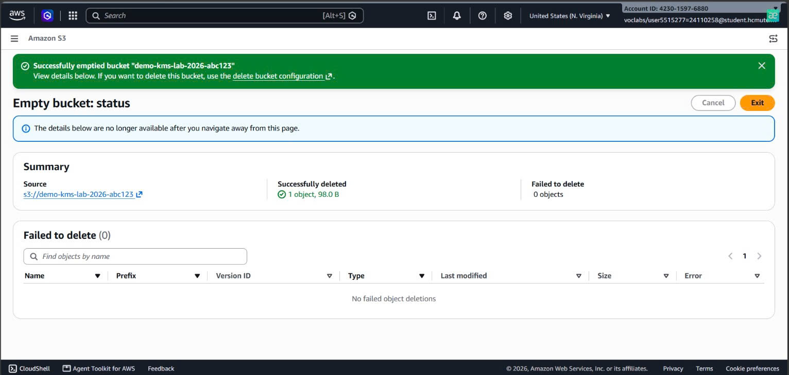
*Hình 1.1: Xóa sạch thành công objects bên trong S3 Bucket.*

---

### 1.2. Amazon S3 - Xóa Bucket `demo-kms-lab-2026-abc123`
- **Tài nguyên:** S3 Bucket lưu trữ môi trường kiểm thử `demo-kms-lab-2026-abc123`.
- **Kết quả nghiệm thu:** Bucket đã được xóa vĩnh viễn khỏi tài khoản, đưa danh sách `General purpose buckets` về `0`.

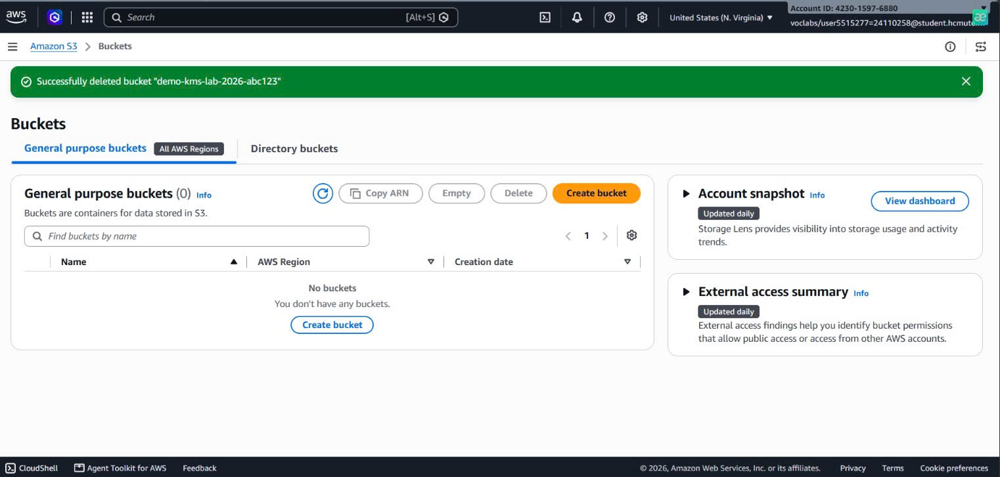
*Hình 1.2: Bucket S3 trên tài khoản SV1 đã được xóa hoàn toàn.*

---

### 1.3. Amazon API Gateway - Xóa HTTP API `CareSync-TestEmail-API`
- **Tài nguyên:** HTTP API `CareSync-TestEmail-API` dùng cho các endpoint kiểm thử gửi email & tính năng hệ thống.
- **Kết quả nghiệm thu:** Danh sách API Gateway trở về `0/0` (`No API`), ngắt hoàn toàn cổng giao tiếp từ internet vào backend.

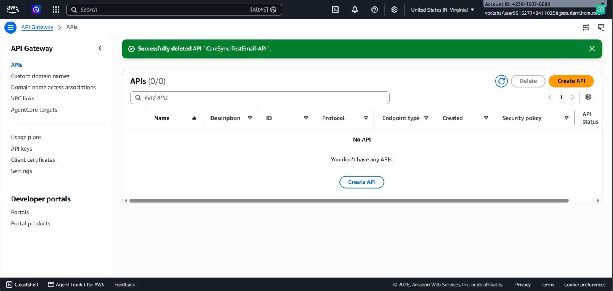
*Hình 1.3: API Gateway CareSync-TestEmail-API đã được xóa sạch (0/0).*

---

### 1.4. AWS Lambda - Xóa Function `CareSync-TestEmail`
- **Tài nguyên:** Hàm xử lý Serverless Backend `CareSync-TestEmail` (Node.js runtime).
- **Kết quả nghiệm thu:** Gỡ bỏ hoàn toàn mã nguồn xử lý logic gửi email kiểm thử và giải phóng tài nguyên tính toán.

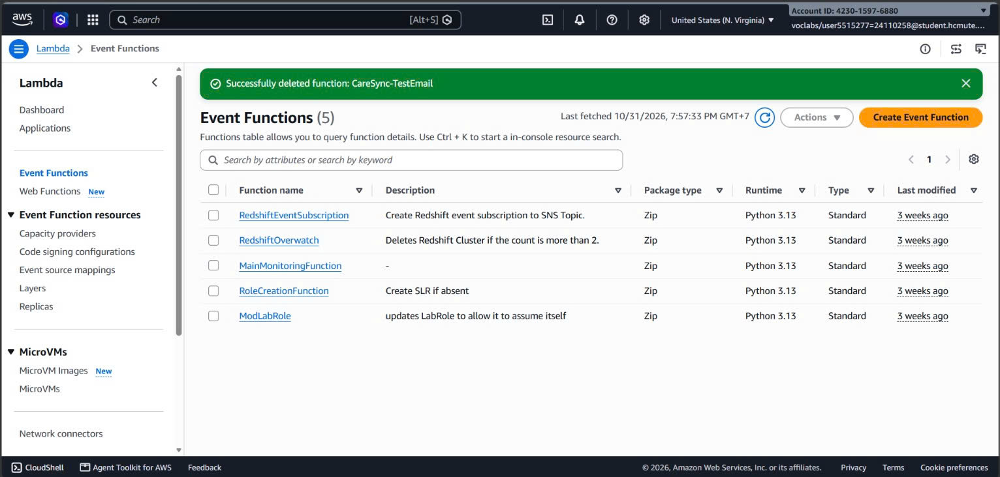
*Hình 1.4: Hàm Lambda CareSync-TestEmail đã được xóa thành công.*

---

### 1.5. AWS KMS - Xóa khóa mã hóa dữ liệu bệnh nhân `caresync-patient-key`
- **Tài nguyên:** Khóa đối xứng AWS Key Management Service (KMS) bảo vệ thông tin bệnh nhân.
- **Kết quả nghiệm thu:** Đã lên lịch xóa khóa thành công, chuyển sang trạng thái chờ xóa (`Pending deletion`).

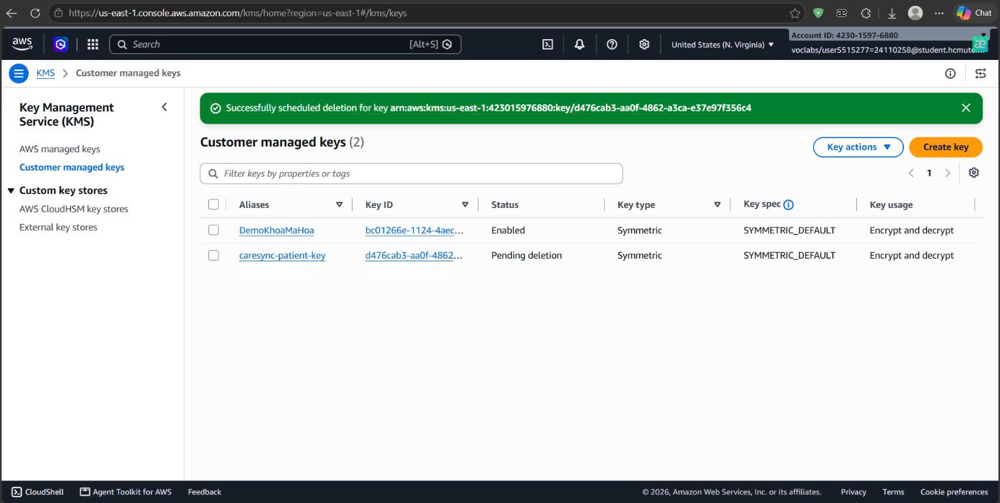
*Hình 1.5: Khóa KMS caresync-patient-key đã được lên lịch xóa thành công.*

---

### 1.6. Amazon EventBridge - Xóa Schedule nhắc lịch hẹn `DemoNhacLichSNS`
- **Tài nguyên:** Schedule kích hoạt thông báo định kỳ `DemoNhacLichSNS`.
- **Kết quả nghiệm thu:** Đã xóa hoàn toàn schedule khỏi EventBridge Scheduler (`Schedules (0)`).

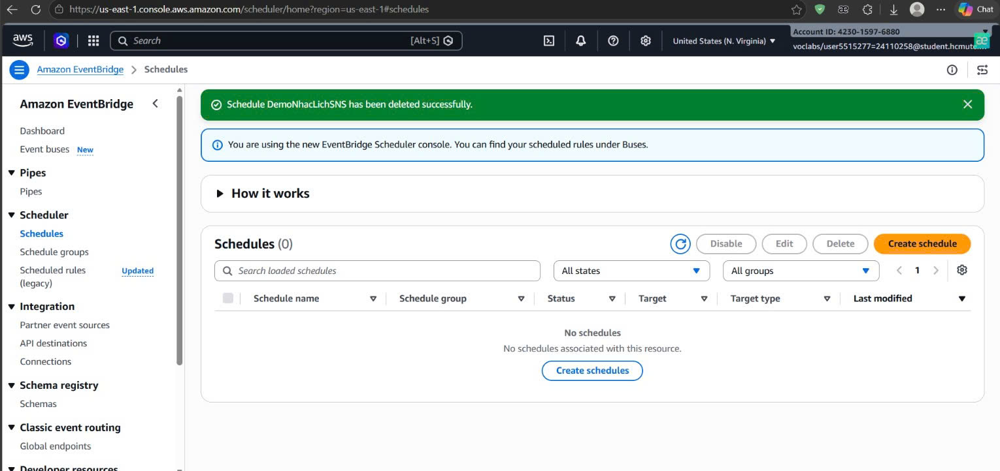
*Hình 1.6: Xóa thành công Schedule DemoNhacLichSNS trên Amazon EventBridge.*

---

### 1.7. Amazon SNS - Xóa Topic phát thông báo `DemoNhacLich`
- **Tài nguyên:** Topic thông báo `DemoNhacLich` dùng kích hoạt luồng gửi email.
- **Kết quả nghiệm thu:** Đã xóa topic thành công, danh sách chỉ còn lại tài nguyên mặc định (`RedshiftSNS`).

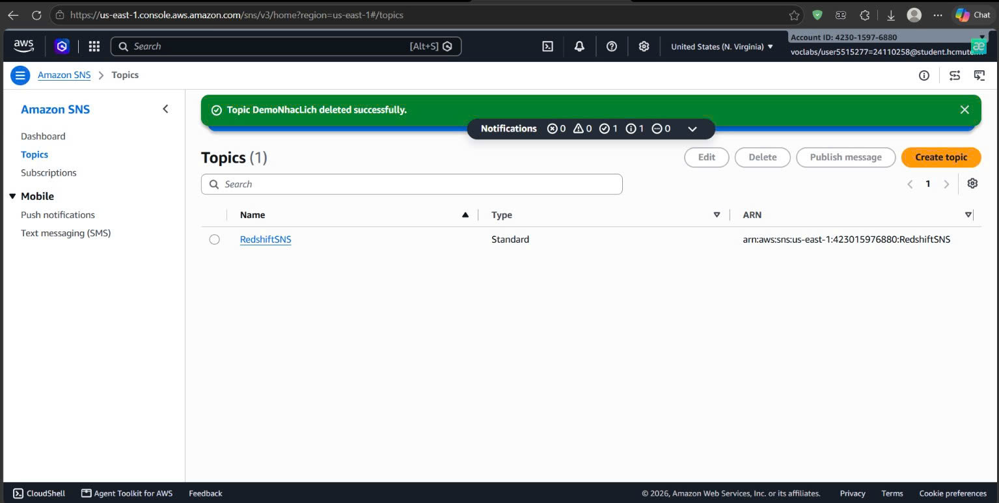
*Hình 1.7: Xóa thành công Topic DemoNhacLich trên Amazon SNS.*

---

## 2. Phần Giải Phóng Tài Nguyên Của Sinh Viên 2 - Huỳnh Ngọc Bảo Khang (MSSV: 24110241)
> **Phạm vi phụ trách:** Giải phóng Cơ sở dữ liệu NoSQL (Amazon DynamoDB), Dọn dẹp nhật ký giám sát (Amazon CloudWatch), Hệ thống phát thông báo (Amazon SNS), cùng toàn bộ Hạ tầng Frontend tĩnh (Amazon S3) và Cổng kết nối điều phối Backend (Amazon API Gateway & AWS Lambda) của hệ thống CareSync chính.

### 2.1. Amazon DynamoDB - Xóa 3 bảng cơ sở dữ liệu NoSQL
- **Tài nguyên:** 3 bảng dữ liệu `Appointments`, `Doctors` và `Patients` (bao gồm toàn bộ dữ liệu khám và chỉ mục toàn cục GSI).
- **Kết quả nghiệm thu:** Gửi yêu cầu xóa thành công, cả 3 bảng chuyển sang trạng thái `Deleting` và được thu hồi hoàn toàn.

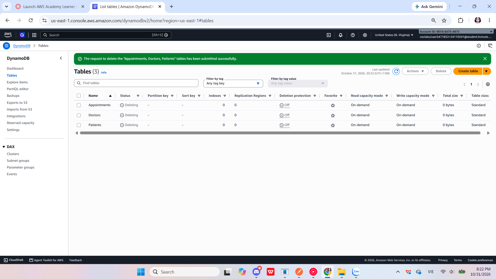
*Hình 2.1: Quá trình xóa đồng loạt 3 bảng cơ sở dữ liệu trên Amazon DynamoDB.*

---

### 2.2. Amazon CloudWatch - Dọn dẹp Log Groups ghi vết
- **Tài nguyên:** Nhóm lưu trữ nhật ký thực thi `/aws/lambda/AppointmentBookingFunction`.
- **Kết quả nghiệm thu:** Đã chọn và xóa toàn bộ log stream ghi vết quá trình kiểm thử, loại bỏ hoàn toàn dung lượng lưu trữ rác.

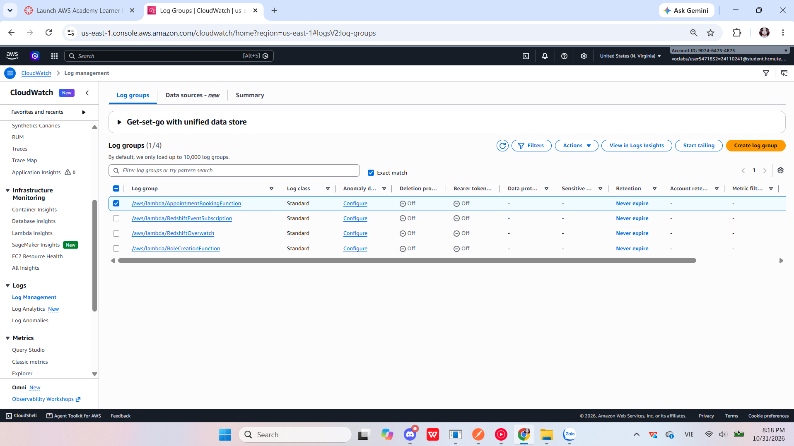
*Hình 2.2: Xóa Log Group của Lambda Function trên Amazon CloudWatch.*

---

### 2.3. Amazon SNS - Xóa các Email Subscriptions
- **Tài nguyên:** Toàn bộ subscription email nhận thông báo lịch khám và mã xác thực OTP của người dùng.
- **Kết quả nghiệm thu:** Xóa thành công toàn bộ subscription liên kết của ứng dụng, chỉ giữ lại tài nguyên hệ thống mặc định (`RedshiftSNS`).

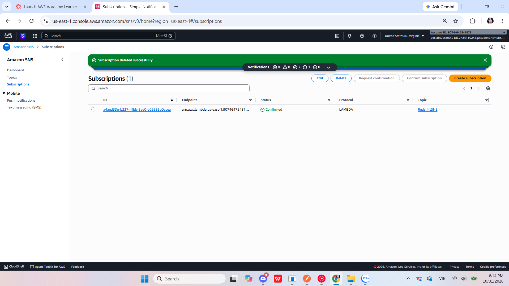
*Hình 2.3: Thông báo xóa thành công các Subscription trên Amazon SNS.*

---

### 2.4. Amazon SNS - Xóa Topic `CareSync-AppointmentNotice`
- **Tài nguyên:** Topic phát email thông báo `CareSync-AppointmentNotice`.
- **Kết quả nghiệm thu:** Topic đã được xóa hoàn toàn khỏi Amazon SNS, ngắt luồng dịch vụ gửi thông báo tự động.

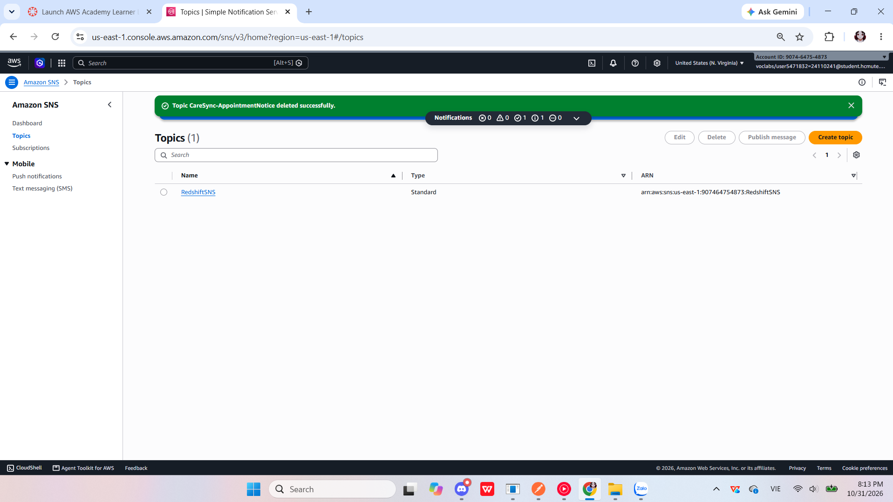
*Hình 2.4: Xác nhận xóa Topic CareSync-AppointmentNotice thành công.*

---

### 2.5. Amazon S3 - Xóa sạch tệp tin tĩnh & Xóa Bucket Frontend `appointment-booking-web-demo`
- **Tài nguyên:** Toàn bộ 46 tệp tin giao diện (6.7 MB) và S3 Bucket hosting web tĩnh của hệ thống CareSync.
- **Kết quả nghiệm thu:** Đã xóa sạch 46 objects và xóa vĩnh viễn bucket khỏi tài khoản, đưa danh sách `General purpose buckets` về `0`.

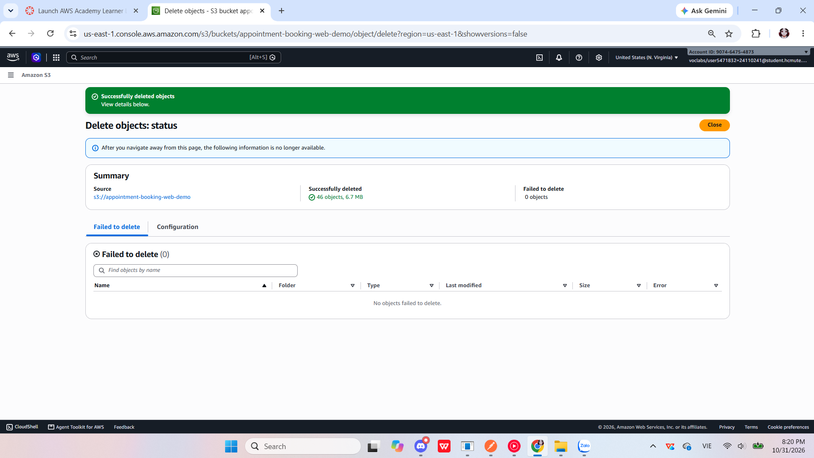
*Hình 2.5a: Xóa sạch thành công 46 objects (6.7 MB) bên trong S3 Bucket.*

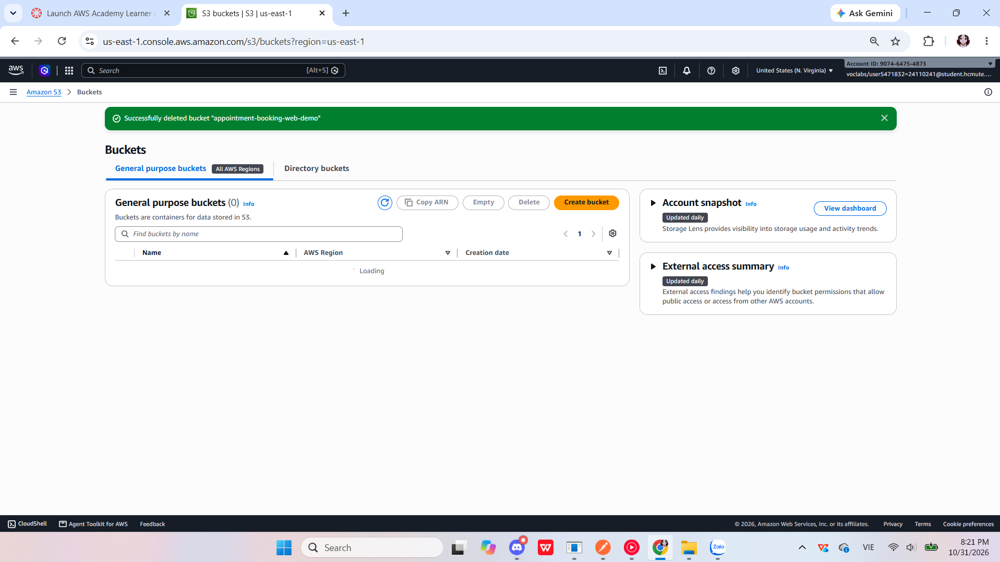
*Hình 2.5b: Bucket S3 lưu trữ frontend CareSync đã được xóa hoàn toàn.*

---

### 2.6. Amazon API Gateway & AWS Lambda - Xóa API chính và Hàm Backend
- **Tài nguyên:** HTTP API `AppointmentBookingAPI` và hàm Lambda xử lý chính `AppointmentBookingFunction`.
- **Kết quả nghiệm thu:** Đã xóa sạch HTTP API (danh sách `0/0`) và xóa bỏ hoàn toàn hàm Lambda chính khỏi tài khoản AWS.

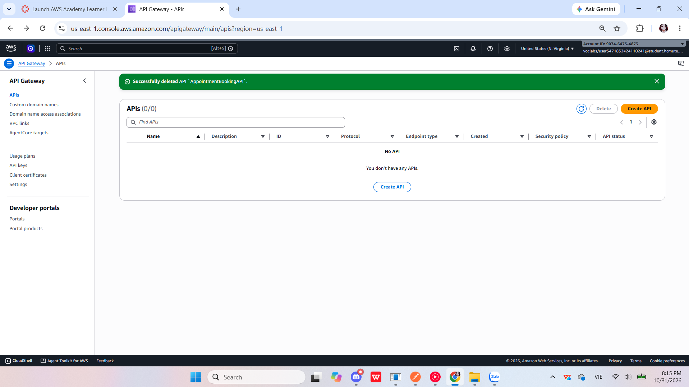
*Hình 2.6a: API Gateway AppointmentBookingAPI đã được xóa sạch.*

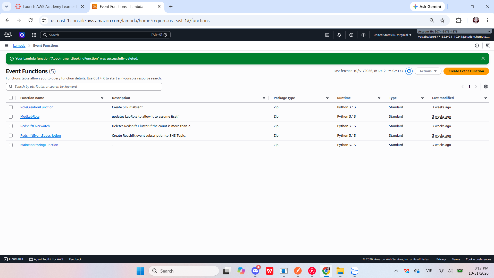
*Hình 2.6b: Hàm Lambda AppointmentBookingFunction đã được xóa thành công.*

---

## 3. Đánh Giá & Kết Quả Sau Khi Giải Phóng

1. **Giải phóng 100% tài nguyên:** Toàn bộ dịch vụ thuộc đồ án CareSync trên AWS (S3, API Gateway, Lambda, DynamoDB, SNS, EventBridge Scheduler, KMS, CloudWatch Logs) đã được cả hai sinh viên dọn dẹp sạch sẽ, không còn tài nguyên chạy ngầm trên cả 2 tài khoản AWS Academy.
2. **Chi phí duy trì về $0.00:** Ngăn chặn triệt để mọi chi phí phát sinh ngoài ý muốn, bảo toàn nguyên vẹn số dư tín dụng trên cả 2 tài khoản **AWS Academy Learner Lab**.
3. **Bảo mật dữ liệu:** Tiêu hủy toàn bộ dữ liệu y tế thử nghiệm (hồ sơ bệnh nhân, số điện thoại, mã CCCD, lịch hẹn) và lên lịch hủy khóa mã hóa KMS khỏi hạ tầng đám mây công cộng theo đúng tiêu chuẩn an toàn thông tin.
