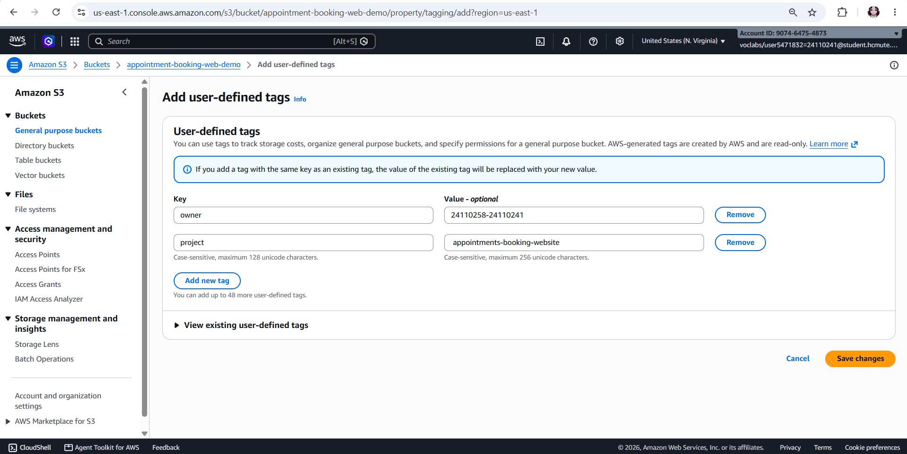
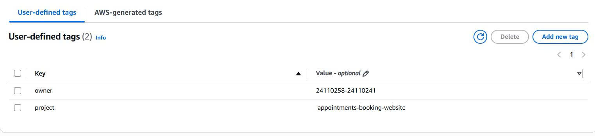

# Báo Cáo Thực Hiện Tuần 1 - Dự Án CareSync

## Mục lục

- [1. API Gateway và Lambda: chức năng, cách hoạt động, cách kết nối](#1-api-gateway-và-lambda-chức-năng-cách-hoạt-động-cách-kết-nối)
  - [AWS Lambda](#aws-lambda)
  - [Amazon API Gateway (HTTP API)](#amazon-api-gateway-http-api)
  - [Cơ chế kết nối giữa API Gateway và Lambda](#cơ-chế-kết-nối-giữa-api-gateway-và-lambda)
- [2. DynamoDB: cấu trúc bảng, key, CRUD và Conditional Write chống trùng lịch](#2-dynamodb-cấu-trúc-bảng-key-crud-và-conditional-write-chống-trùng-lịch)
  - [Amazon DynamoDB](#amazon-dynamodb)
  - [Cấu trúc bảng và Khóa chính (Primary Key)](#cấu-trúc-bảng-và-khóa-chính-primary-key)
  - [Thao tác CRUD trong hệ thống](#thao-tác-crud-trong-hệ-thống)
  - [Cơ chế Conditional Write chống trùng lịch](#cơ-chế-conditional-write-chống-trùng-lịch)
- [3. Tìm hiểu EventBridge Scheduler và SNS: cơ chế tạo lịch nhắc và gửi thông báo](#3-tìm-hiểu-eventbridge-scheduler-và-sns-cơ-chế-tạo-lịch-nhắc-và-gửi-thông-báo)
  - [Amazon EventBridge Scheduler](#amazon-eventbridge-scheduler)
  - [Amazon SNS (Amazon Simple Notification Service)](#amazon-sns-amazon-simple-notification-service)
  - [Cơ chế kết hợp và ứng dụng thực tế](#cơ-chế-kết-hợp-và-ứng-dụng-thực-tế)
- [4. Tìm hiểu KMS và S3: mã hóa dữ liệu, lưu trữ website và bảo mật](#4-tìm-hiểu-kms-và-s3-mã-hóa-dữ-liệu-lưu-trữ-website-và-bảo-mật)
  - [AWS Key Management Service (KMS)](#aws-key-management-service-kms)
  - [Amazon Simple Storage Service (Amazon S3)](#amazon-simple-storage-service-amazon-s3)
  - [Cơ chế bảo mật và ứng dụng thực tế](#cơ-chế-bảo-mật-và-ứng-dụng-thực-tế)
- [5. Thiết kế Database: Doctors, Patients và Appointments](#5-thiết-kế-database-doctors-patients-và-appointments)
  - [Bảng Doctors](#1-bảng-doctors)
  - [Bảng Patients](#2-bảng-patients)
  - [Bảng Appointments](#3-bảng-appointments)
  - [Mối quan hệ giữa các bảng](#4-mối-quan-hệ-giữa-các-bảng)
- [6. Thiết kế API cho hệ thống đặt lịch](#6-thiết-kế-api-cho-hệ-thống-đặt-lịch)
  - [Danh sách các API chính của hệ thống](#danh-sách-các-api-chính-của-hệ-thống)
  - [Quy trình xử lý yêu cầu đặt lịch](#quy-trình-xử-lý-yêu-cầu-đặt-lịch)
  - [Cơ chế chống trùng lịch và mã trạng thái HTTP](#cơ-chế-chống-trùng-lịch-và-mã-trạng-thái-http)
- [7. Thiết kế luồng nhắc lịch và bảo mật](#7-thiết-kế-luồng-nhắc-lịch-và-bảo-mật)
- [8. Thiết kế Kiến trúc AWS](#8-thiết-kế-kiến-trúc-aws)
- [9. Dựng S3, DynamoDB, Lambda, API Gateway thử nghiệm trên AWS Learner Lab](#9-dựng-s3-dynamodb-lambda-api-gateway-thử-nghiệm-trên-aws-learner-lab)
  - [9.1. Khởi tạo Amazon S3 Bucket](#91-khởi-tạo-amazon-s3-bucket)
  - [9.2. Khởi tạo và cấu hình Amazon DynamoDB](#92-khởi-tạo-và-cấu-hình-amazon-dynamodb)
  - [9.3. Xây dựng AWS Lambda Function](#93-xây-dựng-aws-lambda-function)
  - [9.4. Cấu hình Amazon API Gateway (HTTP API)](#94-cấu-hình-amazon-api-gateway-http-api)
  - [9.5. Kiểm thử tích hợp qua Postman](#95-kiểm-thử-tích-hợp-qua-postman)
- [10. Dựng SNS, EventBridge, KMS thử nghiệm trên AWS Learner Lab](#10-dựng-sns-eventbridge-kms-thử-nghiệm-trên-aws-learner-lab)
  - [10.1. Dựng SNS Demo](#101-dựng-sns-demo)
  - [10.2. Dựng EventBridge](#102-dựng-eventbridge)
  - [10.3. KMS](#103-kms)
- [11. Gắn Tag Project/Owner](#11-gắn-tag-projectowner)
  - [11.1. Gắn tag cho SNS](#111-gắn-tag-cho-sns)
  - [11.2. Gắn tag cho KMS](#112-gắn-tag-cho-kms)
  - [11.3. Gắn tag cho S3](#113-gắn-tag-cho-s3)

---

## 1. API Gateway và Lambda: chức năng, cách hoạt động, cách kết nối

### AWS Lambda:

- **Khái niệm:** Là dịch vụ điện toán không máy chủ (Serverless Compute) cho phép thực thi mã nguồn (chạy môi trường Node.js) mà không cần cấu hình, khởi tạo hay quản lý hệ điều hành máy chủ.
- **Đặc điểm & Ưu điểm:**
  - Lambda tự động co giãn (auto-scaling) theo số lượng yêu cầu gọi vào từ người dùng.
  - Tối ưu chi phí: chỉ tính phí theo thời gian chạy thực tế (tính theo mili-giây) và số lượng yêu cầu xử lý, không phát sinh chi phí khi ở trạng thái nhàn rỗi (idle).

### Amazon API Gateway (HTTP API):

- **Vai trò:** Đóng vai trò làm cổng tiếp nhận (entry point) và định tuyến các yêu cầu HTTP từ phía client (trình duyệt web, ứng dụng di động) đến các dịch vụ xử lý backend như AWS Lambda.
- **Lý do lựa chọn HTTP API:**
  - Giảm độ trễ và tối ưu chi phí hơn so với REST API truyền thống.
  - Hỗ trợ cấu hình CORS (Cross-Origin Resource Sharing) nhanh chóng và trực quan cho các ứng dụng web tĩnh lưu trữ trên Amazon S3.

### Cơ chế kết nối giữa API Gateway và Lambda:

- **Lambda Proxy Integration:** API Gateway sử dụng cơ chế tích hợp proxy để chuyển tiếp toàn bộ ngữ cảnh yêu cầu.
  - **Phía tiếp nhận (Request):** Khi có HTTP Request gửi đến, API Gateway tự động đóng gói toàn bộ thông tin (HTTP Method, Path, Headers, Body, Query Parameters) thành đối tượng sự kiện (`event`) và chuyển cho hàm handler của Lambda xử lý.
  - **Phía phản hồi (Response):** Sau khi thực thi xong, Lambda trả về kết quả theo định dạng chuẩn gồm `statusCode`, `headers` và `body` dạng chuỗi JSON:
    ```json
    {
      "statusCode": 200,
      "headers": {
        "Content-Type": "application/json",
        "Access-Control-Allow-Origin": "*"
      },
      "body": "{\"message\": \"Thành công\"}"
    }
    ```
  - API Gateway tiếp nhận định dạng chuẩn này và chuyển tiếp nguyên vẹn phản hồi HTTP về cho phía client.

## 2. DynamoDB: cấu trúc bảng, key, CRUD và Conditional Write chống trùng lịch

### Amazon DynamoDB:

- **Khái niệm:** Là dịch vụ cơ sở dữ liệu NoSQL dạng Key-Value và Document có hiệu năng cao, độ trễ thấp tính bằng mili-giây ở mọi quy mô và khả năng mở rộng tự động.
- **Cơ chế Schema:** DynamoDB không yêu cầu khai báo schema cố định cho toàn bộ các thuộc tính (Schemaless) mà chỉ cần xác định cấu trúc khóa chính (Primary Key) khi khởi tạo bảng.

### Cấu trúc bảng và Khóa chính (Primary Key):

- **Partition Key (PK):** Dùng để băm (hash) và phân tán dữ liệu đồng đều trên các phân vùng vật lý (partitions) của AWS (ví dụ: `DoctorId`).
- **Composite Primary Key (PK + Sort Key):**
  - Kết hợp Partition Key và Sort Key (ví dụ: `DoctorId` và `SlotKey`) để tạo thành khóa chính phức hợp duy nhất.
  - Cho phép định danh chính xác từng khung giờ khám của từng bác sĩ cụ thể, đồng thời hỗ trợ truy vấn nhanh danh sách các khung giờ của một bác sĩ.

### Thao tác CRUD trong hệ thống:

Hệ thống sử dụng AWS SDK (v3) để thực thi các tác vụ:

- **Scan:** Quét toàn bộ bảng danh sách bác sĩ (`Doctors`) để lấy thông tin hiển thị lên giao diện đặt khám.
- **PutItem / PutCommand:** Ghi thông tin lịch khám mới vào bảng `Appointments`.
- **GetItem / GetCommand:** Truy vấn chi tiết thông tin một lịch hẹn hoặc bác sĩ theo khóa chính.
- **DeleteItem / UpdateItem:** Thực hiện hủy hoặc cập nhật trạng thái phiếu khám (ví dụ: từ `CONFIRMED` sang `CANCELLED`).

### Cơ chế Conditional Write chống trùng lịch:

- **Vai trò:** Đây là tính năng then chốt của bài toán đặt lịch khám trong dự án CareSync nhằm giải quyết tranh chấp ghi đồng thời (race condition).
- **Cơ chế hoạt động:**
  - Khi người dùng gửi yêu cầu ghi lịch hẹn vào bảng `Appointments`, Lambda gửi lệnh `PutCommand` kèm biểu thức điều kiện (Condition Expression):
    ```sql
    attribute_not_exists(DoctorId) AND attribute_not_exists(SlotKey)
    ```
  - Cơ chế này đảm bảo thao tác ghi mang tính nguyên tử (atomic operation) ở mức cơ sở dữ liệu.
  - **Xử lý xung đột:** Nếu một bệnh nhân khác đã đặt trùng khung giờ (`DoctorId`, `SlotKey`) đó trước đó, DynamoDB sẽ lập tức từ chối thao tác ghi và trả về lỗi `ConditionalCheckFailedException`.
  - Backend Lambda sẽ bắt ngoại lệ này và phản hồi mã trạng thái HTTP `409 Conflict` kèm thông báo lỗi rõ ràng về cho client, ngăn chặn tuyệt đối tình trạng đặt trùng lịch (double-booking).

---

## 3. Tìm hiểu EventBridge Scheduler và SNS: cơ chế tạo lịch nhắc và gửi thông báo

### Amazon EventBridge Scheduler:

- Là dịch vụ lập lịch của AWS, dịch vụ này cho phép tự động thực thi các tác vụ tại những thời điểm được xác định trước. Dịch vụ hỗ trợ lập lịch chạy một lần hoặc lặp lại theo chu kỳ thông qua biểu thức rate và cron. Nhờ đó, người dùng có thể tự động hóa các công việc mà không cần trực tiếp thực hiện thủ công.

### Amazon SNS (Amazon Simple Notification Service):

- Là dịch vụ gửi thông báo theo mô hình publish/subscribe (xuất bản/đăng ký). Dịch vụ cho phép gửi thông báo đến nhiều đối tượng hoặc hệ thống thông qua các kênh như email, SMS và các dịch vụ AWS được hỗ trợ.

### Cơ chế kết hợp và ứng dụng thực tế:

- EventBridge Scheduler có thể được cấu hình để gọi Amazon SNS theo lịch đã thiết lập. Khi đến thời điểm quy định, Scheduler thực thi tác vụ gửi thông báo đến một SNS topic. Sau đó, SNS phân phối thông báo đến các đối tượng đã đăng ký nhận tin.
- Trong CareSync, nhóm dùng cơ chế này để nhắc lịch hẹn khám cho bệnh nhân qua Email/SMS.
- Định hướng kiến trúc của nhóm là kết hợp **Scheduler ➔ Lambda ➔ SNS**: Scheduler gọi Lambda kiểm tra trạng thái lịch hẹn trong database trước (tránh gửi nhầm nếu lịch đã bị hủy), sau đó Lambda mới phát thông báo qua SNS.
- Về bảo mật, hệ thống cần cấu hình quyền IAM phù hợp để Scheduler có thể thực thi tác vụ và kiểm soát quyền truy cập vào SNS topic. Điều này giúp hạn chế việc sử dụng dịch vụ trái phép và bảo vệ thông tin được gửi đi.

---

## 4. Tìm hiểu KMS và S3: mã hóa dữ liệu, lưu trữ website và bảo mật

### AWS Key Management Service (KMS):

- AWS Key Management Service (KMS) là dịch vụ quản lý khóa mã hóa, hỗ trợ tạo, quản lý và kiểm soát việc sử dụng khóa để bảo vệ dữ liệu. KMS có thể được tích hợp với nhiều dịch vụ AWS nhằm thực hiện mã hóa và giải mã dữ liệu theo các chính sách quyền hạn đã thiết lập.
- Một trong những ứng dụng phổ biến của KMS là mã hóa dữ liệu lưu trữ trên Amazon S3 bằng cơ chế SSE-KMS. Cơ chế này giúp tăng khả năng kiểm soát khóa mã hóa và hỗ trợ ghi nhận các hoạt động sử dụng khóa thông qua các dịch vụ giám sát, nhật ký phù hợp.

### Amazon Simple Storage Service (Amazon S3):

- Amazon S3 là dịch vụ lưu trữ đối tượng trên nền tảng đám mây AWS. Dịch vụ cho phép lưu trữ và truy xuất dữ liệu như hình ảnh, tài liệu, tệp tin, dữ liệu sao lưu và các thành phần của website.
- Amazon S3 có khả năng mở rộng linh hoạt, độ bền dữ liệu cao và hỗ trợ nhiều cơ chế bảo mật. Người dùng có thể thiết lập quyền truy cập bằng IAM, bucket policy, mã hóa dữ liệu và các tính năng bảo vệ quyền truy cập công khai.
- Ngoài chức năng lưu trữ, S3 còn hỗ trợ triển khai website tĩnh thông qua việc lưu trữ các tệp HTML, CSS, JavaScript và hình ảnh. Để tăng cường bảo mật và hiệu quả phân phối nội dung, có thể kết hợp S3 với Amazon CloudFront và cấu hình HTTPS.

### Cơ chế bảo mật và ứng dụng thực tế:

- KMS và S3 có thể kết hợp để bảo vệ dữ liệu trong quá trình lưu trữ. Amazon S3 đảm nhiệm việc lưu trữ đối tượng, trong khi AWS KMS hỗ trợ quản lý khóa mã hóa khi sử dụng cơ chế SSE-KMS. Việc phân quyền hợp lý giúp giới hạn những người dùng và dịch vụ được phép truy cập dữ liệu hoặc sử dụng khóa.
- Trong thực tế, sự kết hợp này phù hợp với các hệ thống cần lưu trữ tài liệu, hình ảnh, dữ liệu sao lưu hoặc nội dung website. Để tăng cường an toàn, cần bật S3 Block Public Access khi không có nhu cầu truy cập công khai, sử dụng chính sách quyền hạn tối thiểu và theo dõi các hoạt động truy cập quan trọng.
- Áp dụng vào CareSync: Website tĩnh (HTML/CSS/JS) lưu trên S3 hosting dùng mã hóa mặc định SSE-S3; còn các tệp sao lưu hoặc dữ liệu nhạy cảm lưu ở bucket riêng, kích hoạt SSE-KMS và bật S3 Block Public Access để bảo vệ an toàn.

---

## 5. Thiết kế Database: Doctors, Patients và Appointments

### Bảng Doctors

Lưu trữ thông tin hồ sơ và trạng thái hoạt động của các bác sĩ trong hệ thống.

- **Partition Key (PK):** `DoctorId` (String) – Khóa phân vùng định danh duy nhất cho từng bác sĩ.
- **Sort Key (SK):** Không sử dụng.
- **Các thuộc tính phi khóa:**
  - `FullName` (String): Họ và tên bác sĩ.
  - `Specialty` (String): Chuyên khoa khám.
  - `Phone` (String): Số điện thoại liên hệ.
  - `Email` (String): Email liên hệ.
  - `IsActive` (Boolean): Trạng thái hoạt động (cho phép đặt lịch hay đang tạm ngưng).

### Bảng Patients

Lưu trữ thông tin cá nhân của người bệnh đặt lịch.

- **Partition Key (PK):** `PatientId` (String) – Mã định danh duy nhất của từng bệnh nhân.
- **Sort Key (SK):** Không sử dụng.
- **Các thuộc tính phi khóa:**
  - `FullName` (String): Họ và tên bệnh nhân.
  - `Phone` (String): Số điện thoại liên hệ.
  - `Email` (String): Email liên hệ.
  - `DateOfBirth` (String): Ngày tháng năm sinh (định dạng `YYYY-MM-DD`).

### Bảng Appointments

Lưu trữ thông tin các lịch khám bệnh do bệnh nhân đặt với bác sĩ.

- **Partition Key (PK):** `DoctorId` (String) – Mã bác sĩ tiếp nhận ca khám.
- **Sort Key (SK):** `AppointmentDateTime` (String) – Khung thời gian khám bệnh (định dạng ISO 8601).
- **Các thuộc tính phi khóa:**
  - `AppointmentId` (String): Mã phiếu đặt khám duy nhất trả về cho bệnh nhân.
  - `PatientId` (String): Mã định danh bệnh nhân đặt lịch.
  - `PatientName` (String): Họ tên bệnh nhân (phi chuẩn hóa để hiển thị ngay mà không cần tra cứu sang bảng Patients).
  - `Status` (String): Trạng thái phiếu khám (`PENDING`, `CONFIRMED`, `CANCELLED`, `COMPLETED`).
  - `Reason` (String): Lý do khám / triệu chứng ban đầu.
  - `CreatedAt` (String): Thời điểm thực hiện đặt lịch (định dạng ISO 8601).

### Mối quan hệ giữa các bảng

- **Doctors – Appointments:** Quan hệ `1 : N` (Một bác sĩ có nhiều ca khám ở các khung giờ khác nhau).
- **Patients – Appointments:** Quan hệ `1 : N` (Một bệnh nhân có thể đặt nhiều lịch khám bệnh).

---

## 6. Thiết kế API cho hệ thống đặt lịch

API được thiết kế theo mô hình RESTful, cho phép giao diện người dùng giao tiếp với máy chủ thông qua các phương thức HTTP tiêu chuẩn. Dữ liệu trao đổi giữa máy khách và máy chủ chủ yếu sử dụng định dạng JSON.

### Danh sách các API chính của hệ thống:


| Phương thức | Endpoint                          | Chức năng                                         |
| :------------- | :-------------------------------- | :-------------------------------------------------- |
| **GET**        | `/api/doctors`                    | Lấy danh sách bác sĩ                            |
| **GET**        | `/api/doctors/{id}`               | Xem thông tin chi tiết bác sĩ                   |
| **GET**        | `/api/doctors/{id}/availability`  | Kiểm tra lịch trống của bác sĩ                |
| **POST**       | `/api/appointments`               | Tạo lịch hẹn khám bệnh                         |
| **GET**        | `/api/appointments/{id}`          | Xem thông tin lịch hẹn                           |
| **GET**        | `/api/patients/{id}/appointments` | Xem lịch hẹn của bệnh nhân                     |
| **PATCH**      | `/api/appointments/{id}`          | Cập nhật thông tin hoặc trạng thái lịch hẹn |
| **DELETE**     | `/api/appointments/{id}`          | Hủy lịch hẹn theo quy tắc hệ thống            |

### Quy trình xử lý yêu cầu đặt lịch:

Khi bệnh nhân gửi yêu cầu đặt lịch (`POST /api/appointments`), máy chủ tiến hành các bước kiểm tra và xử lý tuần tự:

1. **Xác thực người dùng:** Kiểm tra tính hợp lệ của phiên đăng nhập hoặc thông tin định danh của bệnh nhân.
2. **Kiểm tra dữ liệu đầu vào:** Xác thực các trường thông tin bắt buộc (mã bác sĩ, ngày hẹn, khung giờ, thông tin liên lạc).
3. **Xác nhận trạng thái bác sĩ:** Kiểm tra bác sĩ có đang trong trạng thái hoạt động và nhận bệnh nhân hay không.
4. **Kiểm tra khung giờ:** Xác minh khung giờ khám của bác sĩ tại thời điểm yêu cầu vẫn còn trống.
5. **Ghi nhận lịch khám:** Nếu tất cả điều kiện đều hợp lệ, hệ thống tiến hành lưu thông tin lịch hẹn vào cơ sở dữ liệu và trả về phản hồi xác nhận cho người dùng.

### Cơ chế chống trùng lịch và mã trạng thái HTTP:

Để tránh việc hai hoặc nhiều bệnh nhân đặt lịch đồng thời gây trùng ca khám (race condition), thao tác kiểm tra và ghi nhận lịch hẹn cần được thực hiện bằng giao dịch cơ sở dữ liệu (Database Transaction) hoặc cơ chế khóa/ràng buộc điều kiện (Conditional Write).

Hệ thống phản hồi các mã trạng thái HTTP tương ứng:

- **`201 Created`**: Tạo lịch hẹn khám thành công và trả về dữ liệu phiếu khám đã tạo.
- **`400 Bad Request`**: Dữ liệu gửi lên không hợp lệ hoặc thiếu các trường thông tin bắt buộc.
- **`401 Unauthorized`**: Người dùng chưa xác thực hoặc phiên đăng nhập không hợp lệ.
- **`409 Conflict`**: Khung giờ khám của bác sĩ đã có bệnh nhân khác đặt trước, yêu cầu chọn khung giờ khác.

---

## 7. Thiết kế luồng nhắc lịch và bảo mật

Hệ thống có thể sử dụng Amazon EventBridge Scheduler kết hợp với Amazon SNS để tự động gửi thông báo nhắc lịch khám bệnh.

Quy trình hoạt động được thiết kế như sau:

1. Bệnh nhân tạo lịch hẹn và hệ thống lưu thông tin vào bảng Appointments.
2. Sau khi lịch hẹn được xác nhận, hệ thống tạo lịch nhắc tự động tương ứng.
3. EventBridge Scheduler kích hoạt tác vụ tại thời điểm đã thiết lập.
4. Tác vụ gửi thông báo thông qua Amazon SNS đến kênh nhận tin đã đăng ký.
5. Hệ thống ghi nhận kết quả gửi thông báo để phục vụ kiểm tra và xử lý khi có lỗi.
6. Khi lịch hẹn bị hủy hoặc thay đổi, lịch nhắc cũ cần được cập nhật hoặc hủy để tránh gửi thông báo sai.

Đối với các trường hợp cần gửi thông báo qua email hoặc SMS, hệ thống cần cấu hình đúng kênh nhận tin, quyền truy cập và thông tin liên hệ của bệnh nhân. Trạng thái gửi thông báo cũng nên được lưu trữ riêng để hỗ trợ theo dõi và gửi lại khi cần thiết.

Hệ thống xử lý thông tin cá nhân và thông tin liên quan đến khám chữa bệnh, bảo mật cần được triển khai ở cả tầng API, cơ sở dữ liệu và dịch vụ AWS.

- Xác thực và phân quyền: Sử dụng cơ chế đăng nhập an toàn, token xác thực và phân quyền theo vai trò bệnh nhân, bác sĩ và quản trị viên.
- Bảo vệ API: Kiểm tra dữ liệu đầu vào, giới hạn tần suất yêu cầu, xác minh quyền sở hữu lịch hẹn và ngăn truy cập trái phép.
- Bảo vệ cơ sở dữ liệu: Sử dụng tài khoản có quyền tối thiểu, truy vấn có tham số, mã hóa dữ liệu và sao lưu định kỳ.
- Bảo mật trên AWS: Sử dụng IAM để phân quyền cho các dịch vụ (trong môi trường AWS Learner Lab: dùng LabRole/LabInstanceProfile có sẵn, không tạo IAM user/role mới), AWS KMS để quản lý khóa mã hóa và AWS Secrets Manager để lưu trữ thông tin bí mật như thông tin xác thực kết nối cơ sở dữ liệu.
- Bảo vệ thông báo: Hạn chế đưa thông tin nhạy cảm vào nội dung email hoặc SMS; chỉ sử dụng dữ liệu cần thiết để nhắc lịch.
- Giám sát hệ thống: Ghi nhật ký hoạt động, theo dõi lỗi và cảnh báo những truy cập bất thường; không ghi mật khẩu, token hoặc dữ liệu nhạy cảm vào log.

---

## 8. Thiết kế Kiến trúc AWS

Hệ thống được thiết kế theo mô hình Serverless hoàn chỉnh trên AWS Region `us-east-1` bao gồm các thành phần:

1. **Giao diện người dùng & Hosting**: Người dùng truy cập trình duyệt web để tải giao diện HTML/CSS/JavaScript lưu trữ tĩnh trên Amazon S3 (Static Website Hosting).
2. **Cổng tiếp nhận API**: Trình duyệt gửi yêu cầu RESTful HTTP đến Amazon API Gateway (đã cấu hình CORS).
3. **Xử lý nghiệp vụ**: API Gateway kích hoạt hàm AWS Lambda (`AppointmentBookingFunction` chạy Node.js).
4. **Lưu trữ dữ liệu**: Lambda truy vấn bảng Doctors và ghi phiếu khám vào bảng Appointments trên Amazon DynamoDB có gắn kèm cơ chế Conditional Write chống trùng giờ.
5. **Nhắc lịch tự động**: Lambda đẩy lịch hẹn vào Amazon EventBridge Scheduler; khi đến thời điểm nhắc khám, EventBridge kích hoạt Amazon SNS để gửi email/SMS thông báo đến bệnh nhân.
6. **Bảo mật**: AWS KMS cung cấp và quản lý khóa mã hóa dữ liệu tĩnh lưu trữ trên DynamoDB và S3.


---

## 9. Dựng S3, DynamoDB, Lambda, API Gateway thử nghiệm trên AWS Learner Lab

### 9.1. Khởi tạo Amazon S3 Bucket

Tạo thành công S3 Bucket mang tên `appointment-booking-web-demo` tại vùng `us-east-1` đóng vai trò lưu trữ mã nguồn giao diện web tĩnh (HTML, CSS, JS).


---

### 9.2. Khởi tạo và cấu hình Amazon DynamoDB

> **Lưu ý:** Giai đoạn PoC tuần 1 chỉ khởi tạo bảng `Doctors` và `Appointments` nhằm tập trung kiểm thử tính năng Conditional Write; bảng `Patients` sẽ được triển khai cùng module xác thực ở tuần sau.

- **Bảng Doctors:** Khởi tạo với Partition Key `DoctorId` (String) ở chế độ On-demand.


- **Bảng Appointments:** Khởi tạo với Composite Primary Key gồm Partition Key `DoctorId` (String) và Sort Key `SlotKey` đại diện cho trường `AppointmentDateTime` để phục vụ Conditional Write nhằm ngăn chặn việc trùng lặp ca khám trên cùng một khung giờ của bác sĩ.


- **Trạng thái bảng:** Cả hai bảng đều ở trạng thái Active sẵn sàng phục vụ truy vấn.


---

### 9.3. Xây dựng AWS Lambda Function

Khởi tạo hàm xử lý bằng runtime **Node.js 24.x** (gán quyền thực thi qua role `LabRole` có sẵn của Learner Lab).


Sử dụng thư viện `@aws-sdk/lib-dynamodb` để kết nối và thao tác với DynamoDB:

- `GET /doctors`: Thực hiện lệnh `ScanCommand` lấy danh sách bác sĩ từ bảng `Doctors`.
- `POST /appointments`: Thực hiện lệnh `PutCommand` ghi phiếu hẹn vào bảng `Appointments` kèm biểu thức `ConditionExpression: "attribute_not_exists(DoctorId) AND attribute_not_exists(SlotKey)"`. Nếu bị trùng giờ, hàm bắt ngoại lệ `ConditionalCheckFailedException` và trả về lỗi HTTP `409 Conflict`.

**Mã nguồn hàm Lambda:**

```javascript
import { DynamoDBClient } from "@aws-sdk/client-dynamodb";
import { 
  DynamoDBDocumentClient, 
  ScanCommand, 
  PutCommand 
} from "@aws-sdk/lib-dynamodb";

const client = new DynamoDBClient({ region: "us-east-1" });
const ddbDocClient = DynamoDBDocumentClient.from(client);
const DOCTORS_TABLE = "Doctors";
const APPOINTMENTS_TABLE = "Appointments";

const headers = {
  "Content-Type": "application/json",
  "Access-Control-Allow-Origin": "*",
  "Access-Control-Allow-Headers": "Content-Type,Authorization",
  "Access-Control-Allow-Methods": "GET,POST,OPTIONS"
};

export const handler = async (event) => {
  console.log("Incoming event:", JSON.stringify(event));
  const httpMethod = event.requestContext?.http?.method || event.httpMethod;
  const path = event.requestContext?.http?.path || event.path;

  try {
    // 1. GET /doctors: Quét và đọc dữ liệu thật từ bảng Doctors trong DynamoDB
    if (httpMethod === "GET" && path.endsWith("/doctors")) {
      const data = await ddbDocClient.send(
        new ScanCommand({ TableName: DOCTORS_TABLE })
      );
      return {
        statusCode: 200,
        headers,
        body: JSON.stringify({ success: true, data: data.Items || [] })
      };
    }

    // 2. POST /appointments: Ghi lịch hẹn và dùng Conditional Write chống trùng lịch
    if (httpMethod === "POST" && path.endsWith("/appointments")) {
      const body = event.body ? JSON.parse(event.body) : {};
      const { doctorId, patientName, patientPhone, appointmentDate, slotTime } = body;

      if (!doctorId || !patientName || !appointmentDate || !slotTime) {
        return {
          statusCode: 400,
          headers,
          body: JSON.stringify({ message: "Thiếu thông tin đặt lịch bắt buộc!" })
        };
      }

      const appointmentItem = {
        DoctorId: doctorId,
        SlotKey: `${appointmentDate}#${slotTime}`, // Composite Sort Key
        AppointmentId: "APT-" + Date.now(),
        PatientName: patientName,
        PatientPhone: patientPhone || "",
        AppointmentDate: appointmentDate,
        SlotTime: slotTime,
        Status: "CONFIRMED",
        CreatedAt: new Date().toISOString()
      };

      try {
        await ddbDocClient.send(
          new PutCommand({
            TableName: APPOINTMENTS_TABLE,
            Item: appointmentItem,
            // Chống trùng lịch: nếu trùng cả DoctorId và SlotKey thì chặn ghi
            ConditionExpression: "attribute_not_exists(DoctorId) AND attribute_not_exists(SlotKey)"
          })
        );
        return {
          statusCode: 201,
          headers,
          body: JSON.stringify({
            message: "Đặt lịch khám thành công!",
            data: appointmentItem
          })
        };
      } catch (err) {
        // Bắt lỗi nếu khung giờ bị đặt trùng
        if (err.name === "ConditionalCheckFailedException") {
          return {
            statusCode: 409,
            headers,
            body: JSON.stringify({
              error: "Khung giờ này của bác sĩ đã có người đặt trước. Vui lòng chọn giờ khác!"
            })
          };
        }
        throw err;
      }
    }

    return {
      statusCode: 404,
      headers,
      body: JSON.stringify({ message: "Route không tồn tại" })
    };
  } catch (error) {
    console.error("Lỗi:", error);
    return {
      statusCode: 500,
      headers,
      body: JSON.stringify({ error: "Lỗi hệ thống: " + error.message })
    };
  }
};
```

Deploy Lambda function thành công:


---

### 9.4. Cấu hình Amazon API Gateway (HTTP API)

- Tạo API mang tên `AppointmentBookingAPI` tích hợp trực tiếp với Lambda function `AppointmentBookingFunction`.


- Định tuyến (Routes) 2 endpoint chính: `GET /doctors` và `POST /appointments` trên stage mặc định `$default` (bật Auto-deploy).

*Cấu hình routes:*


*Cấu hình stages:*


- Cấu hình đầy đủ Cross-Origin Resource Sharing (CORS) (`Access-Control-Allow-Origin: *`, Methods: `GET, POST, OPTIONS`, Headers: `content-type, authorization`) để sẵn sàng cho frontend gọi API mà không bị chặn bởi trình duyệt.


---

### 9.5. Kiểm thử tích hợp qua Postman

- **Test GET /doctors:** Gửi request thành công, nhận phản hồi mã `200 OK` kèm danh sách bác sĩ truy vấn trực tiếp từ bảng `Doctors` trong DynamoDB.


- **Test POST /appointments:** Gửi request đặt lịch với bác sĩ `DOC01` vào khung giờ `2026-10-15#09:00`, nhận mã `201 Created` và dữ liệu được ghi nhận vào DynamoDB.

*Request Body (Input):*


*Response (Output đặt lịch thành công):*


- **Test chống trùng lịch (Conditional Write):** Gửi lại request với cùng thông tin ca khám vừa đặt, hệ thống kích hoạt cơ chế chống trùng lặp và phản hồi đúng mã `409 Conflict` kèm thông báo *"Khung giờ này của bác sĩ đã có người đặt trước. Vui lòng chọn giờ khác!"*.


---

## 10. Dựng SNS, EventBridge, KMS thử nghiệm trên AWS Learner Lab

### 10.1. Dựng SNS Demo

- Khởi tạo Amazon SNS Topic mang tên `DemoNhacLich` để cấu hình kênh phát thông báo nhắc lịch khám:


- Đăng ký Subscription nhận thông báo qua Email và hoàn tất xác nhận (Confirmed):


- Nhận thông báo thử nghiệm thành công qua hòm thư Email từ SNS Topic:


---

### 10.2. Dựng EventBridge

- Cấu hình lịch trình tự động kích hoạt (One-time schedule / Recurring schedule) trên Amazon EventBridge Scheduler tích hợp gọi dịch vụ SNS:


- EventBridge Scheduler kích hoạt đúng giờ và hệ thống gửi email nhắc lịch tự động thành công đến người dùng:


---

### 10.3. KMS

- Tạo khóa mã hóa Customer Managed Key (CMK) trên AWS Key Management Service (KMS):


- Kiểm tra áp dụng mã hóa bảo mật khi tải file dữ liệu lên Amazon S3:


---

## 11. Gắn Tag Project/Owner

### 11.1. Gắn tag cho SNS

- Kiểm tra cấu hình Region `us-east-1` và gắn nhãn quản lý cho dịch vụ SNS:


---

### 11.2. Gắn tag cho KMS

- Gắn thẻ định danh `Project: CareSync` và `Owner` cho khóa mã hóa trên AWS KMS để quản lý chi phí và tài nguyên:


---

### 11.3. Gắn tag cho S3

- Gắn tag định danh cho Amazon S3 Bucket:





