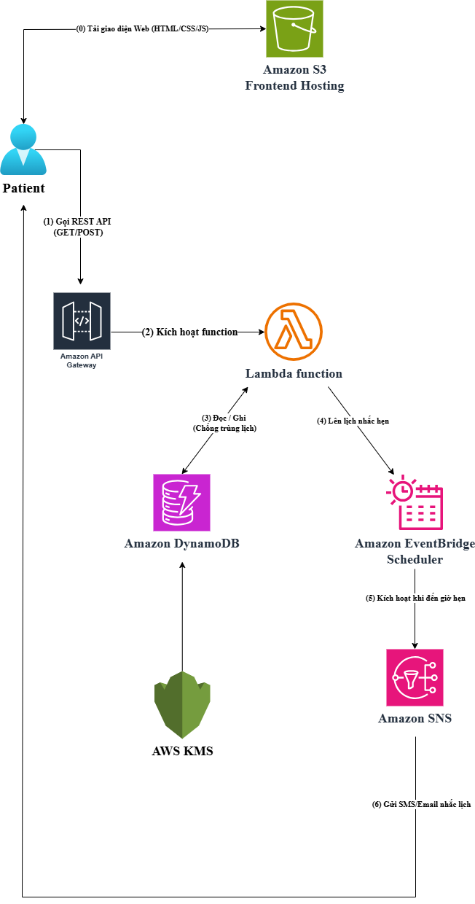

# Thiết kế Kiến trúc AWS

Hệ thống được thiết kế theo mô hình Serverless hoàn chỉnh trên AWS Region us-east-1 bao gồm các thành phần:

1. **Giao diện người dùng & Hosting**: Người dùng truy cập trình duyệt web để tải giao diện HTML/CSS/JavaScript lưu trữ tĩnh trên Amazon S3 (Static Website Hosting).
2. **Cổng tiếp nhận API**: Trình duyệt gửi yêu cầu RESTful HTTP đến Amazon API Gateway (đã cấu hình CORS).
3. **Xử lý nghiệp vụ**: API Gateway kích hoạt hàm AWS Lambda (AppointmentBookingFunction chạy Node.js).
4. **Lưu trữ dữ liệu**: Lambda truy vấn bảng Doctors và ghi phiếu khám vào bảng Appointments trên Amazon DynamoDB có gắn kèm cơ chế Conditional Write chống trùng giờ.
5. **Nhắc lịch tự động**: Lambda đẩy lịch hẹn vào Amazon EventBridge Scheduler; khi đến thời điểm nhắc khám, EventBridge kích hoạt Amazon SNS để gửi email/SMS thông báo đến bệnh nhân.
6. **Bảo mật**: AWS KMS cung cấp và quản lý khóa mã hóa dữ liệu tĩnh lưu trữ trên DynamoDB và S3.

