# Thực hành AWS - SV2 Huỳnh Ngọc Bảo Khang

## Mục lục

- [Thực hành AWS - SV2 Huỳnh Ngọc Bảo Khang](#thực-hành-aws---sv2-huỳnh-ngọc-bảo-khang)
  - [Mục lục](#mục-lục)
  - [Dựng S3, DynamoDB, Lambda, API Gateway thử nghiệm trên AWS Learner Lab](#dựng-s3-dynamodb-lambda-api-gateway-thử-nghiệm-trên-aws-learner-lab)
    - [1. Khởi tạo Amazon S3 Bucket](#1-khởi-tạo-amazon-s3-bucket)
    - [2. Khởi tạo và cấu hình Amazon DynamoDB](#2-khởi-tạo-và-cấu-hình-amazon-dynamodb)
    - [3. Xây dựng AWS Lambda Function](#3-xây-dựng-aws-lambda-function)
    - [4. Cấu hình Amazon API Gateway (HTTP API)](#4-cấu-hình-amazon-api-gateway-http-api)
    - [5. Kiểm thử tích hợp qua Postman](#5-kiểm-thử-tích-hợp-qua-postman)

---

## Dựng S3, DynamoDB, Lambda, API Gateway thử nghiệm trên AWS Learner Lab

### 1. Khởi tạo Amazon S3 Bucket

Tạo thành công S3 Bucket mang tên `appointment-booking-web-demo` tại vùng `us-east-1` đóng vai trò lưu trữ mã nguồn giao diện web tĩnh (HTML, CSS, JS).

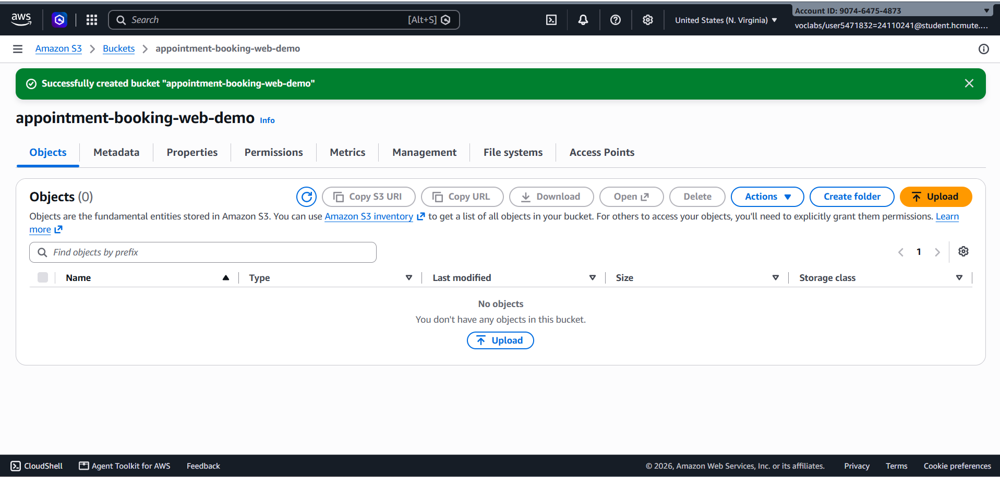

---

### 2. Khởi tạo và cấu hình Amazon DynamoDB

> **Lưu ý:** Giai đoạn PoC tuần 1 chỉ khởi tạo bảng `Doctors` và `Appointments` nhằm tập trung kiểm thử tính năng Conditional Write; bảng `Patients` sẽ được triển khai cùng module xác thực ở tuần sau.

- **Bảng Doctors:** Khởi tạo với Partition Key `DoctorId` (String) ở chế độ On-demand.

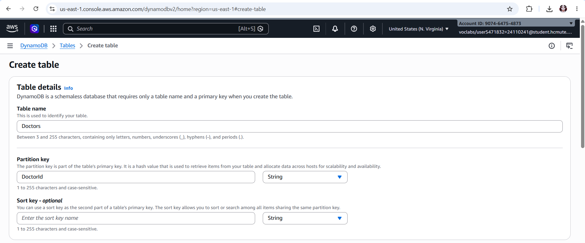

- **Bảng Appointments:** Khởi tạo với Composite Primary Key gồm Partition Key `DoctorId` (String) và Sort Key `SlotKey` đại diện cho trường `AppointmentDateTime` để phục vụ Conditional Write nhằm ngăn chặn việc trùng lặp ca khám trên cùng một khung giờ của bác sĩ.

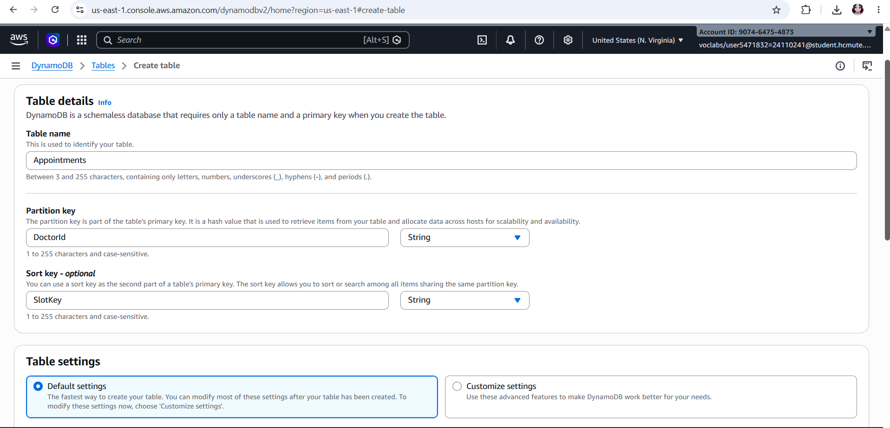

- **Trạng thái bảng:** Cả hai bảng đều ở trạng thái Active sẵn sàng phục vụ truy vấn.

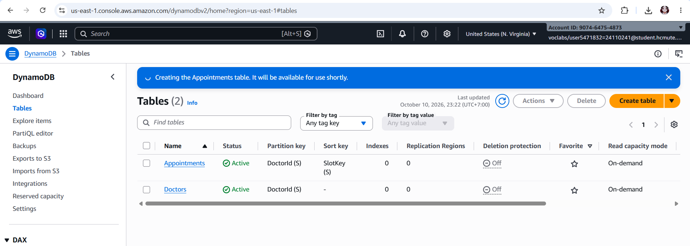

---

### 3. Xây dựng AWS Lambda Function

Khởi tạo hàm xử lý bằng runtime **Node.js 24.x** (gán quyền thực thi qua role `LabRole` có sẵn của Learner Lab).

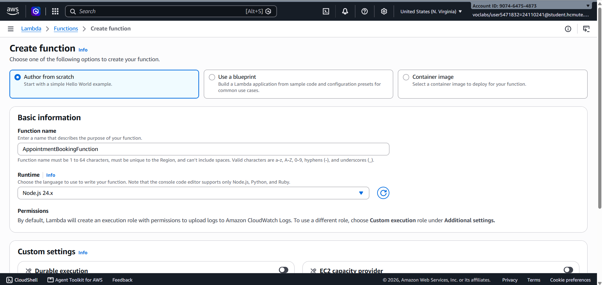

Sử dụng thư viện `@aws-sdk/lib-dynamodb` để kết nối và thao tác với DynamoDB:

- `GET /doctors`: Thực hiện lệnh `ScanCommand` lấy danh sách bác sĩ từ bảng `Doctors`.
- `POST /appointments`: Thực hiện lệnh `PutCommand` ghi phiếu hẹn vào bảng `Appointments` kèm biểu thức `ConditionExpression: "attribute_not_exists(DoctorId) AND attribute_not_exists(SlotKey)"`. Nếu bị trùng giờ, hàm bắt ngoại lệ `ConditionalCheckFailedException` và trả về lỗi HTTP `409 Conflict`.

**Mã nguồn hàm Lambda:**

```javascript
import { DynamoDBClient } from "@aws-sdk/client-dynamodb";
import {
  DynamoDBDocumentClient,
  ScanCommand,
  PutCommand,
} from "@aws-sdk/lib-dynamodb";

const client = new DynamoDBClient({ region: "us-east-1" });
const ddbDocClient = DynamoDBDocumentClient.from(client);
const DOCTORS_TABLE = "Doctors";
const APPOINTMENTS_TABLE = "Appointments";

const headers = {
  "Content-Type": "application/json",
  "Access-Control-Allow-Origin": "*",
  "Access-Control-Allow-Headers": "Content-Type,Authorization",
  "Access-Control-Allow-Methods": "GET,POST,OPTIONS",
};

export const handler = async (event) => {
  console.log("Incoming event:", JSON.stringify(event));
  const httpMethod = event.requestContext?.http?.method || event.httpMethod;
  const path = event.requestContext?.http?.path || event.path;

  try {
    // 1. GET /doctors: Quét và đọc dữ liệu thật từ bảng Doctors trong DynamoDB
    if (httpMethod === "GET" && path.endsWith("/doctors")) {
      const data = await ddbDocClient.send(
        new ScanCommand({ TableName: DOCTORS_TABLE }),
      );
      return {
        statusCode: 200,
        headers,
        body: JSON.stringify({ success: true, data: data.Items || [] }),
      };
    }

    // 2. POST /appointments: Ghi lịch hẹn và dùng Conditional Write chống trùng lịch
    if (httpMethod === "POST" && path.endsWith("/appointments")) {
      const body = event.body ? JSON.parse(event.body) : {};
      const { doctorId, patientName, patientPhone, appointmentDate, slotTime } =
        body;

      if (!doctorId || !patientName || !appointmentDate || !slotTime) {
        return {
          statusCode: 400,
          headers,
          body: JSON.stringify({
            message: "Thiếu thông tin đặt lịch bắt buộc!",
          }),
        };
      }

      const appointmentItem = {
        DoctorId: doctorId,
        SlotKey: `${appointmentDate}#${slotTime}`, // Composite Sort Key
        AppointmentId: "APT-" + Date.now(),
        PatientName: patientName,
        PatientPhone: patientPhone || "",
        AppointmentDate: appointmentDate,
        SlotTime: slotTime,
        Status: "CONFIRMED",
        CreatedAt: new Date().toISOString(),
      };

      try {
        await ddbDocClient.send(
          new PutCommand({
            TableName: APPOINTMENTS_TABLE,
            Item: appointmentItem,
            // Chống trùng lịch: nếu trùng cả DoctorId và SlotKey thì chặn ghi
            ConditionExpression:
              "attribute_not_exists(DoctorId) AND attribute_not_exists(SlotKey)",
          }),
        );
        return {
          statusCode: 201,
          headers,
          body: JSON.stringify({
            message: "Đặt lịch khám thành công!",
            data: appointmentItem,
          }),
        };
      } catch (err) {
        // Bắt lỗi nếu khung giờ bị đặt trùng
        if (err.name === "ConditionalCheckFailedException") {
          return {
            statusCode: 409,
            headers,
            body: JSON.stringify({
              error:
                "Khung giờ này của bác sĩ đã có người đặt trước. Vui lòng chọn giờ khác!",
            }),
          };
        }
        throw err;
      }
    }

    return {
      statusCode: 404,
      headers,
      body: JSON.stringify({ message: "Route không tồn tại" }),
    };
  } catch (error) {
    console.error("Lỗi:", error);
    return {
      statusCode: 500,
      headers,
      body: JSON.stringify({ error: "Lỗi hệ thống: " + error.message }),
    };
  }
};
```

Deploy Lambda function thành công:

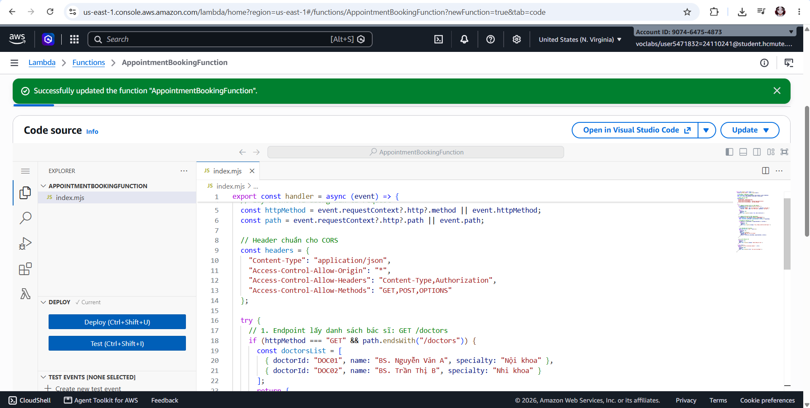

---

### 4. Cấu hình Amazon API Gateway (HTTP API)

- Tạo API mang tên `AppointmentBookingAPI` tích hợp trực tiếp với Lambda function `AppointmentBookingFunction`.

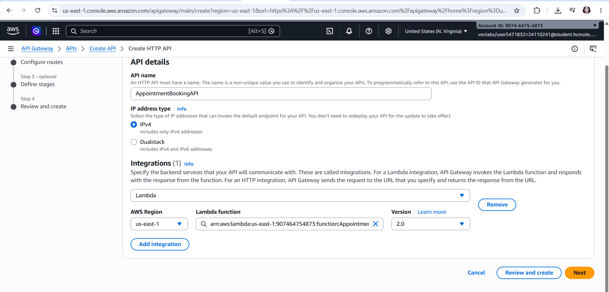

- Định tuyến (Routes) 2 endpoint chính: `GET /doctors` và `POST /appointments` trên stage mặc định `$default` (bật Auto-deploy).

_Cấu hình routes:_
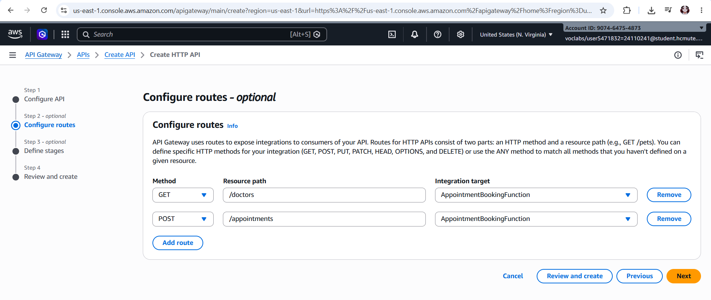

_Cấu hình stages:_
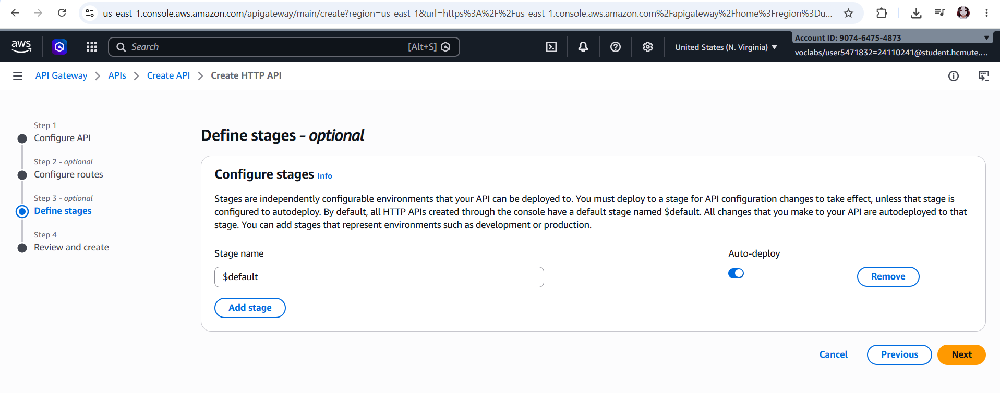

- Cấu hình đầy đủ Cross-Origin Resource Sharing (CORS) (`Access-Control-Allow-Origin: *`, Methods: `GET, POST, OPTIONS`, Headers: `content-type, authorization`) để sẵn sàng cho frontend gọi API mà không bị chặn bởi trình duyệt.

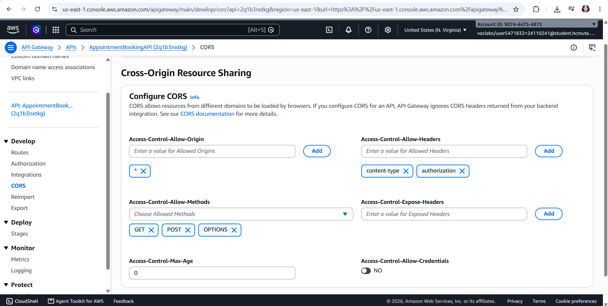

---

### 5. Kiểm thử tích hợp qua Postman

- **Test GET /doctors:** Gửi request thành công, nhận phản hồi mã `200 OK` kèm danh sách bác sĩ truy vấn trực tiếp từ bảng `Doctors` trong DynamoDB.

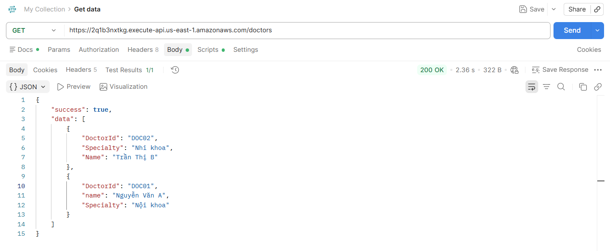

- **Test POST /appointments:** Gửi request đặt lịch với bác sĩ `DOC01` vào khung giờ `2026-10-15#09:00`, nhận mã `201 Created` và dữ liệu được ghi nhận vào DynamoDB.

_Request Body (Input):_
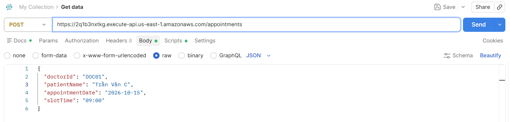

_Response (Output đặt lịch thành công):_
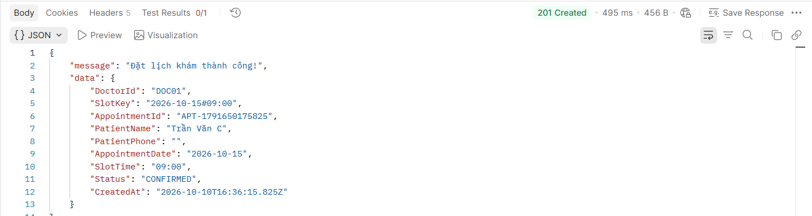

- **Test chống trùng lịch (Conditional Write):** Gửi lại request với cùng thông tin ca khám vừa đặt, hệ thống kích hoạt cơ chế chống trùng lặp và phản hồi đúng mã `409 Conflict` kèm thông báo _"Khung giờ này của bác sĩ đã có người đặt trước. Vui lòng chọn giờ khác!"_.

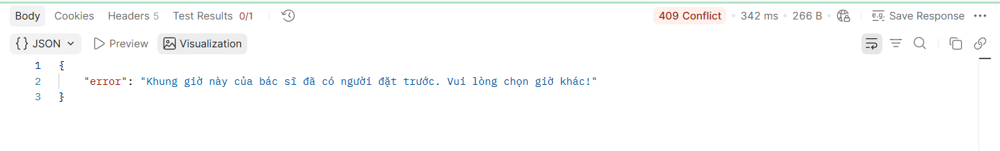

[⬆ Quay lại Mục lục](#mục-lục)
