# Báo Cáo Thực Hiện Tuần 2 - Dự Án CareSync

**Đề tài:** Hệ thống đặt lịch khám bệnh cho phòng khám trực tuyến (CareSync)  
**Học phần:** Điện toán đám mây (Cloud Computing) – HCMUTE  
**Nhóm thực hiện:** Domain Apps  
**Thành viên:**
- **SV1:** Bùi Anh Khôi – MSSV: 24110258
- **SV2:** Huỳnh Ngọc Bảo Khang – MSSV: 24110241  
**GitHub Repository:** [https://github.com/Arenef/CareSync](https://github.com/Arenef/CareSync)  
**Nhánh chính (Branch):** `main`
---
## Mục lục
- [1. Cơ sở dữ liệu và Backend API Đặt lịch](#1-cơ-sở-dữ-liệu-và-backend-api-đặt-lịch)
  - [1.1. Cấu trúc và dữ liệu Amazon DynamoDB](#11-cấu-trúc-và-dữ-liệu-amazon-dynamodb)
    - [Tổng quan 3 bảng trong hệ thống](#tổng-quan-3-bảng-trong-hệ-thống)
    - [Bảng Doctors](#bảng-doctors)
    - [Bảng Appointments](#bảng-appointments)
    - [Bảng Patients](#bảng-patients)
  - [1.2. Tái cấu trúc Backend AWS Lambda theo Clean Architecture](#12-tái-cấu-trúc-backend-aws-lambda-theo-clean-architecture)
  - [1.3. Cơ chế Conditional Write chống trùng lịch khám](#13-cơ-chế-conditional-write-chống-trùng-lịch-khám)
- [2. Luồng thông báo và tự động nhắc lịch hẹn](#2-luồng-thông-báo-và-tự-động-nhắc-lịch-hẹn)
  - [2.1. Cấu hình Amazon SNS Topic và Subscription Email](#21-cấu-hình-amazon-sns-topic-và-subscription-email)
  - [2.2. Xây dựng Lambda gửi thông báo qua SNS](#22-xây-dựng-lambda-gửi-thông-báo-qua-sns)
  - [2.3. Tự động hóa lịch nhắc nhở với Amazon EventBridge Scheduler](#23-tự-động-hóa-lịch-nhắc-nhở-với-amazon-eventbridge-scheduler)
- [3. Tích hợp Giao diện Web CareSync](#3-tích-hợp-giao-diện-web-caresync)
  - [3.1. Hiển thị danh bạ 10 bác sĩ động từ Cloud GET doctors](#31-hiển-thị-danh-bạ-10-bác-sĩ-động-từ-cloud-get-doctors)
  - [3.2. Đặt lịch khám và xuất vé điện tử thành công POST appointments](#32-đặt-lịch-khám-và-xuất-vé-điện-tử-thành-công-post-appointments)
  - [3.3. Phản hồi giao diện thông minh khi trùng lịch khám 409 Conflict](#33-phản-hồi-giao-diện-thông-minh-khi-trùng-lịch-khám-409-conflict)
  - [3.4. Kích hoạt thông báo email từ giao diện web](#34-kích-hoạt-thông-báo-email-từ-giao-diện-web)
- [4. Tổng hợp kết quả kiểm thử hệ thống](#4-tổng-hợp-kết-quả-kiểm-thử-hệ-thống)
  - [4.1. Bảng ma trận kiểm thử toàn diện](#41-bảng-ma-trận-kiểm-thử-toàn-diện)
  - [4.2. Minh chứng kiểm thử độc lập qua Postman](#42-minh-chứng-kiểm-thử-độc-lập-qua-postman)
- [5. Đánh giá kết quả và kế hoạch Tuần 3](#5-đánh-giá-kết-quả-và-kế-hoạch-tuần-3)
  - [5.1. Đánh giá kết quả Tuần 2](#51-đánh-giá-kết-quả-tuần-2)
  - [5.2. Kế hoạch triển khai Tuần 3](#52-kế-hoạch-triển-khai-tuần-3)

---

## 1. Cơ sở dữ liệu và Backend API Đặt lịch

### 1.1. Cấu trúc và dữ liệu Amazon DynamoDB

#### Tổng quan 3 bảng trong hệ thống
Hệ thống CareSync trên AWS DynamoDB khu vực `us-east-1` đã được khởi tạo và rà soát cấu hình 3 bảng dữ liệu ở trạng thái **Active**:

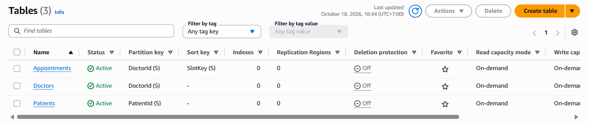

#### Bảng Doctors
* **Partition Key (PK):** `DoctorId` (String).
* **Dữ liệu thực tế:** Nạp thành công 10 bản ghi bác sĩ mẫu (`DOC01` đến `DOC10`) với đầy đủ chuyên khoa, học vị, phòng khám, số điện thoại và trạng thái `IsActive: true`.

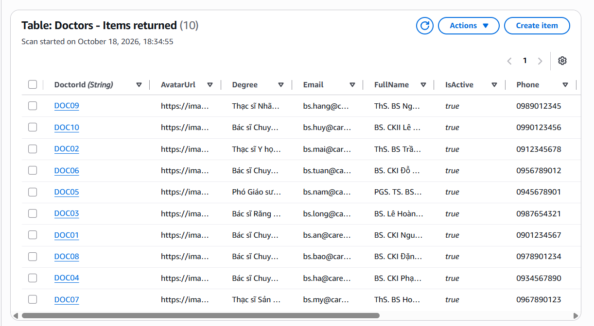

#### Bảng Appointments
* **Composite Primary Key:** Partition Key `DoctorId` (String) kết hợp Sort Key `SlotKey` (String) theo định dạng `YYYY-MM-DD#HH:mm` (Ví dụ: `2026-10-25#09:00`).
* **Ý nghĩa:** Khóa ghép duy nhất trên từng ca khám giúp DynamoDB kiểm soát xung đột nguyên tử.

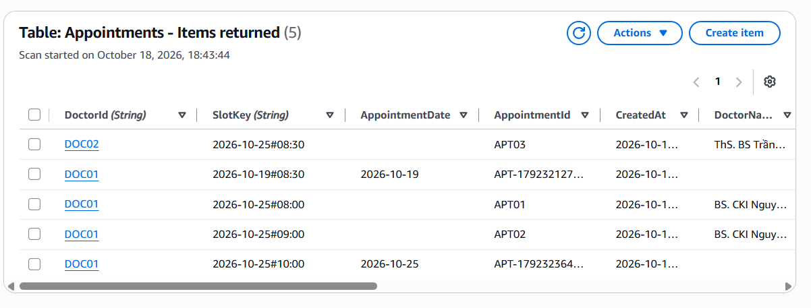

#### Bảng Patients
* **Partition Key (PK):** `PatientId` (String), sẵn sàng phục vụ module hồ sơ bệnh án và xác thực.

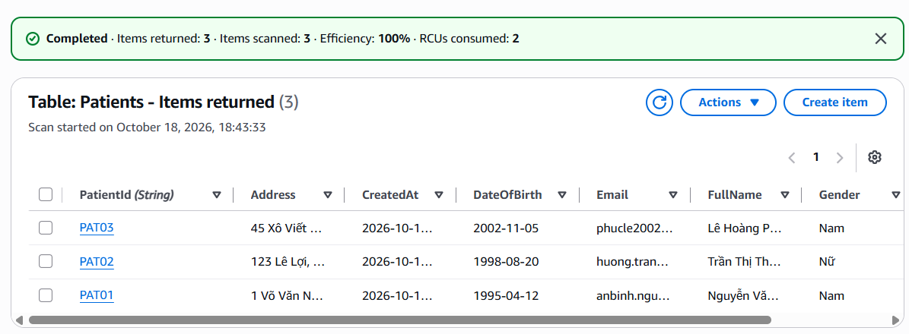

---

### 1.2. Tái cấu trúc Backend AWS Lambda theo Clean Architecture
Để đảm bảo mã nguồn dễ bảo trì, dễ mở rộng và tuân thủ các nguyên lý thiết kế phần mềm (SOLID), toàn bộ hàm `AppointmentBookingFunction` đã được tái cấu trúc từ dạng nguyên khối sang kiến trúc phân tầng:

* `config/db.js`: Khởi tạo `DynamoDBDocumentClient` singleton kết nối AWS SDK v3, tái sử dụng kết nối TCP giữa các lần thực thi để giảm độ trễ.
* `service/`: Tầng nghiệp vụ thuần túy (`doctor.service.js`, `appointment.service.js`).
* `controller/`: Tầng tiếp nhận request, định dạng mã phản hồi Native Lambda (`statusCode`, `headers`, `body`).
* `routes/`: Tầng định tuyến URL (`doctor.routes.js`, `appointment.routes.js`).
* `index.js`: Cổng phân luồng trung tâm (Central Dispatcher), xử lý CORS preflight `OPTIONS` tập trung.

Toàn bộ gói mã nguồn đã được nén zip và triển khai thành công lên AWS Lambda Console:

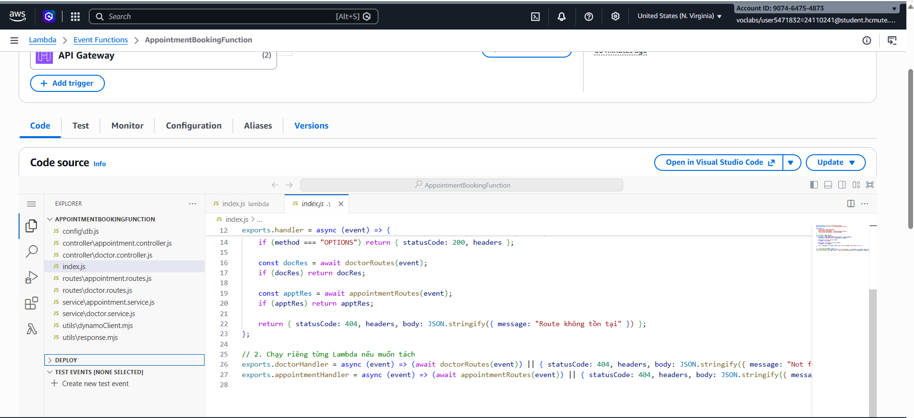

---

### 1.3. Cơ chế Conditional Write chống trùng lịch khám
Trong `appointment.service.js`, thao tác ghi lịch khám được bảo vệ bằng biểu thức điều kiện nguyên tử cấp cơ sở dữ liệu:
```javascript
await docClient.send(new PutCommand({
    TableName: TABLES.APPOINTMENTS,
    Item: newAppointmentItem,
    ConditionExpression: "attribute_not_exists(DoctorId) AND attribute_not_exists(SlotKey)"
}));
```
Nếu đã tồn tại bản ghi có cùng `DoctorId` và `SlotKey`, DynamoDB sẽ hủy bỏ thao tác ghi và trả về ngoại lệ `ConditionalCheckFailedException`. Tầng controller bắt lỗi này và phản hồi mã **`HTTP 409 Conflict`** về cho client.

---

## 2. Luồng thông báo và tự động nhắc lịch hẹn

### 2.1. Cấu hình Amazon SNS Topic và Subscription Email
* Khởi tạo **Amazon SNS Topic** mang tên `DemoNhacLich` tại khu vực `us-east-1`.
* Cấu hình Subscription giao thức Email và hoàn tất xác thực (Confirmed) từ hộp thư người nhận.

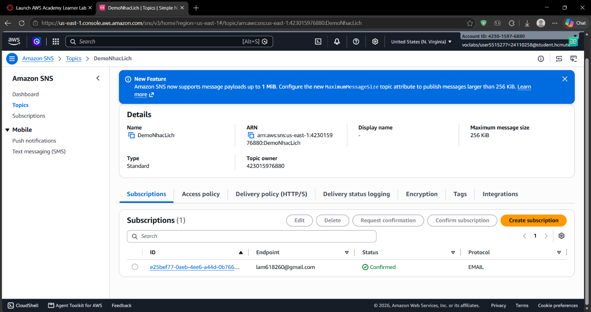

---

### 2.2. Xây dựng Lambda gửi thông báo qua SNS
* Khởi tạo hàm Lambda thử nghiệm `CareSync-TestEmail` sử dụng runtime **Node.js 24.x**, cấp quyền thực thi qua `LabRole`.
* Hàm sử dụng thư viện `@aws-sdk/client-sns` để xuất bản (Publish) thông điệp thông báo tới Topic ARN của SNS ngay khi nhận được yêu cầu đặt lịch.
* Cấu hình sự kiện kiểm thử `TestGuiEmail` trực tiếp trên Console và nhận email thông báo thành công:

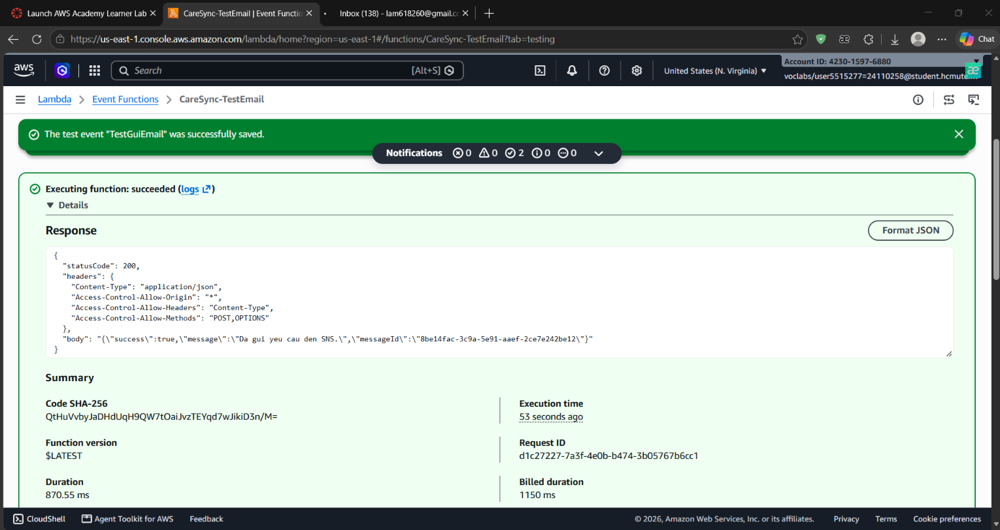

---

### 2.3. Tự động hóa lịch nhắc nhở với Amazon EventBridge Scheduler
Để nâng cao trải nghiệm bệnh nhân, hệ thống tích hợp **Amazon EventBridge Scheduler** để tự động lên lịch nhắc khám:
1. **Gửi email xác nhận tức thời:** Xuất bản thông báo xác nhận đặt lịch thành công qua SNS.
2. **Lên lịch gửi nhắc nhở sau 2 phút (Mô phỏng trước 24h thực tế):** Tính toán mốc thời gian `remindAt` và gọi `CreateScheduleCommand` với biểu thức một lần `at(YYYY-MM-DDTHH:mm:ss)`:
   * Target: Trỏ trực tiếp tới SNS Topic `DemoNhacLich`.
   * ActionAfterCompletion: Tự động xóa lịch trình (`DELETE`) sau khi gửi thành công để tiết kiệm tài nguyên.

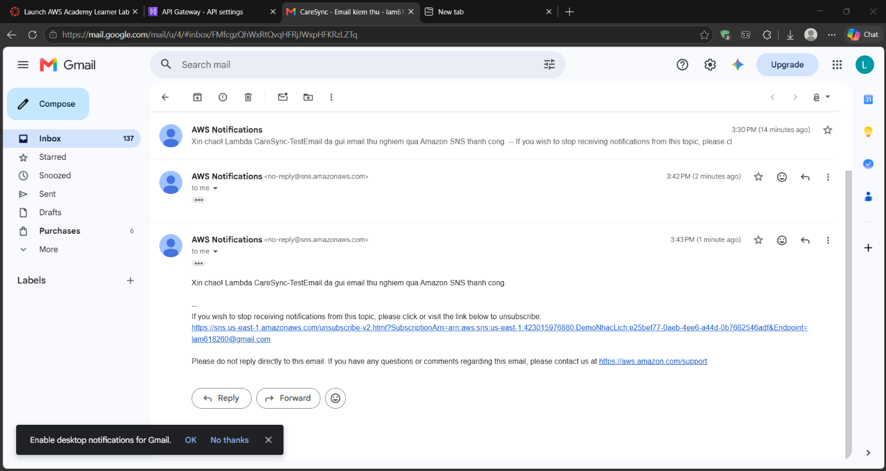

---

## 3. Tích hợp Giao diện Web CareSync

### 3.1. Hiển thị danh bạ 10 bác sĩ động từ Cloud GET doctors
* Module `client/js/api.js` cấu hình endpoint API Gateway `https://2q1b3nxtkg.execute-api.us-east-1.amazonaws.com`.
* Khi tải trang, hàm `initDoctors()` gọi `doctorApi.getAll()` nạp danh sách 10 bác sĩ từ DynamoDB. Giao diện render động thẻ thông tin bác sĩ kèm trạng thái mạng **`200 OK`**:

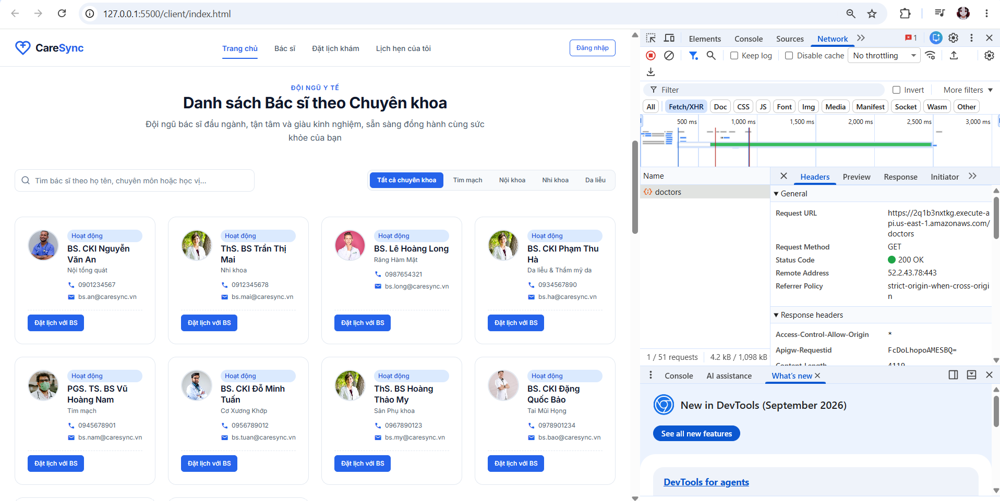

---

### 3.2. Đặt lịch khám và xuất vé điện tử thành công POST appointments
* Bệnh nhân chọn bác sĩ, ngày khám và khung giờ trên giao diện web.
* Bấm **"Xác nhận đặt lịch"**: Request gửi payload JSON lên API Gateway $\rightarrow$ Lambda ghi vào DynamoDB.
* Giao diện nhận phản hồi **`201 Created`**, hiển thị popup **Vé xác nhận khám bệnh (Ticket Modal)** với mã `APT-...` thật:

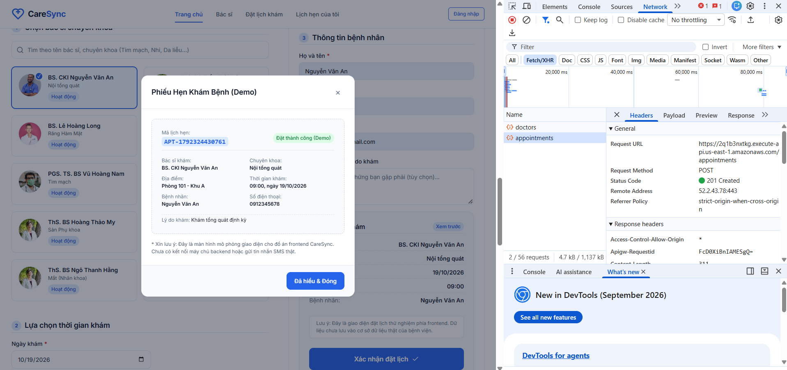

---

### 3.3. Phản hồi giao diện thông minh khi trùng lịch khám 409 Conflict
* Khi bấm đặt lịch lại vào cùng khung giờ đã có người đặt:
* DynamoDB từ chối ghi $\rightarrow$ API Gateway phản hồi mã **`409 Conflict`**.
* Giao diện bắt mã 409: hiển thị Toast cảnh báo màu vàng *"Trùng lịch khám! Khung giờ này vừa có người đặt rồi! Vui lòng chọn khung giờ khác"* và tự động **vô hiệu hóa (khóa nút `disabled`)** khung giờ đó:

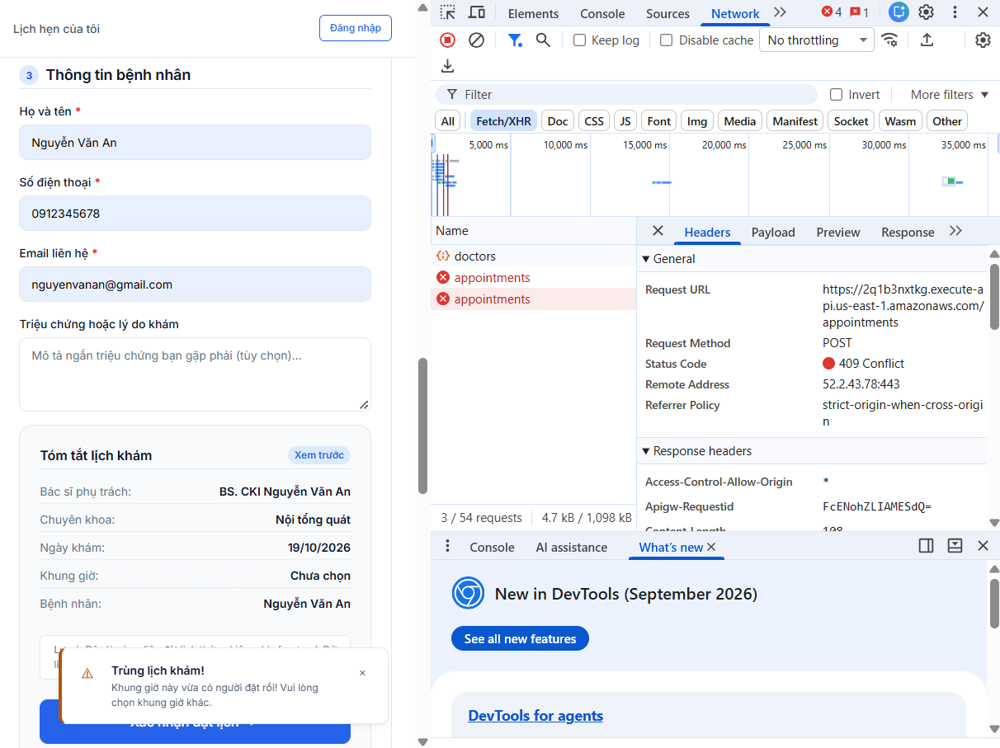

---

### 3.4. Kích hoạt thông báo email từ giao diện web
* Khi bệnh nhân xác nhận đặt lịch trên giao diện web, hệ thống đồng thời kích hoạt API gửi email thông báo mẫu:

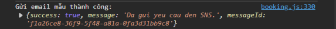

---

## 4. Tổng hợp kết quả kiểm thử hệ thống

### 4.1. Bảng ma trận kiểm thử toàn diện

| STT | Phân hệ kiểm thử | Endpoint / Chức năng | Phương thức | Dữ liệu đầu vào (Input) | Kết quả kỳ vọng | Kết quả thực tế | Trạng thái |
| :-: | :--------------- | :------------------- | :---------: | :---------------------- | :-------------- | :-------------- | :--------: |
| 1 | Danh mục Bác sĩ | `/doctors` | `GET` | Không có (Empty) | HTTP 200, danh sách 10 bác sĩ | HTTP 200, 10 Items | **PASS** |
| 2 | Đặt lịch khám | `/appointments` | `POST` | Payload JSON đặt lịch hợp lệ | HTTP 201, tạo mã `APT-...` | HTTP 201 Created | **PASS** |
| 3 | Chống trùng lịch | `/appointments` | `POST` | Trùng `DoctorId` và `SlotKey` | HTTP 409 Conflict | HTTP 409 Conflict | **PASS** |
| 4 | Kiểm tra dữ liệu | `/appointments` | `POST` | Thiếu `patientName` hoặc `slotTime` | HTTP 400 Bad Request | HTTP 400 Bad Request | **PASS** |
| 5 | Gửi email SNS | `/test-email` | `POST` | Yêu cầu kích hoạt thông báo | HTTP 200, MessageId từ SNS | HTTP 200 OK | **PASS** |
| 6 | Hẹn giờ Scheduler| `EventBridge Scheduler` | Trigger | Biểu thức `at()` sau 2 phút | Gửi email nhắc đúng giờ hẹn | Nhận email thành công | **PASS** |

---

### 4.2. Minh chứng kiểm thử độc lập qua Postman

1. **Kiểm thử API `GET /doctors`:** Trả về HTTP `200 OK` cùng danh sách dữ liệu bác sĩ.  
   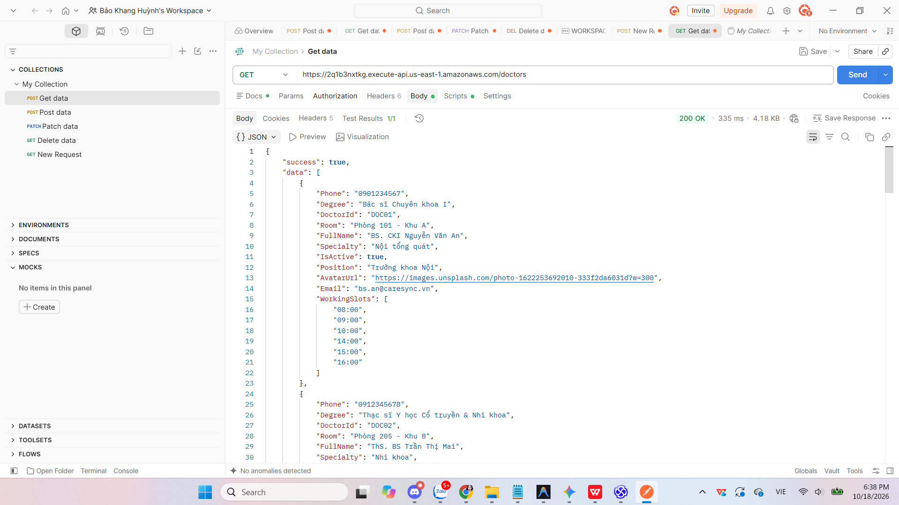

2. **Kiểm thử API `POST /appointments` thành công:** Trả về HTTP `201 Created` cùng thông tin phiếu khám đã lưu vào DynamoDB.  
   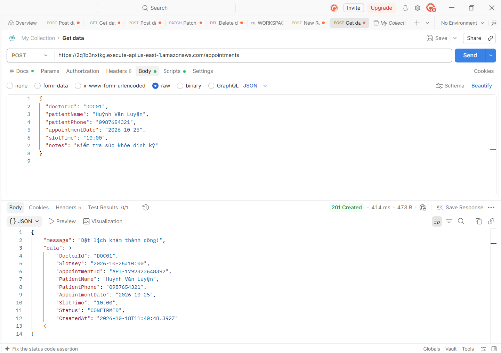

3. **Kiểm thử API `POST /appointments` chống trùng lịch:** Trả về HTTP `409 Conflict` kèm thông báo chặn trùng lịch.  
   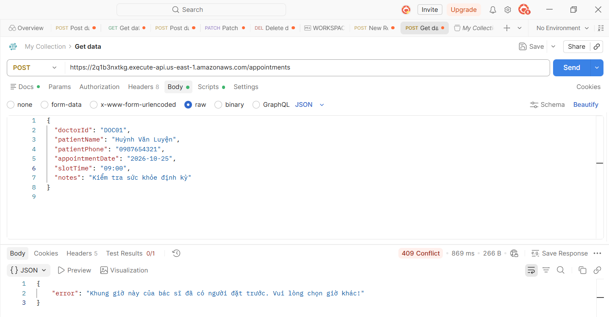

---

## 5. Đánh giá kết quả và kế hoạch Tuần 3

### 5.1. Đánh giá kết quả Tuần 2
* **Mức độ hoàn thành:** Đạt **100%** khối lượng công việc theo đúng phân công nhiệm vụ của cả 2 thành viên.
* **Đặc điểm nổi bật:**
  * Kiến trúc Backend chuẩn hóa theo mô hình phân tầng Clean Architecture, tách bạch giữa xử lý logic và truy vấn CSDL.
  * Tích hợp thành công cơ chế Conditional Write ở mức database, loại trừ hoàn toàn nguy cơ Race Condition và Double-Booking.
  * Hiện thực hóa thành công luồng thông báo nhắc lịch tự động không cần máy chủ (Serverless Notification) thông qua SNS và EventBridge Scheduler.
  * Giao diện người dùng phản hồi trực quan, thân thiện và xử lý lỗi mạng mượt mà.

### 5.2. Kế hoạch triển khai Tuần 3
* **Nhiệm vụ 1:** Tích hợp trực tiếp luồng tạo EventBridge Scheduler và gửi thông báo SNS vào hàm `createAppointment` chính thức trong `appointment.service.js`.
* **Nhiệm vụ 2:** Triển khai module lưu trữ hồ sơ bệnh nhân trên bảng `Patients` và hoàn thiện tính năng tra cứu "Lịch hẹn của tôi" theo số điện thoại bệnh nhân.
* **Nhiệm vụ 3:** Triển khai mã hóa dữ liệu nhạy cảm bằng **AWS KMS** và lưu trữ toàn bộ website tĩnh Frontend lên **Amazon S3** kết hợp CloudFront.
