<a id="top"></a>

# Báo cáo Minh chứng Thực hành - Tuần 2

> **Nội dung:** Triển khai luồng thông báo & nhắc lịch hẹn tự động (AWS Lambda, Amazon SNS, Amazon EventBridge Scheduler, Amazon API Gateway kết nối Frontend Web)

---

## Mục lục

- [1. Kiểm tra SNS Topic và cấu hình Lambda thử nghiệm](#1-kiem-tra-sns-topic-va-cau-hinh-lambda-thu-nghiem)
- [2. Xây dựng HTTP API tích hợp Frontend](#2-xay-dung-http-api-tich-hop-frontend)
- [3. Tự động hóa gửi email xác nhận và đặt lịch nhắc sau vài phút](#3-tu-dong-hoa-gui-email-xac-nhan-va-dat-lich-nhac-sau-vai-phut)
- [4. Kiểm thử toàn diện trên Giao diện Web CareSync](#4-kiem-thu-toan-dien-tren-giao-dien-web-caresync)

---

<a id="1-kiem-tra-sns-topic-va-cau-hinh-lambda-thu-nghiem"></a>

## 1. Kiểm tra SNS Topic và cấu hình Lambda thử nghiệm

### Kiểm tra trạng thái Topic và Subscription

Kiểm tra trạng thái email đăng ký nhận thông báo trong SNS Topic `DemoNhacLich`. Đảm bảo email endpoint đã xác nhận subscription (`Confirmed`).


---

### Khởi tạo hàm Lambda kiểm thử

Tạo một hàm Lambda thử nghiệm riêng `CareSync-TestEmail` trên AWS Console để kiểm tra tính thông suốt của luồng:  
**Frontend → API Gateway → Lambda → Amazon SNS gửi email**.

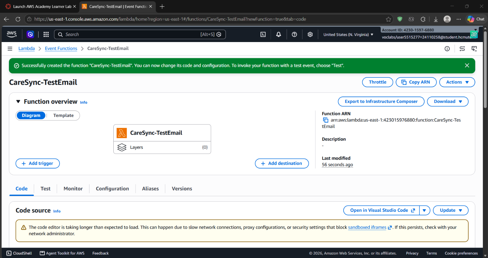

> **Lưu ý:** Email sẽ được chuyển tới các địa chỉ đã đăng ký và xác nhận subscription của SNS Topic, không gửi đến địa chỉ tự do ngoài danh sách chưa xác thực.

---

### Mã nguồn Lambda gửi email qua SNS

Mã nguồn hàm kiểm thử sử dụng AWS SDK v3 (`@aws-sdk/client-sns`) với cấu hình header CORS đầy đủ:

```javascript
import { SNSClient, PublishCommand } from "@aws-sdk/client-sns";

const sns = new SNSClient({ region: "us-east-1" });

export const handler = async (event) => {
  try {
    const result = await sns.send(
      new PublishCommand({
        TopicArn: "arn:aws:sns:us-east-1:423015976880:DemoNhacLich",
        Subject: "CareSync - Email kiem thu",
        Message:
          "Xin chao! Lambda CareSync-TestEmail da gui email thu nghiem qua Amazon SNS thanh cong.",
      }),
    );

    return {
      statusCode: 200,
      headers: {
        "Content-Type": "application/json",
        "Access-Control-Allow-Origin": "*",
        "Access-Control-Allow-Headers": "Content-Type",
        "Access-Control-Allow-Methods": "POST,OPTIONS",
      },
      body: JSON.stringify({
        success: true,
        message: "Da gui yeu cau den SNS.",
        messageId: result.MessageId,
      }),
    };
  } catch (error) {
    console.error("SNS publish error:", error);

    return {
      statusCode: 500,
      headers: {
        "Content-Type": "application/json",
        "Access-Control-Allow-Origin": "*",
      },
      body: JSON.stringify({
        success: false,
        message: error.message,
      }),
    };
  }
};
```

---

### Triển khai (Deploy) Lambda Function

Tiến hành deploy mã nguồn hàm Lambda vừa cấu hình trên giao diện AWS Lambda Console.

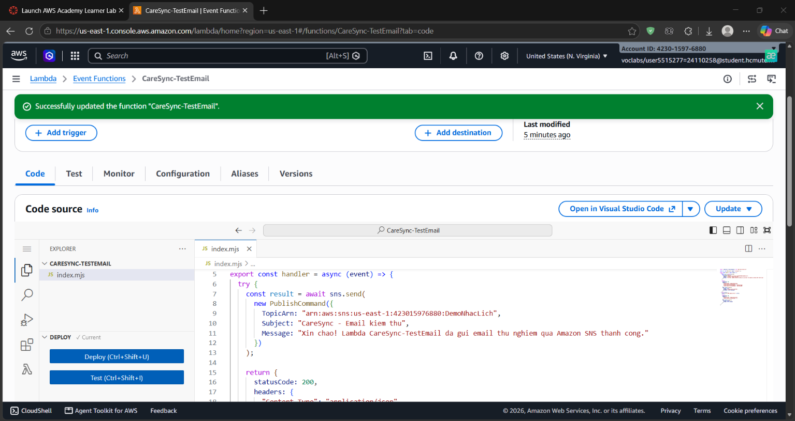

---

### Cấu hình sự kiện kiểm thử (Test Event)

Thiết lập sự kiện kiểm thử (Test Event) mang tên `TestGuiEmail` trực tiếp trong AWS Console qua 3 bước:

- **Bước 1:** Chọn tạo mới sự kiện kiểm thử (Create new event) với kiểu Synchronous.

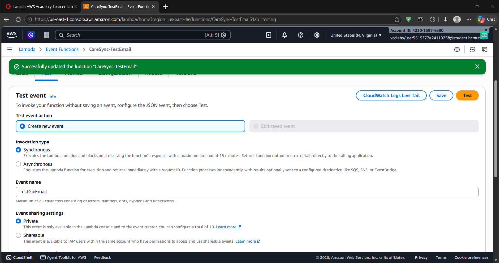

- **Bước 2:** Nhập định dạng Event JSON mẫu.

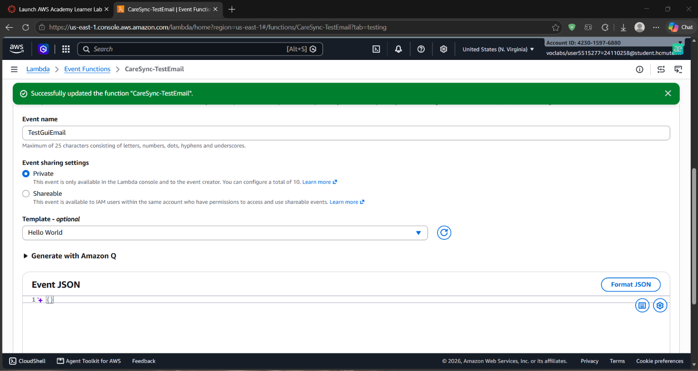

- **Bước 3:** Lưu cấu hình sự kiện kiểm thử thành công.

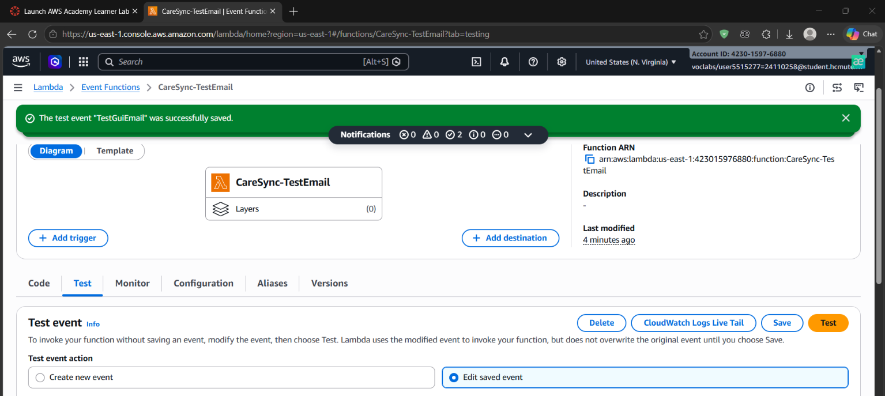

---

### Kết quả kiểm thử gửi email thử nghiệm

Chạy thử nghiệm hàm Lambda với test event đã cấu hình:

- **Kết quả thực thi hàm:** Trả về `statusCode: 200` và `MessageId` của SNS Topic.


- **Hộp thư Gmail nhận thông báo:** Email kiểm thử từ AWS Notifications đã được chuyển tới thành công.

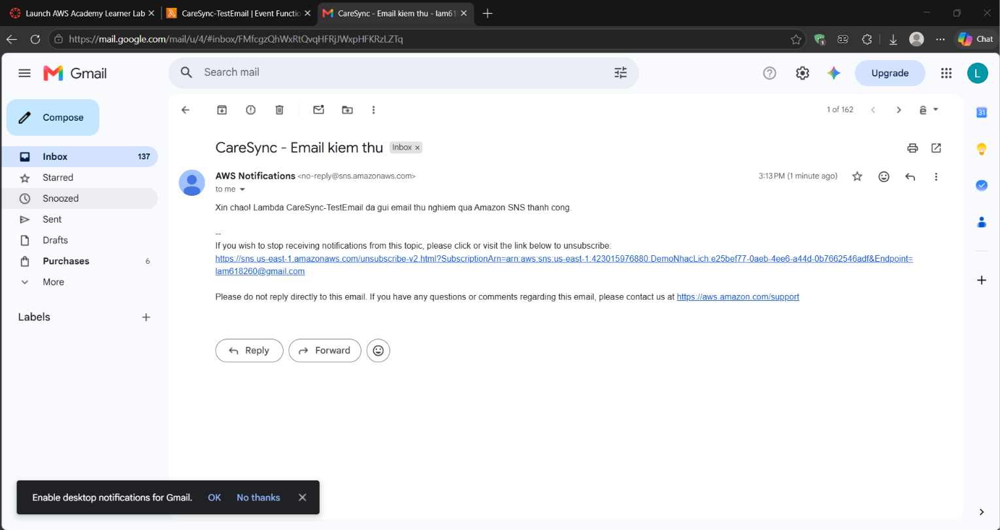

---

<a id="2-xay-dung-http-api-tich-hop-frontend"></a>

## 2. Xây dựng HTTP API tích hợp Frontend

### Khởi tạo HTTP API trên Amazon API Gateway

Khởi tạo HTTP API mang tên `CareSync-TestEmail-API` và liên kết trực tiếp tới Lambda function `CareSync-TestEmail`.

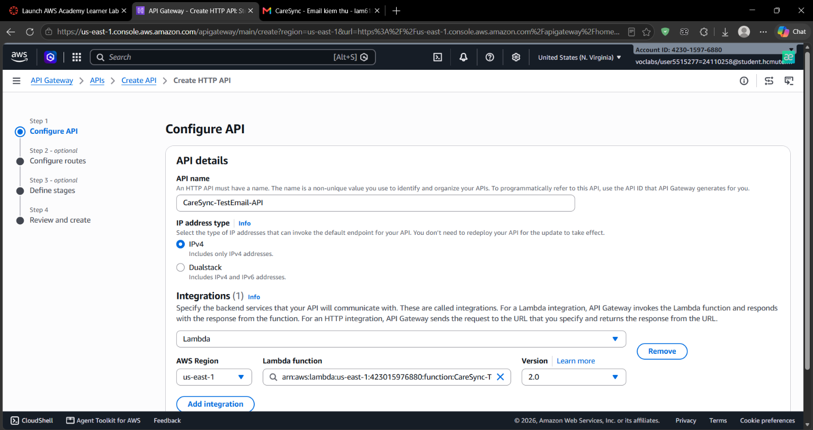

---

### Cấu hình định tuyến (Route)

Tạo Route với phương thức `POST` và đường dẫn tài nguyên `/test-email` để chuyển tiếp request vào hàm Lambda.

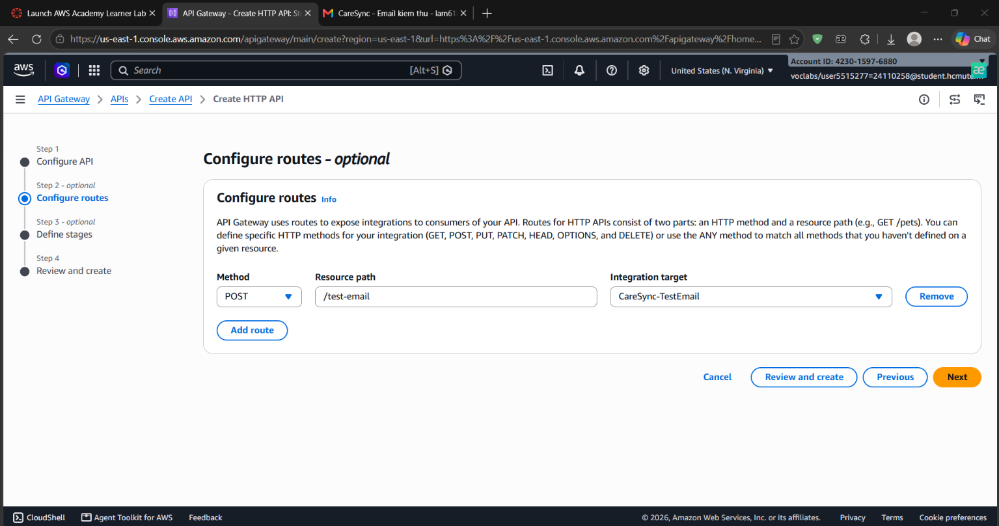

---

### Cấu hình chia sẻ tài nguyên nguồn gốc chéo (CORS)

Cấu hình CORS trên API Gateway để cho phép Frontend gọi API mà không bị chặn bởi chính sách bảo mật trình duyệt:

- `Access-Control-Allow-Origin`: `*`
- `Access-Control-Allow-Headers`: `content-type`
- `Access-Control-Allow-Methods`: `POST, OPTIONS`

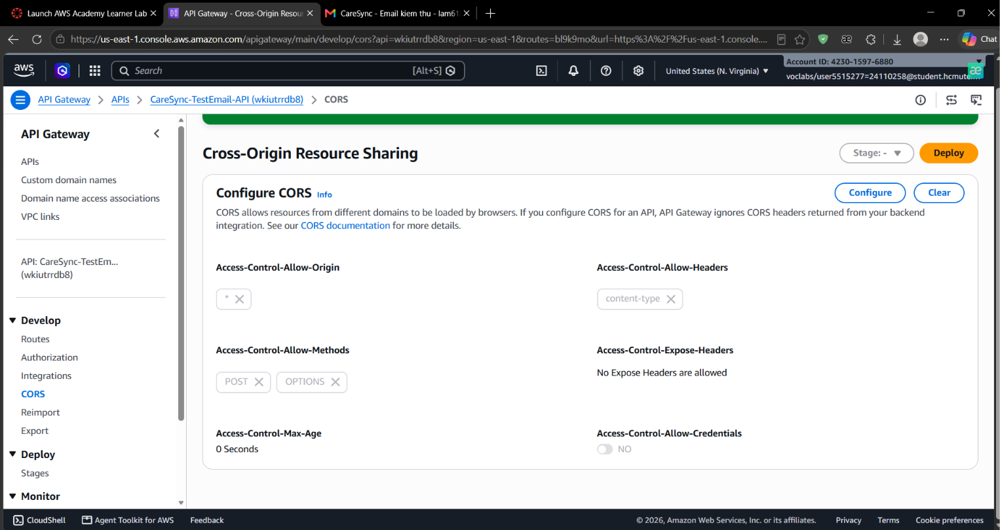

---

### Gắn sự kiện gọi API vào nút đặt lịch trên Web CareSync

Gắn hàm fetch gọi HTTP API gửi email mẫu vào nút xác nhận đặt lịch trong mã nguồn JavaScript Frontend (`booking.js`).

- **Kết quả trên Console trình duyệt:** Trả về kết quả gọi API thành công:


- **Email nhận được từ lượt kiểm thử Frontend:**


---

<a id="3-tu-dong-hoa-gui-email-xac-nhan-va-dat-lich-nhac-sau-vai-phut"></a>

## 3. Tự động hóa gửi email xác nhận và đặt lịch nhắc sau vài phút

### Luồng xử lý kết hợp SNS và EventBridge Scheduler

Nâng cấp hàm Lambda để phục vụ trải nghiệm người dùng hoàn chỉnh:

1. **Gửi ngay email xác nhận:** Xuất bản thông báo tới SNS Topic ngay khi nhận được yêu cầu đặt lịch.
2. **Hẹn lịch nhắc nhở sau 2 phút:** Tự động tạo một lịch trình thực thi một lần (`at()`) thông qua **Amazon EventBridge Scheduler** để kích hoạt gửi thông báo nhắc lịch sau 2 phút.

---

### Mã nguồn Lambda hoàn thiện

```javascript
import { SNSClient, PublishCommand } from "@aws-sdk/client-sns";
import {
  SchedulerClient,
  CreateScheduleCommand,
} from "@aws-sdk/client-scheduler";

const REGION = "us-east-1";
const TOPIC_ARN = "arn:aws:sns:us-east-1:423015976880:DemoNhacLich";

// Điền ARN role mà EventBridge Scheduler sẽ sử dụng
const SCHEDULER_ROLE_ARN = "arn:aws:iam::423015976880:role/LabRole";

const sns = new SNSClient({ region: REGION });
const scheduler = new SchedulerClient({ region: REGION });

export const handler = async (event) => {
  try {
    // 1. Gửi email xác nhận ngay
    await sns.send(
      new PublishCommand({
        TopicArn: TOPIC_ARN,
        Subject: "CareSync - Xac nhan dat lich",
        Message: "CareSync da ghi nhan yeu cau dat lich demo cua ban.",
      }),
    );

    // 2. Tạo lịch nhắc sau 2 phút
    const remindAt = new Date(Date.now() + 2 * 60 * 1000);
    const atTime = remindAt.toISOString().slice(0, 19);

    const scheduleName = `CareSync-reminder-${Date.now()}`;

    await scheduler.send(
      new CreateScheduleCommand({
        Name: scheduleName,
        ScheduleExpression: `at(${atTime})`,
        ScheduleExpressionTimezone: "UTC",
        FlexibleTimeWindow: { Mode: "OFF" },
        ActionAfterCompletion: "DELETE",
        Target: {
          Arn: TOPIC_ARN,
          RoleArn: SCHEDULER_ROLE_ARN,
          Input: JSON.stringify({
            Subject: "CareSync - Nhac lich kham",
            Message:
              "Day la email nhac lich kham demo tu CareSync, duoc gui sau 2 phut.",
          }),
        },
      }),
    );

    return {
      statusCode: 200,
      headers: {
        "Content-Type": "application/json",
        "Access-Control-Allow-Origin": "*",
      },
      body: JSON.stringify({
        success: true,
        message: "Da gui email xac nhan va tao lich nhac sau 2 phut.",
        reminderAt: remindAt.toISOString(),
        scheduleName,
      }),
    };
  } catch (error) {
    console.error("CareSync error:", error);

    return {
      statusCode: 500,
      headers: {
        "Content-Type": "application/json",
        "Access-Control-Allow-Origin": "*",
      },
      body: JSON.stringify({
        success: false,
        message: error.message,
        code: error.name,
      }),
    };
  }
};
```

---

### Kết quả kiểm thử Lambda tự động hóa

- **Phản hồi từ hàm Lambda:** Xác nhận đã gửi email và tạo lịch nhắc với mốc thời gian `reminderAt` chính xác.

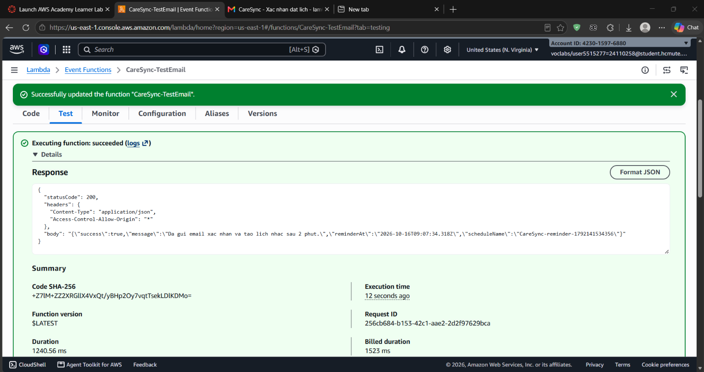

- **Email xác nhận tức thì:** Nhận được thông báo ngay lập tức trong hộp thư.

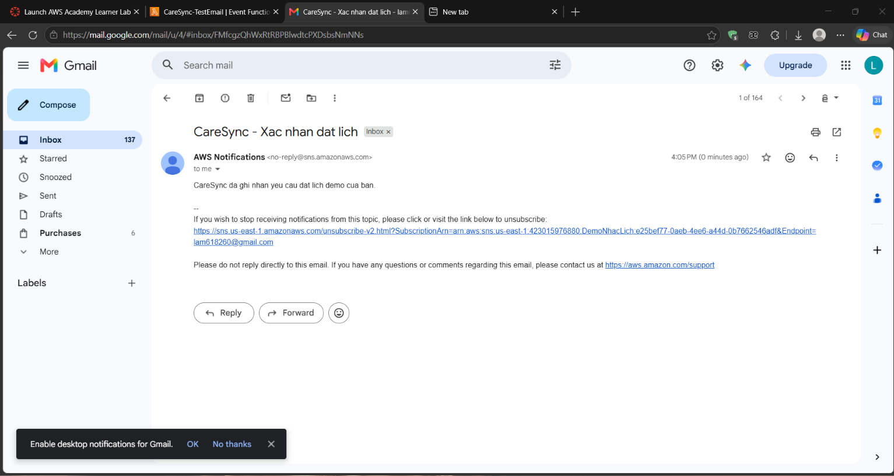

- **Email nhắc lịch sau 2 phút:** Đúng thời gian hẹn, EventBridge Scheduler kích hoạt gửi email nhắc nhở.

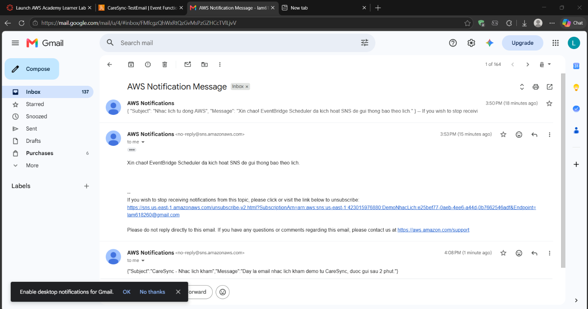

---

<a id="4-kiem-thu-toan-dien-tren-giao-dien-web-caresync"></a>

## 4. Kiểm thử toàn diện trên Giao diện Web CareSync

### Thao tác đặt lịch trên giao diện Web CareSync

Người dùng thực hiện quy trình đặt lịch trực tiếp trên ứng dụng CareSync: chọn bác sĩ, ngày giờ khám, điền thông tin và bấm đặt lịch thành công với mã phiếu khám được tạo tự động (ví dụ: `CS-242784`).

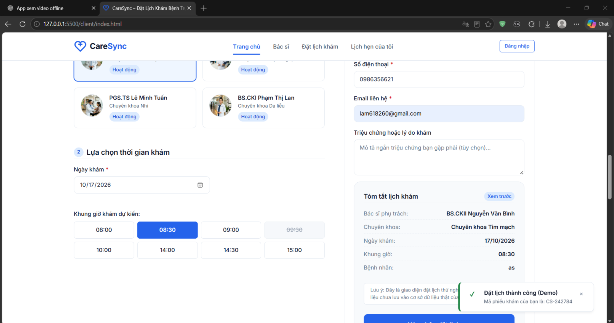

---

### Nhận email xác nhận lịch khám tức thì

Hệ thống tự động kích hoạt gửi email xác nhận đặt lịch hẹn demo đến người dùng.

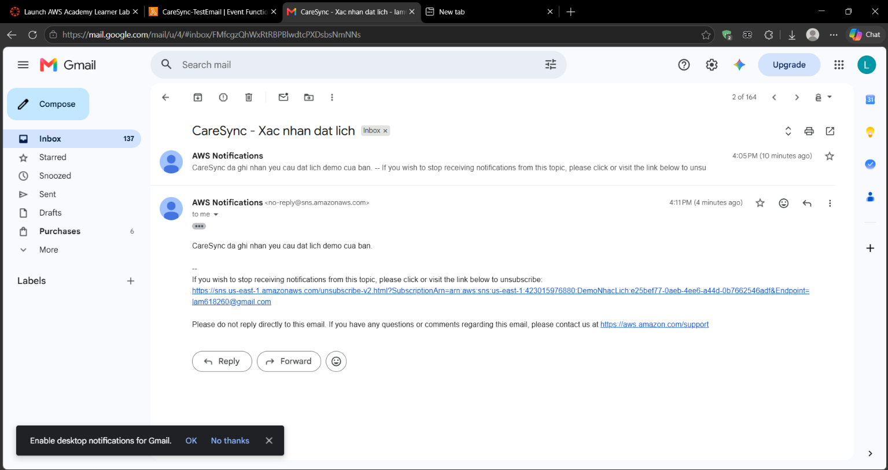

---

### Nhận email nhắc lịch tự động sau 2 phút

Sau 2 phút kể từ thời điểm đặt lịch thành công, người dùng nhận được thông báo nhắc lịch khám demo từ hệ thống qua email.

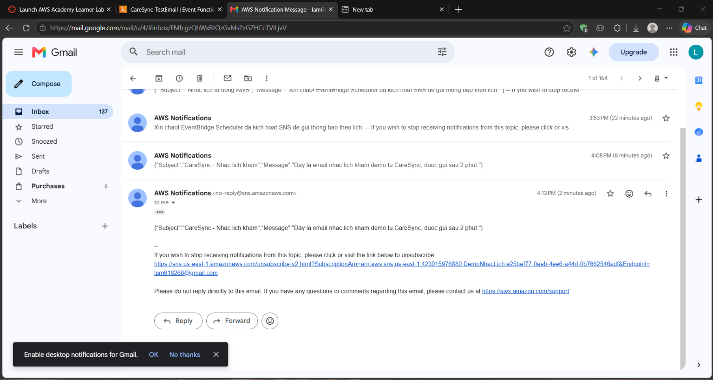

---

[↑ Quay lại đầu trang](#top)
