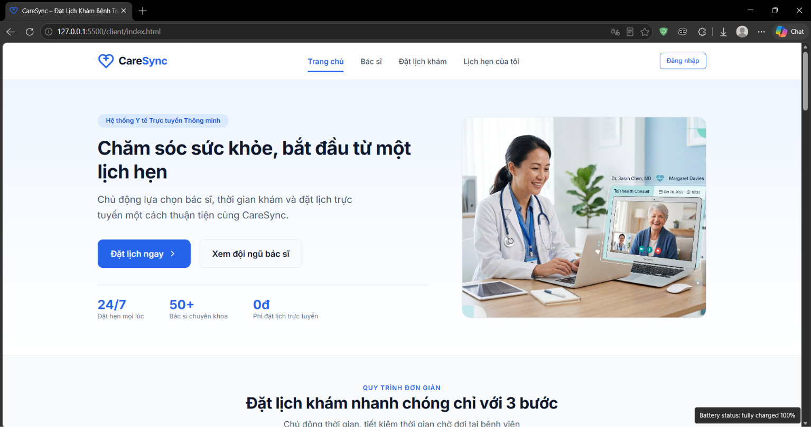
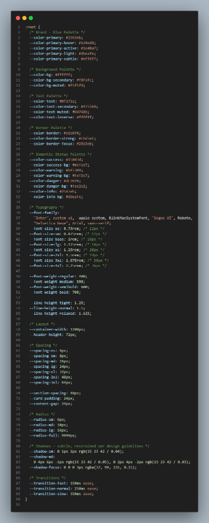
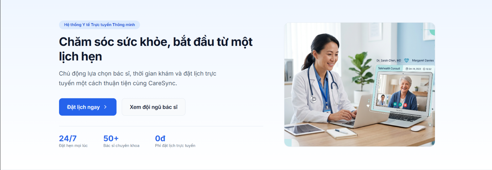
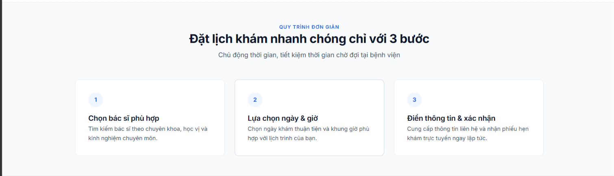
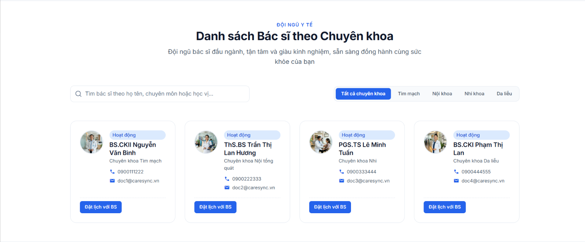
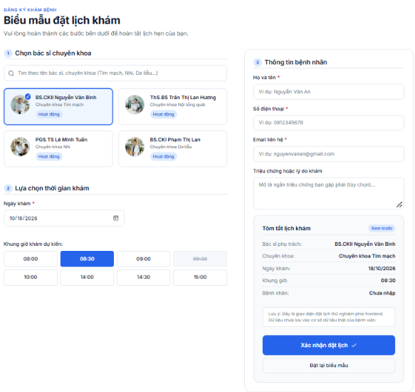
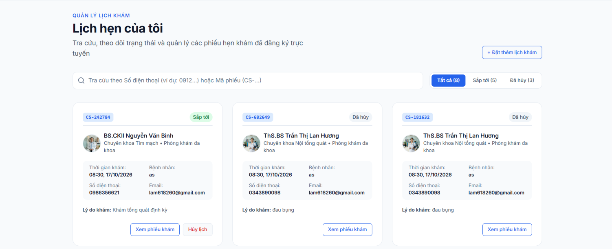
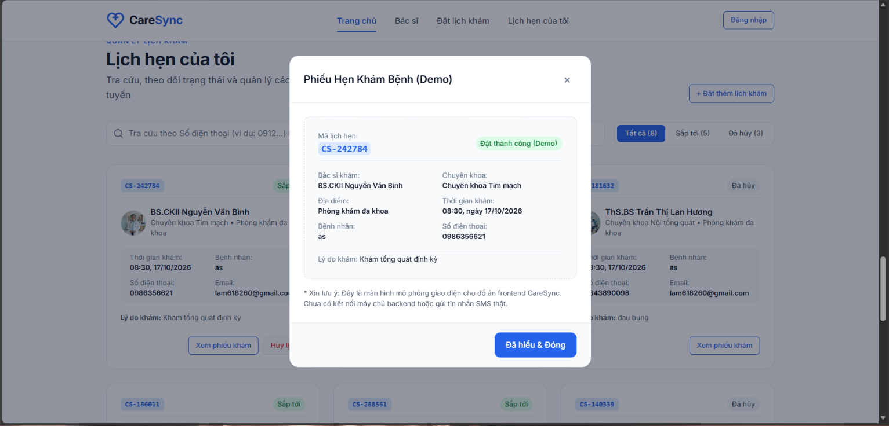
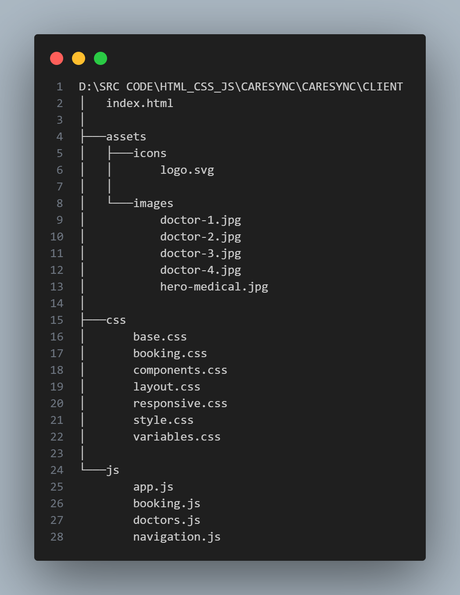

# Báo cáo Xây dựng Giao diện Mẫu (UI/UX Prototype) - CareSync

> **Họ và tên:** Bùi Anh Khôi  
> **MSSV:** 24110258  
> **Tuần thực hiện:** Tuần 2

---

## Mục lục

- [Báo cáo Xây dựng Giao diện Mẫu (UI/UX Prototype) - CareSync](#báo-cáo-xây-dựng-giao-diện-mẫu-uiux-prototype---caresync)
  - [Mục lục](#mục-lục)
  - [1. Mục tiêu và Định hướng Thiết kế](#1-mục-tiêu-và-định-hướng-thiết-kế)
  - [2. Hệ thống Quy chuẩn Thiết kế](#2-hệ-thống-quy-chuẩn-thiết-kế)
  - [3. Các Phân hệ Giao diện Chính](#3-các-phân-hệ-giao-diện-chính)
  - [4. Cấu trúc Mã nguồn Frontend](#4-cấu-trúc-mã-nguồn-frontend)

---

## 1. Mục tiêu và Định hướng Thiết kế

- Xây dựng giao diện web nguyên mẫu hoàn chỉnh cho hệ thống đặt lịch khám bệnh CareSync.
- Đảm bảo tính trực quan, hiện đại, tối ưu trải nghiệm đặt lịch nhanh chóng cho bệnh nhân trên cả máy tính lẫn thiết bị di động.

---

## 2. Hệ thống Quy chuẩn Thiết kế

- **Bảng màu:**
  - Màu thương hiệu chính: Xanh y tế (`#0D6EFD`), tạo cảm giác tin cậy và chuyên nghiệp.
  - Màu nền và thẻ: Trắng kết hợp tone xám nhẹ (`#F8FAFC`).
  - Màu cảnh báo/thông báo: Xanh lá (thành công), Đỏ (lỗi), Vàng (cảnh báo).
- **Typography & Icon:** Sử dụng font `Inter` hiện đại kết hợp bộ icon `Material Symbols Rounded`.
- **Hiệu ứng & Bo góc:** Bo tròn góc các thẻ từ 8px - 16px, hiệu ứng hover mượt mà và bóng đổ tinh tế.

---

## 3. Các Phân hệ Giao diện Chính

- **Thanh điều hướng:** Định vị thương hiệu, điều hướng nhanh các khu vực trên trang và menu mobile.

- **Khu vực Giới thiệu:** Thông điệp cốt lõi và nút gọi hành động đặt lịch nhanh.

-**Hướng dẫn sử dụng:** Quy trình các bước để đặt lịch khám bệnh.

- **Danh mục Bác sĩ:** Bộ lọc theo chuyên khoa, thẻ thông tin bác sĩ chi tiết.

- **Form Đặt lịch khám:** Trực quan hóa quy trình chọn bác sĩ, ngày giờ và điền thông tin bệnh nhân.

- **Lịch hẹn của tôi:** Theo dõi trạng thái lịch hẹn đã đặt.

- **Tương tác:** Phản hồi tức thì thao tác người dùng.

---

## 4. Cấu trúc Mã nguồn Frontend

- Cấu trúc thư mục CSS dạng module (`variables.css`, `base.css`, `components.css`, `booking.css`, `responsive.css`).
- Tách biệt logic JavaScript (`navigation.js`, `doctors.js`, `booking.js`, `app.js`).

