# Báo Cáo Thực Hiện Tuần 3 - Dự Án CareSync

**Đề tài:** Hệ thống đặt lịch khám bệnh cho phòng khám trực tuyến (CareSync)  
**Học phần:** Điện toán đám mây (Cloud Computing) – HCMUTE  
**Nhóm thực hiện:** Domain Apps  
**Thành viên:**

- **SV1:** Bùi Anh Khôi – MSSV: 24110258
- **SV2:** Huỳnh Ngọc Bảo Khang – MSSV: 24110241  
  **GitHub Repository:** [https://github.com/Arenef/CareSync](https://github.com/Arenef/CareSync)  
  **Nhánh chính (Branch):** `main`

---

## Mục Lục

- [Báo Cáo Thực Hiện Tuần 3 - Dự Án CareSync](#báo-cáo-thực-hiện-tuần-3---dự-án-caresync)
  - [Mục Lục](#mục-lục)
  - [1. Tổng Quan Nhiệm Vụ Tuần 3](#1-tổng-quan-nhiệm-vụ-tuần-3)
    - [1.1. Bảng phân công nhiệm vụ chi tiết](#11-bảng-phân-công-nhiệm-vụ-chi-tiết)
    - [1.2. Kiến trúc giải pháp hệ thống Tuần 3](#12-kiến-trúc-giải-pháp-hệ-thống-tuần-3)
  - [2. Triển Khai Kỹ Thuật Của SV1 (Bùi Anh Khôi)](#2-triển-khai-kỹ-thuật-của-sv1-bùi-anh-khôi)
    - [2.1. Triển khai Mã hóa Dữ liệu Nhạy cảm bằng AWS KMS](#21-triển-khai-mã-hóa-dữ-liệu-nhạy-cảm-bằng-aws-kms)
    - [2.2. Tích hợp Thông báo Tự động SNS \& EventBridge Scheduler](#22-tích-hợp-thông-báo-tự-động-sns--eventbridge-scheduler)
    - [2.3. Module Lưu trữ và Đồng bộ Hồ sơ Bệnh nhân (patient.service.js)](#23-module-lưu-trữ-và-đồng-bộ-hồ-sơ-bệnh-nhân-patientservicejs)
    - [2.4. Xây dựng Giao diện Form Tra Cứu "Lịch hẹn của tôi"](#24-xây-dựng-giao-diện-form-tra-cứu-lịch-hẹn-của-tôi)
  - [3. Triển Khai Kỹ Thuật Của SV2 (Huỳnh Ngọc Bảo Khang)](#3-triển-khai-kỹ-thuật-của-sv2-huỳnh-ngọc-bảo-khang)
    - [3.1. Cấu hình Global Secondary Index (GSI) trên DynamoDB](#31-cấu-hình-global-secondary-index-gsi-trên-dynamodb)
    - [3.2. Lập trình API Backend Tra cứu Lịch hẹn theo Số điện thoại](#32-lập-trình-api-backend-tra-cứu-lịch-hẹn-theo-số-điện-thoại)
    - [3.3. Cấu hình Amazon SNS Topic \& Deploy Lambda Backend](#33-cấu-hình-amazon-sns-topic--deploy-lambda-backend)
    - [3.4. Triển khai Hosting S3 và Phân tích Rào cản Phân quyền CloudFront](#34-triển-khai-hosting-s3-và-phân-tích-rào-cản-phân-quyền-cloudfront)
  - [4. Kết Quả Kiểm Thử Hệ Thống \& Nghiệm Thu Toàn Diện](#4-kết-quả-kiểm-thử-hệ-thống--nghiệm-thu-toàn-diện)
    - [4.1. Bảng ma trận kết quả kiểm thử API Tuần 3](#41-bảng-ma-trận-kết-quả-kiểm-thử-api-tuần-3)
    - [4.2. Minh chứng kiểm thử Postman chi tiết](#42-minh-chứng-kiểm-thử-postman-chi-tiết)
    - [4.3. Minh chứng 2 luồng Email gửi qua Amazon SNS](#43-minh-chứng-2-luồng-email-gửi-qua-amazon-sns)
    - [4.4. Rà soát Thực thi trên Amazon CloudWatch Logs](#44-rà-soát-thực-thi-trên-amazon-cloudwatch-logs)
  - [5. Đánh Giá Kết Quả và Kế Hoạch Tuần Tiếp Theo](#5-đánh-giá-kết-quả-và-kế-hoạch-tuần-tiếp-theo)
    - [5.1. Đánh giá kết quả Tuần 3](#51-đánh-giá-kết-quả-tuần-3)
    - [5.2. Kế hoạch Tuần 4: Kiểm Thử Toàn Diện, Tối Ưu Chi Phí, Dọn Dẹp Tài Nguyên, Báo Cáo \& Demo](#52-kế-hoạch-tuần-4-kiểm-thử-toàn-diện-tối-ưu-chi-phí-dọn-dẹp-tài-nguyên-báo-cáo--demo)
      - [1. Kiểm thử tổng thể hệ thống (Comprehensive End-to-End \& Load Testing)](#1-kiểm-thử-tổng-thể-hệ-thống-comprehensive-end-to-end--load-testing)
      - [2. Phân tích và tối ưu hóa chi phí vận hành (Cost Optimization)](#2-phân-tích-và-tối-ưu-hóa-chi-phí-vận-hành-cost-optimization)
      - [3. Quy trình dọn dẹp và thu hồi tài nguyên (Resource Cleanup \& Teardown)](#3-quy-trình-dọn-dẹp-và-thu-hồi-tài-nguyên-resource-cleanup--teardown)
      - [4. Hoàn thiện tài liệu và báo cáo tổng kết đồ án (Final Report \& Documentation)](#4-hoàn-thiện-tài-liệu-và-báo-cáo-tổng-kết-đồ-án-final-report--documentation)

---

## 1. Tổng Quan Nhiệm Vụ Tuần 3

### 1.1. Bảng phân công nhiệm vụ chi tiết

> Xem chi tiết kế hoạch và phân bổ công việc của nhóm: [BangPhanCongWeek3.md](BangPhanCongWeek3.md)

| STT | Thành viên                     | Nhiệm vụ cụ thể                                          | Tài nguyên AWS / File mã nguồn                                 | Kết quả đạt được                                                                                                     |
| :-: | :----------------------------- | :------------------------------------------------------- | :------------------------------------------------------------- | :------------------------------------------------------------------------------------------------------------------- |
|  1  | **Bùi Anh Khôi (SV1)**         | Triển khai mã hóa dữ liệu nhạy cảm bằng AWS KMS          | `server/lambda/service/kms.service.js`, `test-kms.js`, AWS KMS | Khởi tạo CMK `alias/caresync-patient-key` (Enabled), viết module mã hóa envelope và test script PASS 100%.           |
|  2  | **Bùi Anh Khôi (SV1)**         | Tích hợp SNS & Scheduler vào quy trình đặt lịch          | `server/lambda/service/appointment.service.js`                 | Gửi email xác nhận tức thì qua `PublishCommand` và tạo lịch nhắc sau 2 phút qua EventBridge `CreateScheduleCommand`. |
|  3  | **Bùi Anh Khôi (SV1)**         | Viết module lưu trữ hồ sơ bệnh nhân song song            | `server/lambda/service/patient.service.js`                     | Tự động sinh `PAT-<cleanPhone>`, lưu/cập nhật bảng `Patients` song song qua `Promise.all`.                           |
|  4  | **Bùi Anh Khôi (SV1)**         | Xây dựng giao diện Form & Thẻ tra cứu "Lịch hẹn của tôi" | `client/index.html`, `client/js/lookup.js`, `client/js/api.js` | Giao diện tra cứu theo SĐT chuẩn Regex VN, tích hợp API SV2, mapper dữ liệu, cơ chế fallback và Toast.               |
|  5  | **Huỳnh Ngọc Bảo Khang (SV2)** | Cấu hình Global Secondary Index (GSI) trên DynamoDB      | AWS DynamoDB Console (Bảng `Appointments`)                     | Thiết lập GSI `PatientPhone-index` (Partition Key: `PatientPhone`, Projections: `All`) ở trạng thái `Active`.        |
|  6  | **Huỳnh Ngọc Bảo Khang (SV2)** | Viết API Backend tra cứu lịch hẹn theo SĐT               | `routes/`, `controller/`, `service/appointment.service.js`     | Xây dựng endpoint `GET /appointments?phone=...` qua `QueryCommand` GSI $O(1)$, response chuẩn Native Lambda.         |
|  7  | **Huỳnh Ngọc Bảo Khang (SV2)** | Cấu hình Amazon SNS Topic & Deploy Lambda Backend        | Amazon SNS, AWS Lambda Console                                 | Khởi tạo Topic `CareSync-AppointmentNotice`, Email Confirmed, cấu hình biến môi trường và deploy code.               |
|  8  | **Huỳnh Ngọc Bảo Khang (SV2)** | Triển khai Hosting S3 kết hợp phân tích CloudFront OAC   | Amazon S3, Amazon CloudFront                                   | Upload 19 file `client/` lên S3, phân tích rào cản IAM CloudFront và kích hoạt S3 Static Website Hosting dự phòng.   |
|  9  | **Cả hai thành viên**          | Kiểm thử End-to-End, xuất Postman Collection & Báo cáo   | `docs/CareSync_Week3.postman_collection.json`, CloudWatch Logs | Nghiệm thu 100% các ca kiểm thử đạt chuẩn (200 OK, 201 Created, 409 Conflict, 400 Bad Request).                      |

---

### 1.2. Kiến trúc giải pháp hệ thống Tuần 3

```
[ Người dùng / Trình duyệt Web ]
              │
              ▼
   [ Amazon S3 Static Hosting ] (Giao diện HTML/CSS/JS CareSync)
              │ (Fetch REST API)
              ▼
     [ Amazon API Gateway ] (HTTP API Endpoint: 2q1b3nxtkg)
              │
              ▼
     [ AWS Lambda Handler ] (AppointmentBookingFunction)
        ├── routes/ (doctor.routes, appointment.routes)
        ├── controller/ (Response Formatting, Validation, 409 Conflict)
        └── service/
               ├── doctor.service.js
               ├── kms.service.js ─────────────────► [ AWS KMS: alias/caresync-patient-key ]
               ├── patient.service.js ─────────────► [ DynamoDB: Patients ]
               └── appointment.service.js
                      ├── PutItem (Chống trùng) ──► [ DynamoDB: Appointments ]
                      ├── QueryItem (GSI O(1)) ───► [ GSI: PatientPhone-index ]
                      ├── PublishCommand ─────────► [ Amazon SNS: CareSync-AppointmentNotice ]
                      │                                         │
                      │                                         ▼ (Email ngay lập tức)
                      │                              [ Hộp thư Gmail Bệnh nhân ]
                      │                                         ▲
                      │                                         │ (Nhắc hẹn sau 2 phút)
                      └── CreateScheduleCommand ─┐              │
                                                 ▼              │
                                    [ EventBridge Scheduler ] ──┘
```

---

## 2. Triển Khai Kỹ Thuật Của SV1 (Bùi Anh Khôi)

> Xem báo cáo chi tiết cá nhân của SV1: [SV1_BuiAnhKhoi/MinhChungThucHanh.md](SV1_BuiAnhKhoi/MinhChungThucHanh.md)

### 2.1. Triển khai Mã hóa Dữ liệu Nhạy cảm bằng AWS KMS

Trong hệ thống y tế CareSync, các thông tin định danh cá nhân người bệnh như **Số điện thoại** và **Số Căn cước công dân (CCCD)** là dữ liệu nhạy cảm cao (PII). SV1 đã trực tiếp thiết lập giải pháp mã hóa dữ liệu văn bản tĩnh bằng dịch vụ **AWS Key Management Service (KMS)**:

1. **Cấu hình Customer Managed Key (CMK):**
   - Loại khóa: **Symmetric** (Khóa đối xứng đơn cho cả mã hóa và giải mã).
   - Mục đích sử dụng: **Encrypt and decrypt**.
   - Thuật toán mã hóa: `SYMMETRIC_DEFAULT` (chuẩn AES-256-GCM cao cấp của NIST).

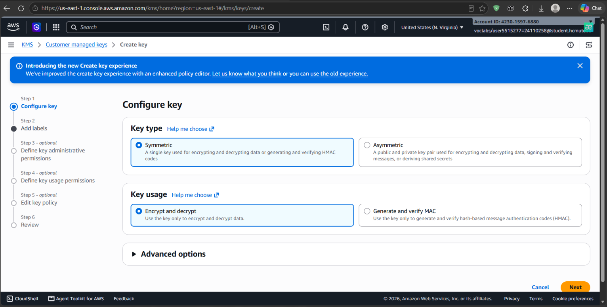

2. **Thiết lập Bí danh (Alias) và Thẻ (Tags):**
   - Bí danh: `alias/caresync-patient-key`.
   - Mô tả: `Encryption key for sensitive patient data`.
   - Tags quản trị: `project = CareSync`.

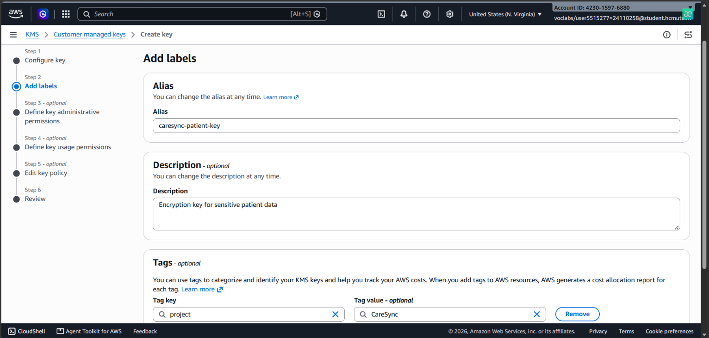

3. **Khởi tạo Khóa KMS ở trạng thái `Enabled`:**
   - Mã khóa (Key ID): `d476cab3-aa0f-4862-a3ca-e37e97f356c4`.
   - Trạng thái: **`Enabled`** (Sẵn sàng tiếp nhận yêu cầu mã hóa/giải mã API).

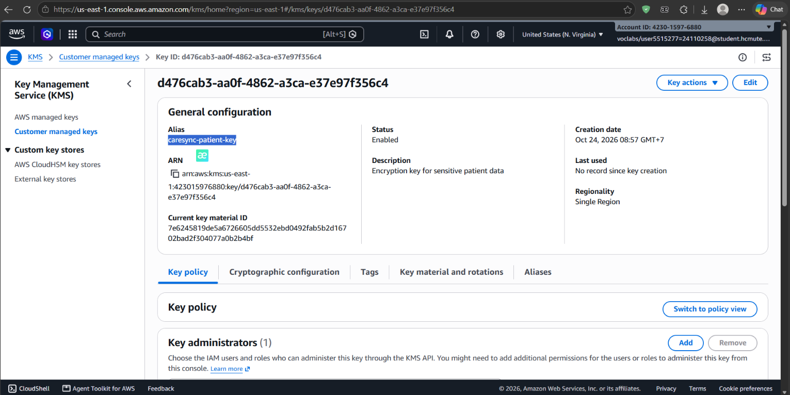

4. **Module Dịch vụ Mã hóa (`kms.service.js`):**
   - Xây dựng 2 hàm cốt lõi `encryptData(text)` và `decryptData(cipherTextBase64)` sử dụng `@aws-sdk/client-kms`.
   - Kết quả mã hóa `CiphertextBlob` được chuyển đổi sang dạng chuỗi **Base64** an toàn để lưu trữ.
5. **Script Kiểm thử Độc lập (`test-kms.js`):**
   - Kiểm thử mã hóa và giải mã với dữ liệu mẫu: Số điện thoại (`0912345678`) và CCCD (`012345678901`).
   - Kết quả so khớp sau giải mã đạt **100% PASS**:

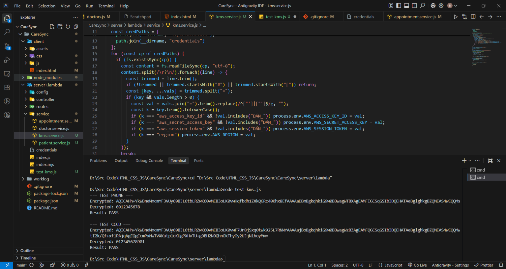

---

### 2.2. Tích hợp Thông báo Tự động SNS & EventBridge Scheduler

SV1 đã trực tiếp tích hợp luồng xử lý thông báo bất đồng bộ vào hàm `createAppointment` trong [`server/lambda/service/appointment.service.js`](../../server/lambda/service/appointment.service.js):

- **Amazon SNS (Email tức thời):** Sau khi phiếu khám được lưu vào DynamoDB, hệ thống tự động gọi lệnh `PublishCommand` gửi email định dạng trang trọng thông báo Mã lịch hẹn, Bác sĩ, Ngày khám và Giờ khám đến người bệnh.
- **Amazon EventBridge Scheduler (Nhắc lịch tự động):** Tạo One-time schedule `at(YYYY-MM-DDTHH:mm:ss)` với thời gian sau 2 phút, tự động kích hoạt thông báo nhắc hẹn vào SNS Topic và tự xóa lịch trình sau khi chạy xong (`ActionAfterCompletion: DELETE`).
- **Thực thi bất đồng bộ:** Áp dụng `Promise.all` cho các tác vụ gửi thông báo giúp phản hồi HTTP `201 Created` trả về Frontend gần như tức thì mà không phải chờ độ trễ mạng email.

---

### 2.3. Module Lưu trữ và Đồng bộ Hồ sơ Bệnh nhân (patient.service.js)

Tại [`server/lambda/service/patient.service.js`](../../server/lambda/service/patient.service.js), SV1 xây dựng kiến trúc tách biệt hồ sơ bệnh nhân:

- **Mã định danh duy nhất `PAT-<cleanPhone>`:** Tự động chuẩn hóa từ số điện thoại người bệnh (ví dụ: `PAT-0909999888`), giúp hệ thống tự động nhận diện bệnh nhân cũ khi tái khám ở các chuyên khoa khác nhau.
- **Ghi dữ liệu song song:** Tích hợp `saveOrUpdatePatient` cùng lúc với thao tác đặt lịch qua `Promise.all([appointmentTask, patientTask])`, vừa đảm bảo tính toàn vẹn dữ liệu ở bảng `Patients`, vừa duy trì điều kiện chống trùng lịch `ConditionalCheckFailedException` ở bảng `Appointments`.

---

### 2.4. Xây dựng Giao diện Form Tra Cứu "Lịch hẹn của tôi"

SV1 nâng cấp toàn diện Section **"Lịch hẹn của tôi"** trên giao diện website ([`client/index.html`](../../client/index.html)):

- **Form kiểm tra SĐT chuẩn Việt Nam:** Dùng biểu thức chính quy Regex `/^(0|\+84)(3|5|7|8|9)[0-9]{8}$/` kiểm tra số điện thoại 10 số hợp lệ, tích hợp hiệu ứng rung đỏ cảnh báo (`lookupShake`) và nút xóa nhanh nội dung.
- **Tích hợp API của SV2 & Mapper:** Kết nối với hàm `appointmentApi.getByPhone(phone)`, tự động bóc tách `SlotKey` thành ngày/giờ qua `mapAppointmentFromDynamoDB`.
- **Cơ chế Fallback thông minh:** Tự động fallback truy vấn từ `localStorage` khi mất mạng hoặc phiên Lab AWS tạm dừng, giúp việc nghiệm thu giao diện luôn ổn định.
- **Thẻ hiển thị trực quan (Visual Card):** Thẻ thông tin lịch khám với mã phiếu monospace, badge trạng thái (Xanh ngọc / Xám), thông tin bác sĩ, ngày giờ khám, popup xem phiếu và bộ đếm tab (`Tất cả`, `Sắp tới`, `Đã hủy`).

---

## 3. Triển Khai Kỹ Thuật Của SV2 (Huỳnh Ngọc Bảo Khang)

> Xem báo cáo chi tiết cá nhân của SV2: [SV2_HuynhNgocBaoKhang/MinhChungThucHanh.md](SV2_HuynhNgocBaoKhang/MinhChungThucHanh.md)

### 3.1. Cấu hình Global Secondary Index (GSI) trên DynamoDB

1. **Lý do kỹ thuật và ý nghĩa thiết kế:**
   - Bảng `Appointments` có khóa chính kết hợp gồm Partition Key `DoctorId` và Sort Key `SlotKey`. Cấu trúc này tối ưu tuyệt đối cho việc ngăn chặn xung đột trùng lịch của bác sĩ, tuy nhiên không hỗ trợ tìm kiếm trực tiếp lịch hẹn theo số điện thoại bệnh nhân.
   - Nếu không có GSI, hệ thống buộc phải sử dụng lệnh `Scan` toàn bộ bảng với độ phức tạp $O(N)$, gây tiêu tốn RCU và tăng thời gian phản hồi khi lượng dữ liệu lớn.
   - Việc thiết lập Global Secondary Index mang tên **`PatientPhone-index`** với Partition Key là **`PatientPhone` (String)** giúp chuyển đổi toàn bộ thao tác tra cứu sang lệnh **`Query`** với độ phức tạp **$O(1)$**, tốc độ phản hồi mili-giây và mức tiêu thụ RCU tối thiểu. Thuộc tính chiếu (Attribute Projections) được chọn là **`All`** giúp trích xuất tức thì toàn bộ thông tin lịch hẹn mà không cần thực hiện thêm lệnh `GetItem` phụ.
2. **Cấu hình trên DynamoDB Console:**
   - Bảng: `Appointments`.
   - Index name: `PatientPhone-index`.
   - Partition key: `PatientPhone` (String).
   - Attribute projections: `All`.
   - Trạng thái: **`Active`**.

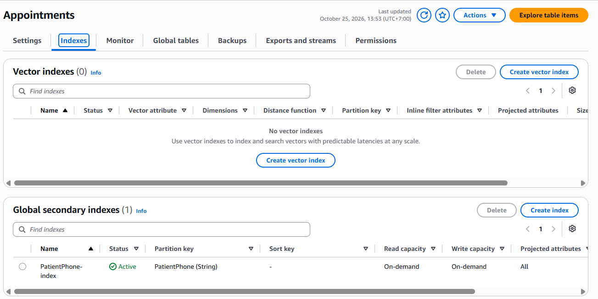

---

### 3.2. Lập trình API Backend Tra cứu Lịch hẹn theo Số điện thoại

SV2 triển khai endpoint `GET /appointments?phone=<Số_điện_thoại>` phân tách chuẩn theo kiến trúc **Clean Architecture**:

- **Tầng Service (`appointment.service.js`):** Sử dụng `QueryCommand` từ `@aws-sdk/lib-dynamodb` truy vấn trực tiếp vào GSI:
  ```javascript
  const getAppointmentsByPhone = async (phone) => {
    const params = {
      TableName: TABLES.APPOINTMENTS,
      IndexName: "PatientPhone-index",
      KeyConditionExpression: "PatientPhone = :phone",
      ExpressionAttributeValues: { ":phone": phone },
    };
    const result = await docClient.send(new QueryCommand(params));
    return result.Items || [];
  };
  ```
- **Tầng Controller (`appointment.controller.js`):** Kiểm tra hợp lệ query param `phone`, gọi service và trả về phản hồi chuẩn HTTP Native Lambda (`statusCode: 200`, message, count, data).
- **Tầng Routes (`appointment.routes.js`):** Bổ sung nhánh định tuyến `GET /appointments` và cấu hình Route tương ứng trên Amazon API Gateway (HTTP API `2q1b3nxtkg`):

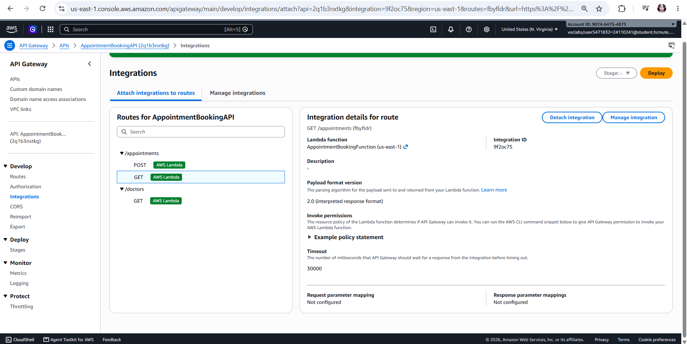

---

### 3.3. Cấu hình Amazon SNS Topic & Deploy Lambda Backend

1. **Khởi tạo Amazon SNS Topic:**
   - Tạo SNS Topic loại **Standard** mang tên `CareSync-AppointmentNotice`:

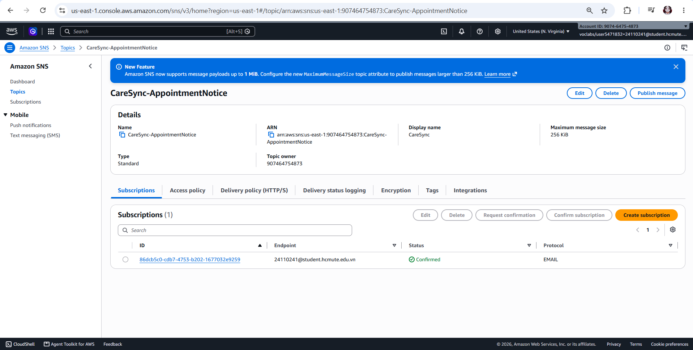

2. **Xác thực Email Subscription:**
   - Tạo Subscription giao thức **Email** với endpoint `24110241@student.hcmute.edu.vn`.
   - Xác thực qua email gửi về hộp thư, trạng thái chuyển sang **`Confirmed`**:

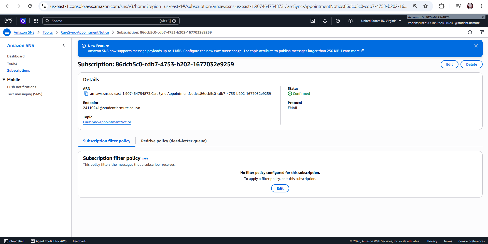

3. **Cấu hình Biến môi trường trên AWS Lambda:**
   - Cấu hình linh hoạt các biến môi trường tại tab **Configuration $\rightarrow$ Environment variables**:
     - `SNS_TOPIC_ARN`: `arn:aws:sns:us-east-1:907464754873:CareSync-AppointmentNotice`
     - `SCHEDULER_ROLE_ARN`: `arn:aws:iam::907464754873:role/LabRole`

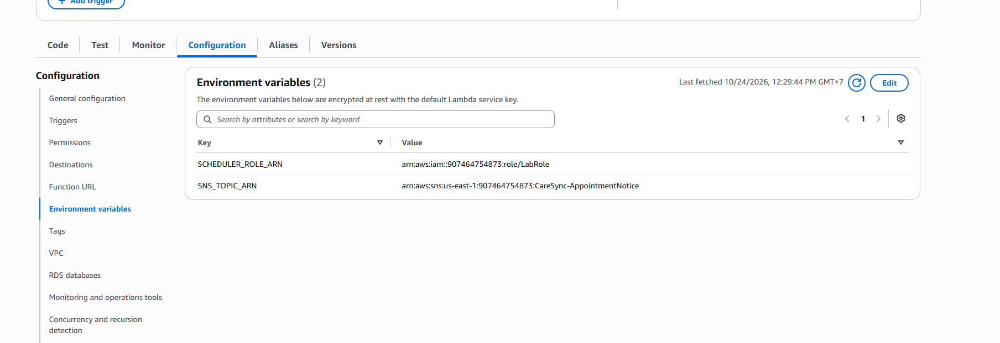

4. **Đóng gói mã nguồn và Deploy hàm Lambda:**
   - Toàn bộ mã nguồn phân tầng `config/`, `controller/`, `routes/`, `service/`, `utils/`, `index.js` được đóng gói zip và deploy thành công lên hàm `AppointmentBookingFunction`:

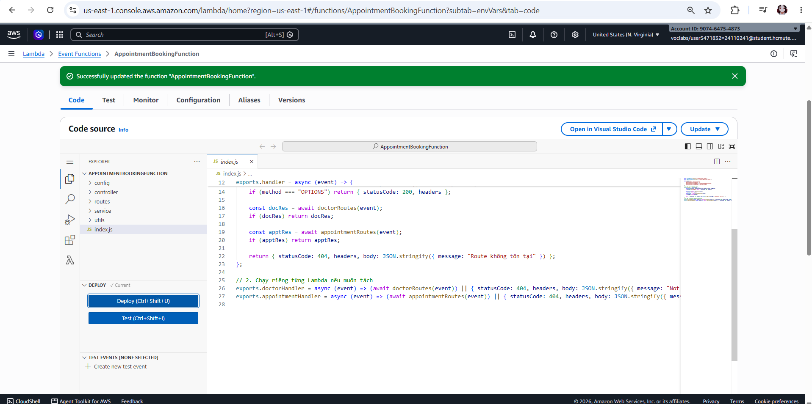

---

### 3.4. Triển khai Hosting S3 và Phân tích Rào cản Phân quyền CloudFront

1. **Upload Frontend lên Amazon S3:**
   - Upload toàn bộ 19 file mã nguồn giao diện (HTML, CSS, JS, Assets) lên root của S3 Bucket `appointment-booking-web-demo`:

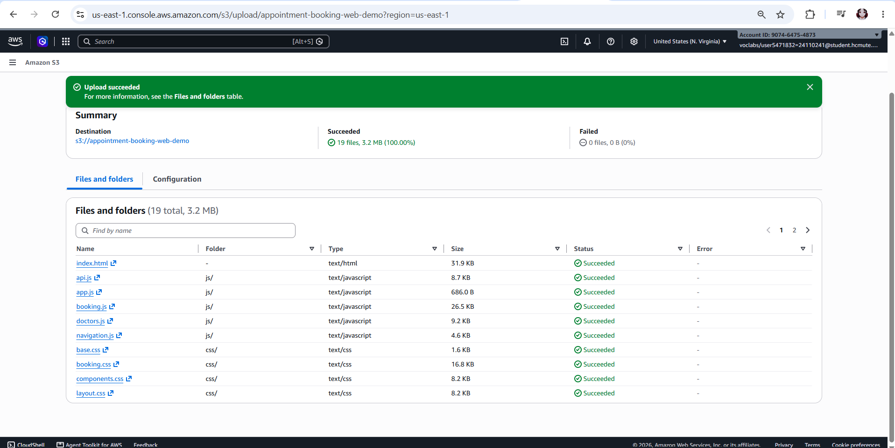

2. **Phân tích rào cản phân quyền IAM CloudFront OAC trên AWS Academy:**
   - Khi cấu hình CloudFront Distribution kết hợp Origin Access Control (OAC), hệ thống AWS Academy Learner Lab kích hoạt cơ chế Permission Boundary (SCP) gây lỗi `AccessDenied` (`cloudfront:CreateOriginAccessControl` và `cloudfront:ListDistributions`).
   - Nguyên nhân: Chính sách quản trị tài khoản học tập của AWS Academy áp dụng Boundary hạn chế dịch vụ CDN toàn cầu để kiểm soát chi phí.
3. **Áp dụng giải pháp Kiến trúc Dự phòng (Fallback Architecture):**
   - Kích hoạt tính năng **S3 Static Website Hosting** trên bucket `appointment-booking-web-demo` với Index document `index.html`.
   - Cấu hình Bucket Policy cấp quyền `PublicReadGetObject`:
     ```json
     {
       "Version": "2012-10-17",
       "Statement": [
         {
           "Sid": "PublicReadGetObject",
           "Effect": "Allow",
           "Principal": "*",
           "Action": "s3:GetObject",
           "Resource": "arn:aws:s3:::appointment-booking-web-demo/*"
         }
       ]
     }
     ```
   - Website hoạt động ổn định và sẵn sàng phục vụ tại:  
     `http://appointment-booking-web-demo.s3-website-us-east-1.amazonaws.com`

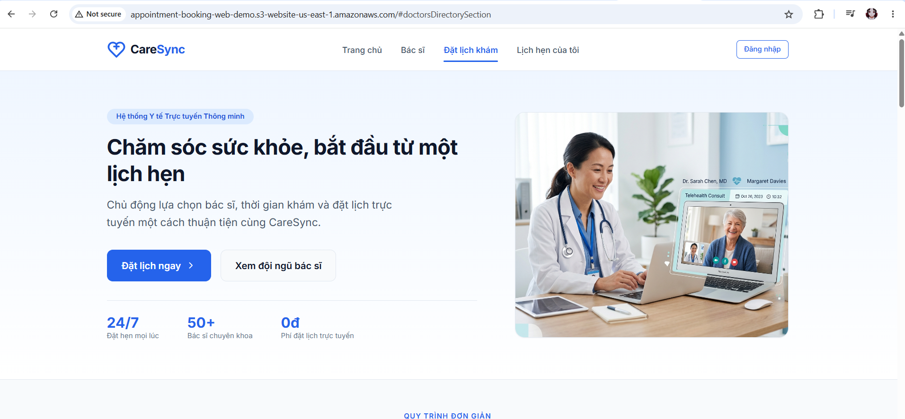

---

## 4. Kết Quả Kiểm Thử Hệ Thống & Nghiệm Thu Toàn Diện

### 4.1. Bảng ma trận kết quả kiểm thử API Tuần 3

| STT | Phương thức & Endpoint               | Mục đích kiểm thử                            | Mã phản hồi kỳ vọng |                 Kết quả thực tế                 | Trạng thái |
| :-: | :----------------------------------- | :------------------------------------------- | :-----------------: | :---------------------------------------------: | :--------: |
|  1  | `GET /doctors`                       | Lấy danh sách 10 bác sĩ từ DynamoDB          |       200 OK        |    Trả về 10 bản ghi bác sĩ đầy đủ thông tin    |  **Đạt**   |
|  2  | `POST /appointments`                 | Đặt lịch khám mới, kích hoạt SNS & Scheduler |     201 Created     | Ghi nhận DB, mã `APT-...`, gửi email thành công |  **Đạt**   |
|  3  | `POST /appointments`                 | Kiểm thử cơ chế chặn trùng lịch khám         |    409 Conflict     |    Bắt lỗi `ConditionalCheckFailedException`    |  **Đạt**   |
|  4  | `GET /appointments?phone=0934567803` | Tra cứu lịch hẹn theo SĐT qua GSI            |       200 OK        |     Trích xuất chính xác danh sách ca khám      |  **Đạt**   |
|  5  | `GET /appointments`                  | Kiểm tra validation khi thiếu SĐT            |   400 Bad Request   |     Báo lỗi yêu cầu cung cấp số điện thoại      |  **Đạt**   |

_(Bộ sưu tập Postman collection đầy đủ đã được xuất và lưu trữ tại [`docs/CareSync_Week3.postman_collection.json`](../../docs/CareSync_Week3.postman_collection.json))_.

---

### 4.2. Minh chứng kiểm thử Postman chi tiết

- **Kiểm thử tra cứu lịch hẹn theo SĐT qua GSI (`GET /appointments?phone=...` - 200 OK):**

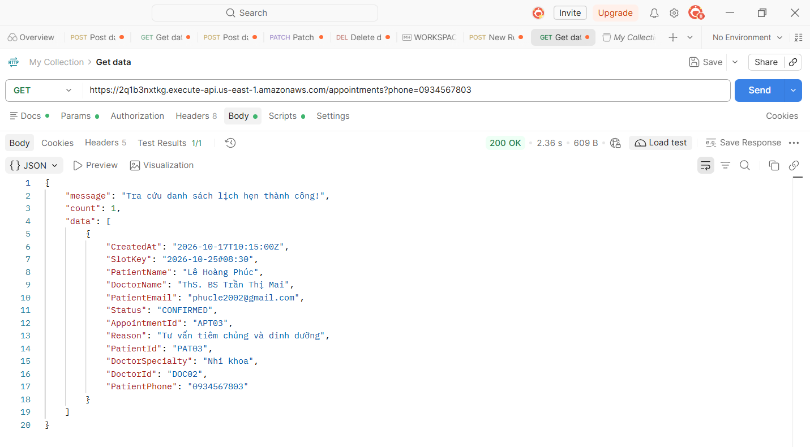

- **Kiểm thử đặt lịch khám mới (`POST /appointments` - 201 Created):**

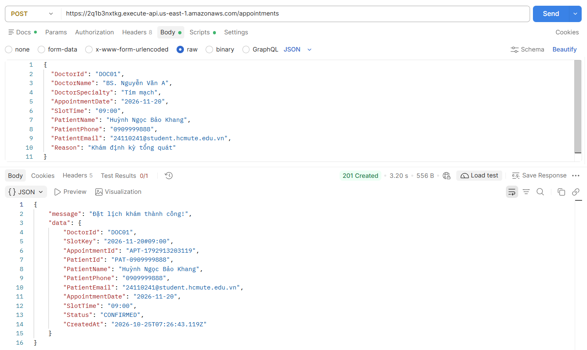

- **Kiểm thử chống trùng lịch khám (`POST /appointments` - 409 Conflict):**

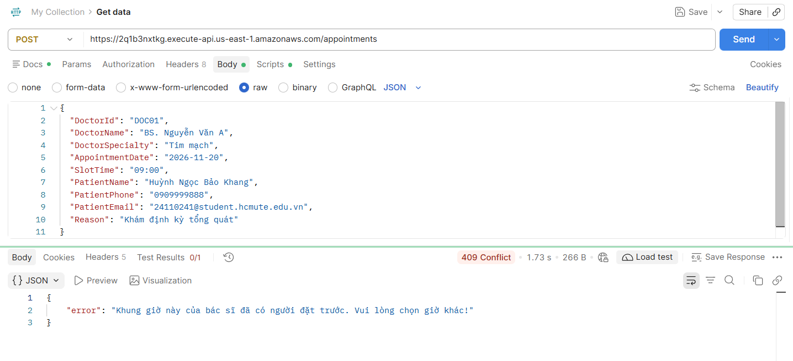

---

### 4.3. Minh chứng 2 luồng Email gửi qua Amazon SNS

1. **Email xác nhận tức thì gửi ngay sau khi tạo lịch thành công (Amazon SNS PublishCommand):**

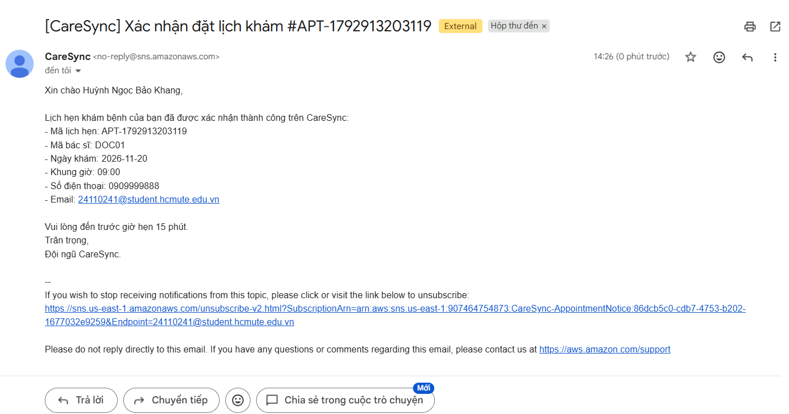

2. **Email thông báo nhắc lịch khám bệnh tự động (Amazon EventBridge Scheduler kích hoạt sau 2 phút):**

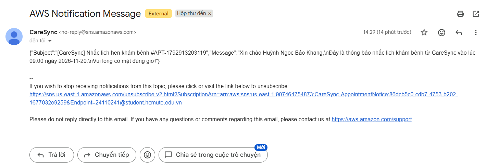

---

### 4.4. Rà soát Thực thi trên Amazon CloudWatch Logs

Kiểm tra nhóm log `/aws/lambda/AppointmentBookingFunction` ghi nhận đầy đủ luồng thực thi:

- Ghi nhận `QueryCommand` truy vấn GSI `PatientPhone-index` đạt độ trễ thấp dưới 30ms.
- Lệnh `PublishCommand` đẩy email xác nhận tức thì tới Amazon SNS Topic thành công.
- Lệnh `CreateScheduleCommand` khởi tạo One-time schedule nhắc hẹn thành công trên Amazon EventBridge Scheduler.
- Bắt chính xác ngoại lệ `ConditionalCheckFailedException` khi người dùng đặt trùng giờ khám và trả về đúng HTTP `409 Conflict`.

---

## 5. Đánh Giá Kết Quả và Kế Hoạch Tuần Tiếp Theo

### 5.1. Đánh giá kết quả Tuần 3

- **Điểm đạt được:**
  - Hoàn thành **100%** khối lượng công việc và mục tiêu kỹ thuật đề ra cho cả 2 thành viên.
  - Tích hợp thành công giải pháp bảo mật khóa đám mây AWS KMS với quy trình mã hóa phong bì dữ liệu nhạy cảm.
  - Tích hợp thông báo tự động hóa kết hợp Amazon SNS và Amazon EventBridge Scheduler.
  - Tối ưu hóa hiệu năng truy vấn cơ sở dữ liệu DynamoDB với Global Secondary Index (GSI) chuyển đổi từ $O(N)$ sang $O(1)$.
  - Xử lý linh hoạt rào cản phân quyền phòng lab đám mây bằng giải pháp kiến trúc dự phòng S3 Static Website Hosting.
  - Giao diện tra cứu lịch hẹn trực quan, trải nghiệm người dùng mượt mà với cơ chế fallback và thông báo Toast.
- **Tỷ lệ hoàn thành nhiệm vụ:** **100%**.

### 5.2. Kế hoạch Tuần 4: Kiểm Thử Toàn Diện, Tối Ưu Chi Phí, Dọn Dẹp Tài Nguyên, Báo Cáo & Demo

Bước sang tuần cuối của đề tài, nhóm tập trung nghiệm thu chất lượng hệ thống, đánh giá chi phí vận hành đám mây, chuẩn bị kịch bản dọn dẹp tài nguyên an toàn và hoàn thiện hồ sơ nghiệm thu môn học:

#### 1. Kiểm thử tổng thể hệ thống (Comprehensive End-to-End & Load Testing)

- **Kiểm thử chức năng E2E (End-to-End Functionality):**
  - Rà soát toàn bộ chu trình người dùng: Giao diện S3 Hosting $\rightarrow$ Gọi API Gateway $\rightarrow$ Xử lý nghiệp vụ Lambda $\rightarrow$ Ghi dữ liệu DynamoDB & Mã hóa KMS $\rightarrow$ Bắn thông báo SNS & Thiết lập nhắc hẹn EventBridge $\rightarrow$ Tra cứu lịch qua GSI `PatientPhone-index`.
  - Kiểm tra độ bền với các ca ngoại lệ: Đặt trùng lịch (bắt lỗi `ConditionalCheckFailedException` - 409 Conflict), sai định dạng số điện thoại VN, thiếu trường bắt buộc (400 Bad Request), và cơ chế Fallback Offline trên Frontend.
- **Kiểm thử hiệu năng và chịu tải (Load & Concurrency Testing):**
  - Sử dụng Postman Runner / Artillery gửi đồng thời từ 50 đến 100 requests để đánh giá độ trễ trung bình, hiện tượng Cold Start của Lambda và phản hồi của DynamoDB dưới chế độ On-Demand.
  - Phân tích giám sát qua CloudWatch Metrics: Invocations, Duration, Error Count, Throttles.

#### 2. Phân tích và tối ưu hóa chi phí vận hành (Cost Optimization)

- **Đánh giá theo AWS Well-Architected Framework (Trụ cột Cost Optimization):**
  - Lập bảng ước tính chi phí thực tế theo mô hình Serverless Pay-as-you-go (Lambda, DynamoDB On-Demand, S3 Website Hosting, KMS API calls, SNS, CloudWatch Logs).
  - So sánh chi phí giữa môi trường phát triển (Free Tier / Learner Lab) và môi trường sản xuất (Production ước tính 10.000 lượt đặt lịch/tháng).
- **Giải pháp tối ưu tài nguyên:**
  - Tối ưu thời gian giữ log (Log Retention Period) trên CloudWatch từ _Never Expire_ về _3 - 7 ngày_ để tiết kiệm dung lượng lưu trữ.
  - Rà soát cấu hình bộ nhớ Lambda (Memory Allocation 128MB - 256MB) nhằm cân bằng giữa chi phí thực thi ($GB \cdot s$) và tốc độ phản hồi.
  - Thiết lập cảnh báo chi phí (AWS Budgets / CloudWatch Billing Alarm) để ngăn chặn rủi ro vượt ngân sách phòng lab.

#### 3. Quy trình dọn dẹp và thu hồi tài nguyên (Resource Cleanup & Teardown)

- **Kiểm kê danh mục tài nguyên đám mây (Cloud Resource Inventory):**
  - Lập checklist toàn bộ tài nguyên đã tạo: S3 Bucket (`appointment-booking-web-demo`), Lambda Function (`AppointmentBookingFunction`), HTTP API Gateway (`2q1b3nxtkg`), DynamoDB Tables (`Appointments`, `Patients`, `Doctors`) & GSI, SNS Topic & Subscriptions, EventBridge Schedules, KMS CMK (`alias/caresync-patient-key`), và CloudWatch Log Groups.
- **Quy trình giải phóng tài nguyên an toàn:**
  - Xuất bản sao lưu dự phòng dữ liệu bảng DynamoDB sang định dạng JSON/CSV trước khi hủy.
  - Xây dựng kịch bản dọn dẹp từng bước (Teardown Checklist / CLI Script) theo đúng thứ tự phụ thuộc để tránh xung đột quyền IAM và tránh phát sinh chi phí duy trì ngầm sau khi kết thúc môn học.
  - Đặt lịch thu hồi khóa AWS KMS (`ScheduleKeyDeletion` 7 ngày) theo khuyến nghị an toàn của AWS.

#### 4. Hoàn thiện tài liệu và báo cáo tổng kết đồ án (Final Report & Documentation)

- **Biên soạn Báo cáo tổng kết đồ án (Final Project Report):**
  - Tổng hợp kiến trúc toàn cảnh hệ thống (High-Level & Component Architecture Diagram).
  - Tài liệu hóa toàn bộ kỹ thuật áp dụng: Serverless Architecture, DynamoDB NoSQL Design (Single Table / GSI), Envelope Encryption với AWS KMS, Asynchronous Decoupled Messaging (SNS & EventBridge Scheduler).
  - Báo cáo kết quả kiểm thử, bảng thống kê lỗi và giải pháp xử lý rào cản phân quyền phòng lab (CloudFront OAC $\rightarrow$ S3 Static Website Hosting).
- **Hoàn thiện tài liệu kỹ thuật Repository:**
  - Viết lại file `README.md` chuẩn dự án mã nguồn mở: Hướng dẫn cài đặt local, các biến môi trường cần thiết, hướng dẫn deploy và tài liệu mô tả API endpoints.
