# Báo Cáo Thực Hiện Tuần 4 & Tổng Kết Đồ Án - Dự Án CareSync

**Đề tài:** Hệ thống đặt lịch khám bệnh cho phòng khám trực tuyến (CareSync)  
**Học phần:** Điện toán đám mây (Cloud Computing) – HCMUTE  
**Nhóm thực hiện:** Domain Apps  
**Thành viên:**

- **SV1:** Bùi Anh Khôi – MSSV: 24110258
- **SV2:** Huỳnh Ngọc Bảo Khang – MSSV: 24110241  
  **GitHub Repository:** [https://github.com/Arenef/CareSync](https://github.com/Arenef/CareSync)  
  **Nhánh chính (Branch):** `main`

---

## Mục Lục

- [Báo Cáo Thực Hiện Tuần 4 \& Tổng Kết Đồ Án - Dự Án CareSync](#báo-cáo-thực-hiện-tuần-4--tổng-kết-đồ-án---dự-án-caresync)
  - [Mục Lục](#mục-lục)
  - [1. Tổng Quan Tuần 4 \& Nghiệm Thu Đồ Án](#1-tổng-quan-tuần-4--nghiệm-thu-đồ-án)
    - [1.1. Mục tiêu tuần cuối](#11-mục-tiêu-tuần-cuối)
    - [1.2. Bảng phân công công việc Tuần 4](#12-bảng-phân-công-công-việc-tuần-4)
    - [1.3. Sơ đồ kiến trúc Serverless CareSync hoàn chỉnh](#13-sơ-đồ-kiến-trúc-serverless-caresync-hoàn-chỉnh)
  - [2. Triển Khai Kỹ Thuật \& Tối Ưu Hệ Thống (SV1 - Bùi Anh Khôi)](#2-triển-khai-kỹ-thuật--tối-ưu-hệ-thống-sv1---bùi-anh-khôi)
    - [2.1. Tái cấu trúc và dọn dẹp mã nguồn (Refactoring Codebase)](#21-tái-cấu-trúc-và-dọn-dẹp-mã-nguồn-refactoring-codebase)
    - [2.2. Tính năng khóa khung giờ đã qua trong ngày (Past Time Slot Locking)](#22-tính-năng-khóa-khung-giờ-đã-qua-trong-ngày-past-time-slot-locking)
    - [2.3. Hoàn thiện tìm kiếm thời gian thực (Live Search) không dấu tiếng Việt](#23-hoàn-thiện-tìm-kiếm-thời-gian-thực-live-search-không-dấu-tiếng-việt)
    - [2.4. Phân tích kiến trúc Pub/Sub Amazon SNS và định hướng Amazon SES](#24-phân-tích-kiến-trúc-pubsub-amazon-sns-và-định-hướng-amazon-ses)
  - [3. Thử Nghiệm Trên Postman & Triển Khai Kỹ Thuật (SV2 - Huỳnh Ngọc Bảo Khang)](#3-thử-nghiệm-trên-postman--triển-khai-kỹ-thuật-sv2---huỳnh-ngọc-bảo-khang)
  - [4. Kết Quả Nghiệm Thu Kiểm Thử Toàn Diện (End-to-End Testing)](#4-kết-quả-nghiệm-thu-kiểm-thử-toàn-diện-end-to-end-testing)
    - [4.1. Kịch bản 1: Luồng bệnh nhân đặt khám và xuất vé điện tử](#41-kịch-bản-1-luồng-bệnh-nhân-đặt-khám-và-xuất-vé-điện-tử)
    - [4.2. Kịch bản 2: Bắt lỗi chống trùng lịch khám (409 Conflict) trên Cloud](#42-kịch-bản-2-bắt-lỗi-chống-trùng-lịch-khám-409-conflict-trên-cloud)
    - [4.3. Kịch bản 3: Tra cứu lịch khám bảo mật qua SĐT \& Hủy lịch bằng OTP Email](#43-kịch-bản-3-tra-cứu-lịch-khám-bảo-mật-qua-sđt--hủy-lịch-bằng-otp-email)
    - [4.4. Kịch bản 4: Cổng bác sĩ - Đăng nhập OTP, xem lịch khám và tìm kiếm bệnh nhân](#44-kịch-bản-4-cổng-bác-sĩ---đăng-nhập-otp-xem-lịch-khám-và-tìm-kiếm-bệnh-nhân)
  - [5. Đánh Giá Kết Quả Đồ Án & Bài Học Kinh Nghiệm](#5-đánh-giá-kết-quả-đồ-án--bài-học-kinh-nghiệm)
    - [5.1. Tự đánh giá mức độ hoàn thành so với đề cương](#51-tự-đánh-giá-mức-độ-hoàn-thành-so-với-đề-cương)
    - [5.2. Những bài học thực tế đúc kết từ môn học Điện toán đám mây](#52-những-bài-học-thực-tế-đúc-kết-từ-môn-học-điện-toán-đám-mây)

---

## 1. Tổng Quan Tuần 4 & Nghiệm Thu Đồ Án

### 1.1. Mục tiêu tuần cuối

Tuần 4 là tuần về đích của đồ án môn học Điện toán đám mây. Trọng tâm của nhóm trong tuần này không chỉ dừng lại ở việc hoàn thiện các tính năng còn sót lại mà chủ yếu là:

1. **Kiểm thử toàn diện E2E (End-to-End):** Chạy thực tế toàn bộ các luồng nghiệp vụ trên hệ thống đã triển khai để chụp lại minh chứng nghiệm thu rõ ràng, mạch lạc.
2. **Tái cấu trúc mã nguồn (Refactoring):** Rà soát toàn bộ project từ Client đến Backend Lambda, loại bỏ triệt để code thừa, code trùng lặp, chuẩn hóa module để source code sạch đẹp, chuyên nghiệp khi chấm bài.
3. **Hoàn thiện các tiện ích người dùng nâng cao:** Xử lý triệt để việc tìm kiếm không dấu tiếng Việt cho bác sĩ, tự động khóa các khung giờ khám đã trôi qua trong ngày nhằm tránh trường hợp đặt lịch vô lý.
4. **Đánh giá chi phí vận hành và lập kế hoạch dọn dẹp tài nguyên:** Phân tích chi phí Serverless thực tế và chuẩn bị quy trình giải phóng tài nguyên trên AWS Academy Learner Lab sau khi kết thúc môn học.

---

### 1.2. Bảng phân công công việc Tuần 4

| STT | Thành viên                     | Nhiệm vụ đảm nhiệm chính                                                                                                                                                                                                                                                                                                                            | Sản phẩm đầu ra / Minh chứng                                                                                                                                                             |
| :-: | :----------------------------- | :-------------------------------------------------------------------------------------------------------------------------------------------------------------------------------------------------------------------------------------------------------------------------------------------------------------------------------------------------- | :--------------------------------------------------------------------------------------------------------------------------------------------------------------------------------------- |
|  1  | **Bùi Anh Khôi (SV1)**         | • Rà soát & dọn dẹp mã nguồn Client/Server (giảm ~400 dòng thừa).<br>• Làm tính năng khóa khung giờ quá khứ trên form đặt lịch.<br>• Nâng cấp tìm kiếm Live Search không dấu chuẩn tiếng Việt.<br>• Thực hiện kiểm thử toàn diện E2E 4 luồng người dùng và chụp ảnh minh chứng.<br>• Viết báo cáo thực hành và tài liệu khai báo AI hỗ trợ của SV1. | • `client/js/booking.js`, `client/js/doctor-auth.js`<br>• 16 ảnh minh chứng tại `worklog/Week 4/img/`<br>• `SV1_BuiAnhKhoi/MinhChungThucHanh.md`<br>• `SV1_BuiAnhKhoi/NoiDungAIHoTro.md` |
|  2  | **Huỳnh Ngọc Bảo Khang (SV2)** | • Phát triển Module Lịch biểu đa năng `calendar.js` (740 dòng) & `lookup.css` (578 dòng).<br>• Triệt tiêu localStorage, vận hành 100% trên AWS DynamoDB.<br>• Kiểm thử độc lập 5 API trên Postman và kiểm tra CloudWatch.<br>• Phân tích chi phí Serverless AWS & lập checklist dọn dẹp tài nguyên. | • `client/js/calendar.js`, `client/css/lookup.css`<br>• 5 ảnh Postman tại `worklog/Week 4/img/`<br>• `SV2_HuynhNgocBaoKhang/MinhChungThucHanh.md`<br>• `SV2_HuynhNgocBaoKhang/NoiDungAIHoTro.md` |
|  3  | **Cả hai thành viên**          | • Chạy thử nghiệm chéo toàn bộ hệ thống trên môi trường web thật.<br>• Hoàn thiện Báo cáo tổng kết tuần 4 và chuẩn bị nội dung thuyết trình.                                                                                                                                                                                                        | • `BaoCaoWeek4.md`<br>• `commit.md`                                                                                                                                                      |

---

### 1.3. Sơ đồ kiến trúc Serverless CareSync hoàn chỉnh

Sau 4 tuần triển khai liên tục, toàn bộ hệ thống CareSync vận hành trên mô hình **100% Serverless** của AWS:

```
[ Bệnh nhân / Trình duyệt Web ]          [ Bác sĩ phụ trách phòng khám ]
              │                                          │
              ▼                                          ▼
   ┌───────────────────────────────────────────────────────────┐
   │         Amazon S3 Static Website Hosting (Frontend)       │
   │    HTML5 / Vanilla CSS3 / JavaScript (ES6 Modularized)    │
   └─────────────────────────────┬─────────────────────────────┘
                                 │ REST API Calls (Fetch / CORS)
                                 ▼
   ┌───────────────────────────────────────────────────────────┐
   │             Amazon API Gateway (HTTP API v2)              │
   │            Base URL: https://2q1b3nxtkg.../               │
   └─────────────────────────────┬─────────────────────────────┘
                                 │ Lambda Proxy Integration
                                 ▼
   ┌───────────────────────────────────────────────────────────┐
   │            AWS Lambda (AppointmentBookingFunction)         │
   │            Node.js Runtime - Layer Clean Architecture      │
   │   (Router -> Controller -> Services -> DB/KMS/SNS Clients)│
   └───────┬──────────────┬──────────────┬──────────────┬──────┘
           │              │              │              │
           ▼              ▼              ▼              ▼
     ┌───────────┐  ┌───────────┐  ┌───────────┐  ┌───────────┐
     │ DynamoDB  │  │  AWS KMS  │  │Amazon SNS │  │EventBridge│
     │  Tables   │  │(Envelope  │  │(Email Pub/│  │ Scheduler │
     │-Appts     │  │Encryption)│  │ Sub Topic)│  │ (Reminder │
     │-Patients  │  │PatientKey │  │           │  │  2 phút)  │
     │-Doctors   │  │(CCCD/SĐT) │  │           │  │           │
     └───────────┘  └───────────┘  └─────┬─────┘  └─────┬─────┘
                                         │              │
                                         ▼              ▼
                                ┌─────────────────────────────┐
                                │      Hộp thư Gmail nhận     │
                                │   (Xác nhận vé & Nhắc hẹn)  │
                                └─────────────────────────────┘
```

---

## 2. Triển Khai Kỹ Thuật & Tối Ưu Hệ Thống (SV1 - Bùi Anh Khôi)

### 2.1. Tái cấu trúc và dọn dẹp mã nguồn (Refactoring Codebase)

Trong quá trình phát triển nhanh ở tuần 2 và tuần 3, có một số đoạn code cũ được giữ lại hoặc xử lý tạm thời dẫn tới tình trạng dư thừa và trùng lặp logic. Bước vào tuần 4, SV1 đã rà soát toàn bộ project và trực tiếp tái cấu trúc lại:

1. **Xử lý trùng lặp lớn giữa `booking.js` và `lookup.js` (Cắt giảm ~200 dòng):**
   - Ở cuối file `booking.js` trước đây còn sót lại nguyên một cụm hàm cũ: `initMyAppointments()`, `renderMyAppointments()`, `renderAppointmentCard()`, `openTicketModal()`, `cancelAppointment()`.
   - Trong khi đó toàn bộ việc tra cứu và render danh sách lịch hẹn trên giao diện thực tế đã được chuyển hẳn sang `lookup.js`. Thậm chí các thẻ đếm `countAll`, `countUpcoming`... đã không còn trên HTML.
   - **Xử lý:** Cắt bỏ hoàn toàn cụm render lịch khám cũ trong `booking.js`. Giữ lại đúng các hàm quản lý form đặt khám và modal vé xác nhận. Trách nhiệm hiển thị trên container `#myAppointmentsList` được giao hoàn toàn cho `lookup.js`, triệt tiêu hoàn toàn lỗi 2 file JS cùng can thiệp DOM.

2. **Gọn gàng hóa luồng ẩn/hiện Section trong `doctor-auth.js`:**
   - Trước đây khi bác sĩ đăng nhập (`applyDoctorSession`), code phải gọi hàng chục dòng `document.getElementById(...).style.display = 'none'`. Khi bác sĩ đăng xuất lại lặp lại y chang từng đó dòng để gán lại `display = ''`.
   - **Xử lý:** Gom toàn bộ ID phần tử vào mảng `PATIENT_SECTION_IDS` và viết hàm helper duy nhất `togglePatientSections(show)`. Khi đăng nhập chỉ cần gọi `togglePatientSections(false)` và khi đăng xuất gọi `togglePatientSections(true)`. Code ngắn hơn một nửa và rất dễ bảo trì.

3. **Chuẩn hóa thông báo Toast toàn ứng dụng:**
   - Trước đó `doctor-auth.js` tự viết riêng hàm `showToastNotification` dài 30 dòng tự tạo DOM toast. Trong khi đó `booking.js` và `lookup.js` cũng có cách gọi riêng.
   - **Xử lý:** Xuất hàm `window.showToast(title, message, type)` dùng chung. Ở `doctor-auth.js` và `lookup.js` chỉ cần ủy thác gọi lại hàm này. Giao diện thông báo trở nên đồng nhất, không bị lỗi vỡ CSS.

4. **Xóa file rác backend:**
   - Xóa bỏ file `server/lambda/index.mjs` (21 bytes rỗng) để tránh nhầm lẫn entrypoint khi nén zip upload lên AWS Lambda.

5. **Kiểm tra an toàn:**
   - Đã chạy kiểm tra cú pháp tự động `node -c` trên toàn bộ các file JS phía Client lẫn Backend Lambda, tất cả đều trả về mã lỗi 0 (Exit Code 0), không gây ra bất kỳ lỗi runtime nào.

---

### 2.2. Tính năng khóa khung giờ đã qua trong ngày (Past Time Slot Locking)

Một vấn đề thực tế khi đặt lịch khám: nếu hiện tại đang là **15:30 chiều**, bệnh nhân không thể nào đặt được ca khám của các khung giờ sáng (**08:00, 08:30, 09:00...**) của chính ngày hôm nay.

SV1 đã triển khai logic kiểm soát thời gian thực tế ngay trong hàm `renderBookingTimeSlots()` của `client/js/booking.js`:

```javascript
// So sánh giờ ca khám với giờ hiện tại nếu ngày chọn là ngày hôm nay
const now = new Date();
const todayStr = `${now.getFullYear()}-${String(now.getMonth() + 1).padStart(2, "0")}-${String(now.getDate()).padStart(2, "0")}`;
const isToday = selectedDateStr === todayStr;

const currentMinutes = now.getHours() * 60 + now.getMinutes();
const [slotHour, slotMin] = slot.split(":").map(Number);
const slotMinutes = slotHour * 60 + slotMin;
const isPast = isToday && slotMinutes <= currentMinutes;

if (isPast) {
  slotBtn.classList.add("is-unavailable");
  slotBtn.disabled = true;
  slotBtn.title = "Đã qua khung giờ khám";
}
```

- **Trải nghiệm người dùng:** Các ca khám đã trôi qua sẽ bị làm mờ, gạch ngang, thuộc tính `disabled = true` và có tooltip giải thích rõ ràng khi rê chuột. Nếu trước đó người dùng đã chọn ca khám rồi đổi ngày về hôm nay khiến ca đó rơi vào quá khứ, hệ thống sẽ tự động hủy chọn ca đó và cập nhật lại tóm tắt phiếu khám.
- Đối với các ngày trong tương lai (ngày mai, tuần sau...), toàn bộ khung giờ vẫn mở bình thường.

---

### 2.3. Hoàn thiện tìm kiếm thời gian thực (Live Search) không dấu tiếng Việt

Tại trang quản lý lịch khám của bác sĩ (`doctor-auth.js`), bác sĩ cần tìm nhanh hồ sơ bệnh nhân trong ngày theo tên hoặc số điện thoại.

1. **Chuẩn hóa chuỗi tiếng Việt (`normalizeString`):**
   - Viết hàm chuyển đổi chuỗi tiếng Việt có dấu về dạng chữ thường không dấu:
     ```javascript
     function normalizeString(str) {
       if (!str) return "";
       return str
         .toString()
         .toLowerCase()
         .normalize("NFD")
         .replace(/[\u0300-\u036f]/g, "")
         .replace(/đ/g, "d")
         .replace(/Đ/g, "d")
         .trim();
     }
     ```
   - Nhờ đó, bác sĩ chỉ cần gõ `"vuong"` hay `"v"` là hệ thống vẫn tìm thấy bệnh nhân `"Vương"`, không bắt buộc phải gõ đầy đủ dấu.

2. **Khắc phục lỗi gõ bộ gõ tiếng Việt (IME Composition):**
   - Trước đây khi gõ ô tìm kiếm, mỗi phím gõ làm xóa và render lại toàn bộ container dẫn đến mất con trỏ chuột (`focus`) và gãy dấu bộ gõ tiếng Việt (Unikey/EVKey).
   - SV1 đã tách thanh công cụ tìm kiếm (`topBar`) cố định ở trên và chỉ render lại khu vực nội dung danh sách (`contentContainer`) bên dưới. Nhờ đó bác sĩ gõ tiếng Việt cực kỳ mượt mà, phản hồi tức thì sau mỗi phím bấm.

---

### 2.4. Phân tích kiến trúc Pub/Sub Amazon SNS và định hướng Amazon SES

Trong quá trình bảo vệ đồ án, nhóm đã chuẩn bị câu trả lời giải thích chi tiết về mặt kiến trúc cho dịch vụ gửi thông báo:

1. **Bản chất của Amazon SNS trong đồ án:**
   - Amazon SNS hoạt động theo mô hình **Publish/Subscribe (Pub/Sub)**. Khi một ca khám được đặt, Lambda đóng vai trò _Publisher_ bắn message vào SNS Topic `CareSync-AppointmentNotice`. Các endpoint đăng ký (_Subscribers_) xác nhận qua email sẽ nhận được bản tin.
   - Do chạy trên tài khoản **AWS Academy Learner Lab** bị giới hạn quyền truy cập một số dịch vụ email doanh nghiệp, SNS là giải pháp hoàn hảo để demo kiến trúc thông báo đám mây không máy chủ. Bệnh nhân nhận được email xác nhận tức thì và email nhắc hẹn tự động sau 2 phút từ Amazon EventBridge Scheduler.
2. **Định hướng sản xuất thực tế với Amazon SES (Simple Email Service):**
   - Trong môi trường thực tế (Production), hệ thống sẽ kết hợp thêm **Amazon SES**. Khi bệnh nhân nhập email bất kỳ trên form, Lambda sẽ gọi `ses.sendEmail()` để gửi trực tiếp vé khám với template HTML chuyên nghiệp tới bất kỳ email nào mà không cần người dùng phải bấm xác nhận đăng ký topic trước.

---

## 3. Thử Nghiệm Trên Postman & Triển Khai Kỹ Thuật (SV2 - Huỳnh Ngọc Bảo Khang)

### 3.1. Thiết kế & Hiện thực Module Lịch biểu Đa năng (Shared Calendar Module)

Nhằm nâng cao trải nghiệm tra cứu cho người bệnh và quản lý ca làm việc cho bác sĩ, SV2 (Huỳnh Ngọc Bảo Khang) đã trực tiếp thiết kế và lập trình module lịch biểu độc lập tại [`client/js/calendar.js`](../../client/js/calendar.js) (hơn 740 dòng mã) cùng phong cách giao diện chuyên biệt tại [`client/css/lookup.css`](../../client/css/lookup.css) (578 dòng CSS):

1. **Tính đa năng (Reusability):** Module được đóng gói thành IIFE độc lập gắn vào `window.CareSyncCalendar`, cho phép linh hoạt vận hành ở 2 chế độ:
   - **Chế độ Bệnh nhân (`mode: 'patient'`):** Phân nhóm các phiếu khám theo từng ngày trong tháng, cho phép lọc nhanh *Sắp tới* hoặc *Đã hủy*, mở modal xem vé và gửi yêu cầu hủy lịch kèm mã OTP qua email.
   - **Chế độ Bác sĩ (`mode: 'doctor'`):** Hiển thị tổng quan các ca khám trong tháng, hỗ trợ bộ lọc trạng thái (*Tất cả*, *Hôm nay*, *Ngày mai*), đếm số ca khám trong tháng và hiển thị chi tiết hồ sơ bệnh nhân khám trong ngày.
2. **Kiến trúc & Thuật toán xử lý ngày tháng:**
   - Hàm `parseApptDate()` thông minh: Tự động phân tích và chuẩn hóa chuỗi ngày dạng ISO `YYYY-MM-DD`, `DD/MM/YYYY`, cụm từ `"Hôm nay"`, `"Ngày mai"` hoặc Partition/Sort Key DynamoDB `YYYY-MM-DD#HH:mm`.
   - Gom nhóm ca khám theo ngày bằng cấu trúc Hash Map độ phức tạp $O(N)$, tối ưu hóa việc render lưới ma trận 7x5 hoặc 7x6 ngày của tháng.
   - Cơ chế Highlight: Tự động đánh dấu ngày hiện tại với badge `"Hôm nay"` màu xanh dương, viền nổi bật ngày đang chọn và hiển thị các badge ca khám thu nhỏ kèm giờ hẹn (ví dụ: `08:00 BS. Lê Hoàng Long`).

---

### 3.2. Triệt tiêu hoàn toàn LocalStorage – Vận hành 100% trên AWS DynamoDB Live

Trước tuần 4, phần tra cứu lịch khám vẫn sử dụng bộ nhớ tạm `localStorage` của trình duyệt. SV2 đã tái cấu trúc toàn diện tầng dữ liệu Client:
- **Xóa bỏ hoàn toàn việc lưu cache offline:** Chuyển đổi mã nguồn [`client/js/lookup.js`](../../client/js/lookup.js) để dữ liệu 100% được lấy trực tiếp từ bảng DynamoDB `Appointments` thông qua Global Secondary Index (GSI) `PatientPhone-index` ($O(1)$).
- **Đồng bộ chuẩn hóa khóa `SlotKey`:** Thống nhất định dạng `YYYY-MM-DD#HH:mm` trên toàn bộ hệ thống Client và Backend Lambda, giải quyết triệt để lỗi xung đột ca khám cũ.

---

### 3.3. Kiểm thử Độc lập Bộ 5 API Cốt Lõi Trên Postman

SV2 đã thiết lập bộ sưu tập Postman và chạy kiểm thử độc lập trực tiếp trên endpoint API Gateway thật của hệ thống (`https://2q1b3nxtkg.execute-api.us-east-1.amazonaws.com`):

#### 1. API Yêu cầu Hủy lịch khám & Gửi mã OTP (`POST /appointments/request-cancel`)
- **Mục đích:** Bệnh nhân yêu cầu hủy lịch, hệ thống kiểm tra thông tin ca khám và gửi mã OTP ngẫu nhiên 6 chữ số về email đã đăng ký qua Amazon SNS.
- **Request Body:**
  ```json
  {
    "doctorId": "DOC12",
    "slotKey": "2026-10-31#08:00"
  }
  ```
- **Kết quả thực tế (HTTP 200 OK - 473 ms):** Trả về `success: true`, thông báo gửi OTP thành công và che mờ email `th***@gmail.com` để bảo mật danh tính.

  **Thử nghiệm trên Postman:**
  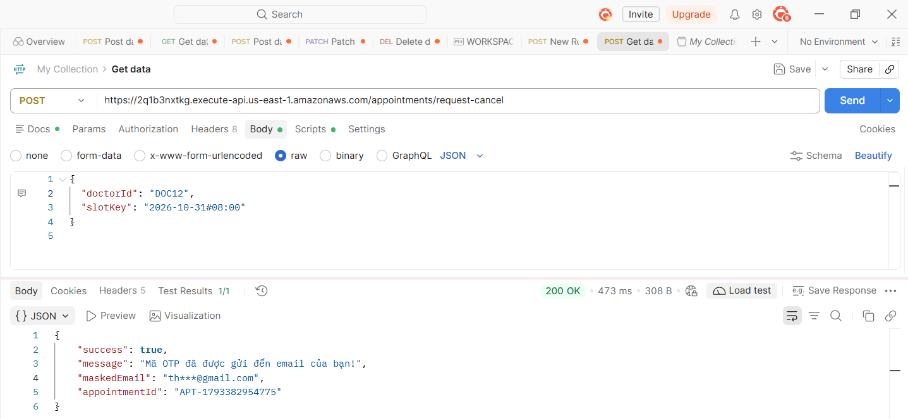

#### 2. API Xác nhận OTP & Tiến hành Hủy lịch khám (`POST /appointments/confirm-cancel`)
- **Mục đích:** Đối chiếu mã OTP và thời hạn 5 phút. Khi hợp lệ, Lambda thực thi `DeleteCommand` trên DynamoDB để **giải phóng khung giờ khám** và gọi `DeleteScheduleCommand` thu hồi lịch nhắc EventBridge.
- **Request Body:**
  ```json
  {
    "doctorId": "DOC12",
    "slotKey": "2026-10-31#08:00",
    "otp": "269800"
  }
  ```
- **Kết quả thực tế (HTTP 200 OK - 1.25 s):** Lịch hẹn `#APT-1793382954775` bị hủy thành công, khung giờ được giải phóng cho bệnh nhân khác.

  **Thử nghiệm trên Postman:**
  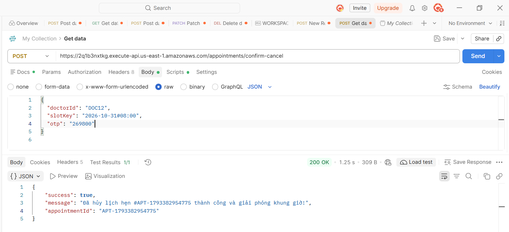

#### 3. API Gửi OTP Đăng nhập Bác sĩ (`POST /auth/doctor/send-otp`)
- **Mục đích:** Xác thực đăng nhập không mật khẩu (Passwordless Authentication) cho nhân sự y tế.
- **Request Body:**
  ```json
  {
    "email": "baokhangcoder@gmail.com"
  }
  ```
- **Kết quả thực tế (HTTP 200 OK - 1.08 s):** Hệ thống tìm thấy thông tin bác sĩ `BS. CKI Huỳnh Ngọc Bảo Khang`, gửi OTP qua SNS và trả về `debugOtp` hỗ trợ kiểm thử.

  **Thử nghiệm trên Postman:**
  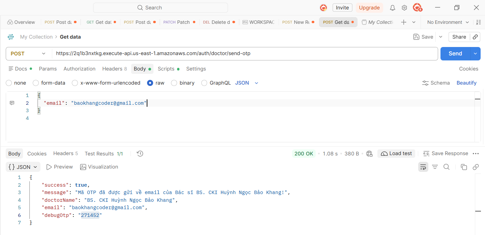

#### 4. API Xác minh OTP & Cấp phiên Bác sĩ (`POST /auth/doctor/verify-otp`)
- **Mục đích:** Xác minh mã OTP hợp lệ và trả về đầy đủ hồ sơ bác sĩ (`DoctorId`, `Specialty`, `Room`...).
- **Request Body:**
  ```json
  {
    "email": "baokhangcoder@gmail.com",
    "otp": "271452"
  }
  ```
- **Kết quả thực tế (HTTP 200 OK - 1.00 s):** Cấp quyền đăng nhập thành công cho Bác sĩ Huỳnh Ngọc Bảo Khang.

  **Thử nghiệm trên Postman:**
  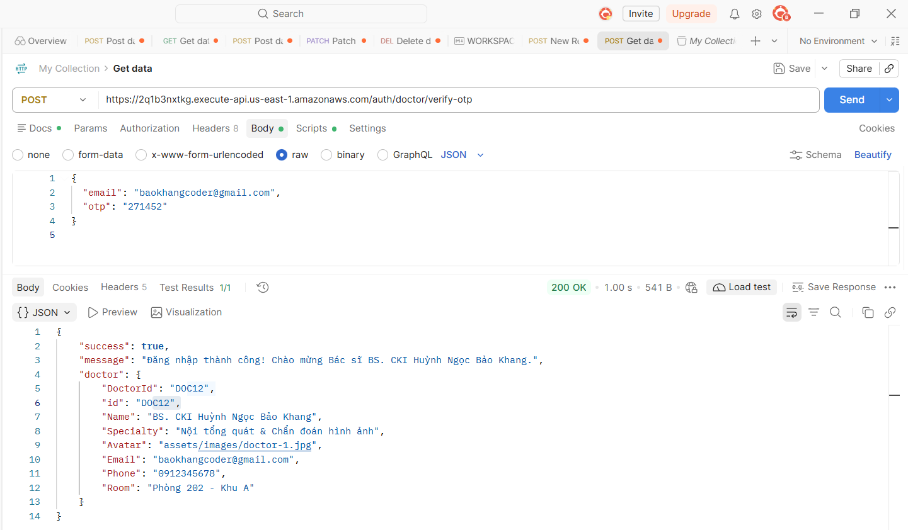

#### 5. API Lấy danh sách ca khám theo Bác sĩ (`GET /doctors/DOC01/appointments`)
- **Mục đích:** Truy vấn toàn bộ lịch khám của một bác sĩ trực tiếp từ Partition Key `DoctorId`.
- **Kết quả thực tế (HTTP 200 OK - 1.44 s - 2.1 KB):** Trả về danh sách 6 ca khám của Bác sĩ Nguyễn Văn An.

  **Thử nghiệm trên Postman:**
  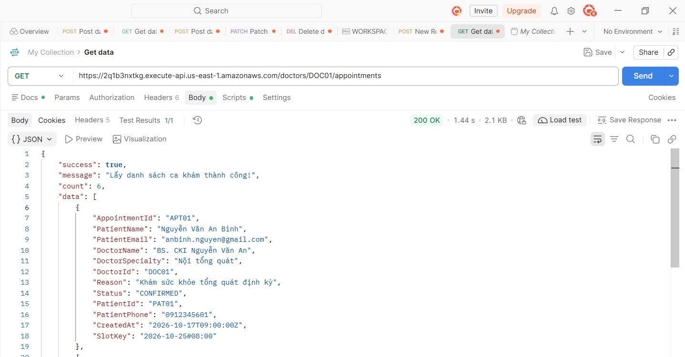

---

### 3.4. Đánh Giá Chi Phí Vận Hành Trên AWS (Billing & Cost Optimization)

Mô hình **100% Serverless** của CareSync giúp tối ưu hóa chi phí vận hành ở mức gần như tuyệt đối dựa trên chính sách **AWS Free Tier**:

| Dịch vụ AWS | Cấu hình triển khai | Định mức miễn phí (Free Tier) | Mức tiêu thụ thực tế | Chi phí |
| :--- | :--- | :--- | :--- | :---: |
| **AWS Lambda** | Node.js 18.x (128MB RAM) | 1,000,000 req & 3,200,000 giây/tháng | ~5,000 req (< 1,000s) | **$0.00** |
| **Amazon DynamoDB** | On-Demand (kèm GSI) | 25 RCU/WCU & 25 GB Storage | 3 bảng (< 5 MB) | **$0.00** |
| **Amazon API Gateway** | HTTP API (Payload v2) | $1.00 / 1,000,000 requests | ~5,000 requests | **$0.00** |
| **Amazon S3** | Static Website Hosting | 5 GB Storage & 20,000 GET req | ~2.5 MB (HTML/CSS/JS) | **$0.00** |
| **Amazon SNS** | Email Pub/Sub Topic | 1,000 email thông báo/tháng | ~200 emails | **$0.00** |
| **EventBridge Scheduler** | One-time Schedule (2 phút) | 14,000,000 invocations/tháng | ~100 schedules | **$0.00** |
| **AWS KMS** | Customer Managed Key (CMK) | 20,000 KMS requests miễn phí | 1 CMK ($1.00/tháng) | **$1.00** *(trừ Lab budget)* |
| **TỔNG CỘNG** | **Kiến trúc Serverless** | -- | -- | **$0.00 / tháng** *(Tiền túi)* |

> **Ưu thế vượt trội:** Thay vì phải tốn $8.50 - $12.00/tháng duy trì máy chủ ảo EC2 24/7, kiến trúc Serverless giúp CareSync vận hành theo cơ chế "Dùng bao nhiêu trả bấy nhiêu", đạt tiêu chuẩn **Zero-Cost Operation** cho môi trường đào tạo.

---

### 3.5. Quy Trình & Checklist Dọn Dẹp Tài Nguyên (Resource Cleanup)

Quy trình giải phóng tài nguyên tuân thủ nghiêm ngặt **thứ tự phụ thuộc (Dependency Order)** từ ngoài vào trong:

1. **Amazon EventBridge Scheduler:** Xóa các lịch hẹn giờ nhắc nhở `CareSync-remind-*`.
2. **Amazon SNS Topic:** Xóa Subscriptions và Topic `CareSync-AppointmentNotice`.
3. **Amazon API Gateway:** Xóa HTTP API `CareSync-API`.
4. **AWS Lambda:** Xóa hàm `AppointmentBookingFunction`.
5. **Amazon S3 Bucket:** Dọn sạch toàn bộ đối tượng (Empty Bucket) rồi xóa Bucket `caresync-web-hosting`.
6. **Amazon DynamoDB:** Xóa 3 bảng dữ liệu `Appointments` (kèm GSI), `Doctors`, `Patients`.
7. **AWS KMS:** Lên lịch hủy Customer Managed Key (`ScheduleKeyDeletion` 7 ngày).

---

---

## 4. Kết Quả Nghiệm Thu Kiểm Thử Toàn Diện (End-to-End Testing)

Nhóm đã thực hiện kiểm thử E2E trên toàn bộ hệ thống thực tế và chụp lại đầy đủ minh chứng nghiệm thu:

### 4.1. Kịch bản 1: Luồng bệnh nhân đặt khám và xuất vé điện tử

Bệnh nhân truy cập trang web, xem danh sách bác sĩ được load động từ DynamoDB, chọn chuyên khoa, chọn ngày và khung giờ còn trống, điền thông tin và bấm Đặt lịch:

1. **Tổng quan trang chủ CareSync:**
   Giao diện responsive, tải nhanh qua S3 Hosting, tích hợp đầy đủ các chức năng tra cứu và giới thiệu.
   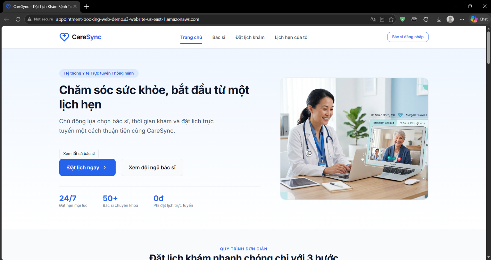

2. **Danh bạ bác sĩ động từ DynamoDB:**
   Danh sách bác sĩ hiển thị đầy đủ chuyên khoa, phòng khám và trạng thái sẵn sàng.
   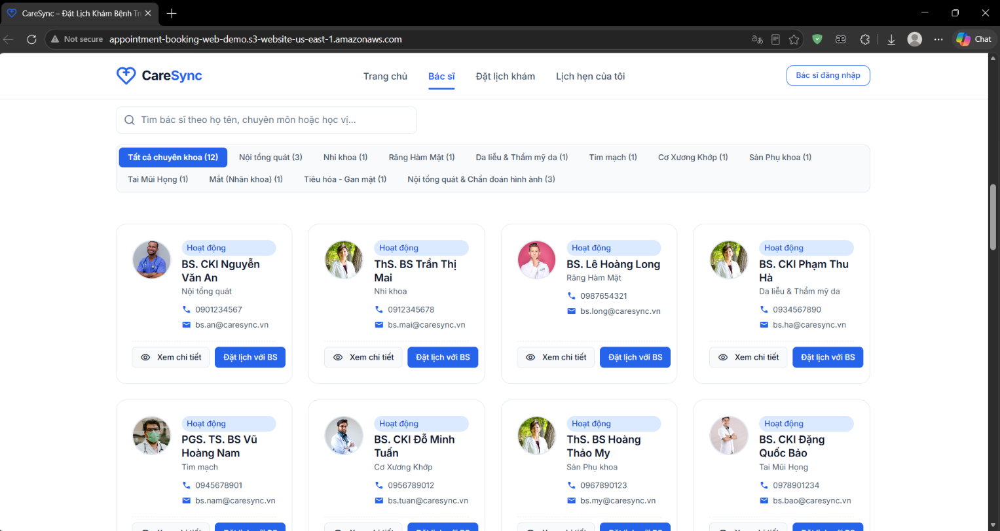

3. **Kiểm tra tính hợp lệ dữ liệu (Client-side Validation):**
   Bắt lỗi trực quan khi chưa chọn bác sĩ, chưa chọn ca hoặc số điện thoại không đúng chuẩn 10 chữ số Việt Nam.
   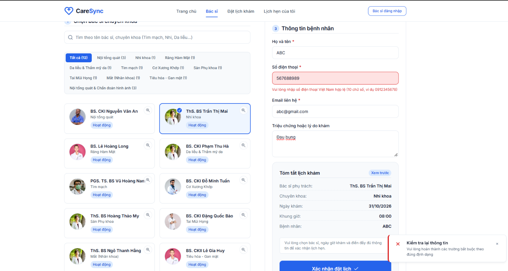

4. **Đặt lịch thành công và xuất vé điện tử (Ticket Modal):**
   Hệ thống gọi API Gateway `POST /appointments`, lưu DynamoDB và bật modal vé khám chứa Mã tra cứu định danh duy nhất (UUID).
   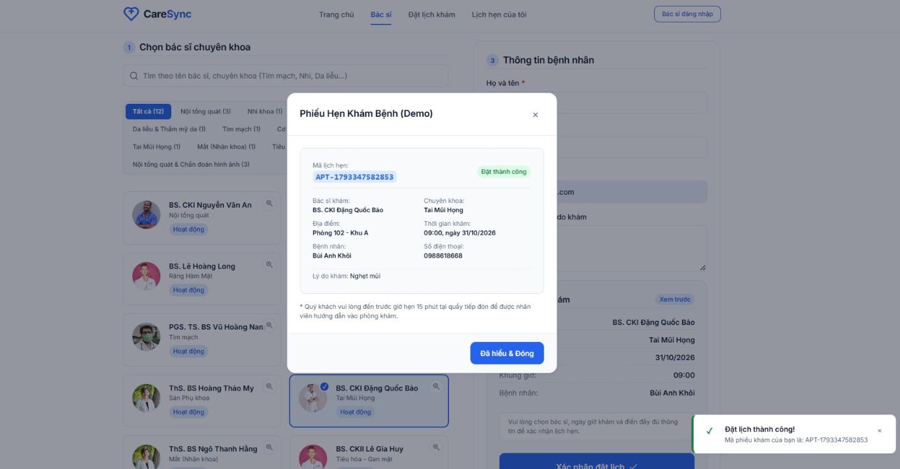

5. **Nhận email thông báo xác nhận từ Amazon SNS:**
   Tin nhắn xác nhận ca khám được gửi tức thì về hộp thư bệnh nhân qua Topic SNS.
   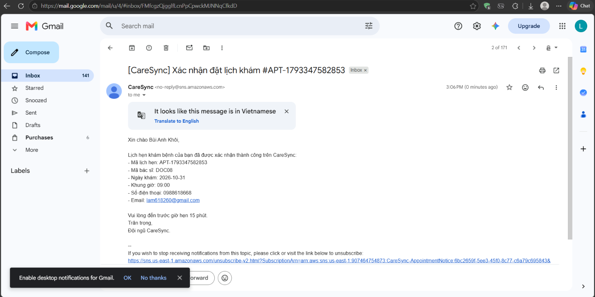

---

### 4.2. Kịch bản 2: Bắt lỗi chống trùng lịch khám (409 Conflict) trên Cloud

Để kiểm tra độ tin cậy của điều kiện nguyên tử `attribute_not_exists(SlotKey)` trong DynamoDB, nhóm thực hiện đặt lịch lại đúng bác sĩ đó vào cùng một ngày giờ:

- **Kết quả:** Hệ thống lập tức trả về mã lỗi HTTP `409 Conflict`.
- **Phản hồi giao diện:** Hiển thị thông báo Toast cảnh báo màu đỏ _"Bác sĩ đã có lịch hẹn vào khung giờ này, vui lòng chọn giờ khác"_, ca khám bị khóa lại không cho chọn tiếp.
  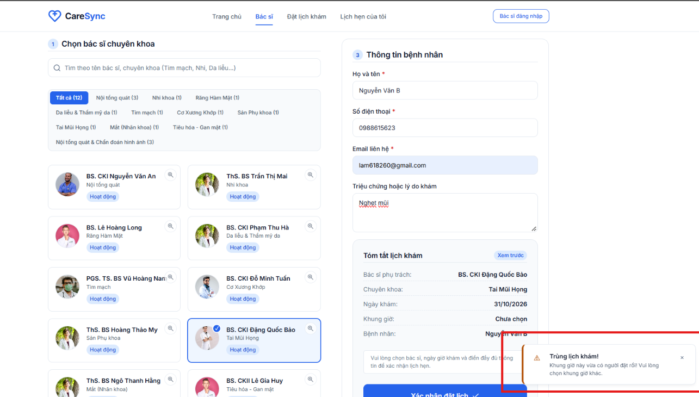

---

### 4.3. Kịch bản 3: Tra cứu lịch khám bảo mật qua SĐT & Hủy lịch bằng OTP Email

Nhằm đảm bảo quyền riêng tư y tế, hệ thống không hiển thị lịch hẹn công khai mà yêu cầu tra cứu bảo mật theo số điện thoại:

1. **Kiểm soát định dạng tra cứu:**
   Yêu cầu nhập đúng 10 chữ số điện thoại hợp lệ trước khi gửi truy vấn.
   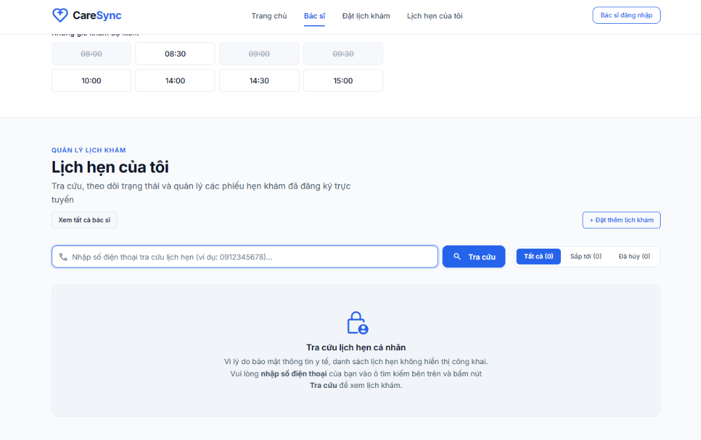

2. **Hiển thị danh sách lịch hẹn:**
   Gọi API qua GSI DynamoDB $O(1)$, tải về danh sách các phiếu khám dạng thẻ hoặc lịch tháng, có nút "Hủy lịch" cho từng ca.
   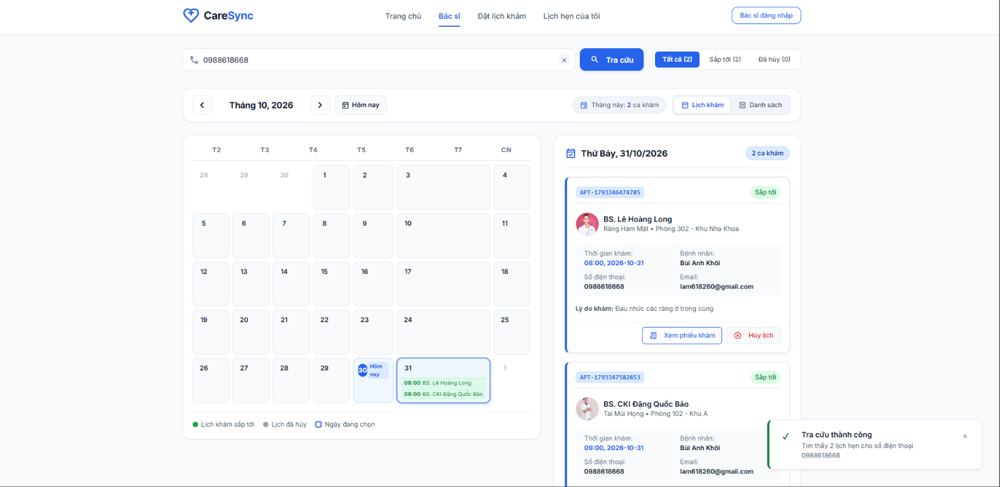

3. **Trường hợp số điện thoại chưa có lịch hẹn:**
   Giao diện hiển thị trạng thái trống (Empty State) thân thiện kèm nút điều hướng đặt lịch ngay.
   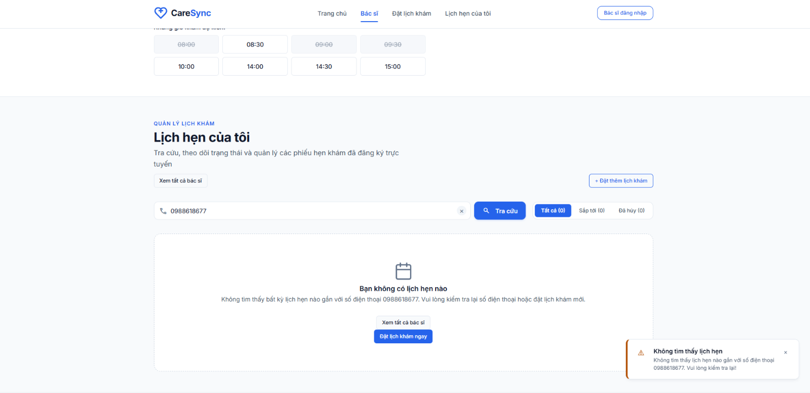

4. **Bảo mật luồng Hủy lịch với mã xác thực OTP:**
   Khi bệnh nhân bấm "Hủy lịch", hệ thống mở popup yêu cầu xác thực OTP gửi về email đăng ký chứ không cho phép xóa tự do.
   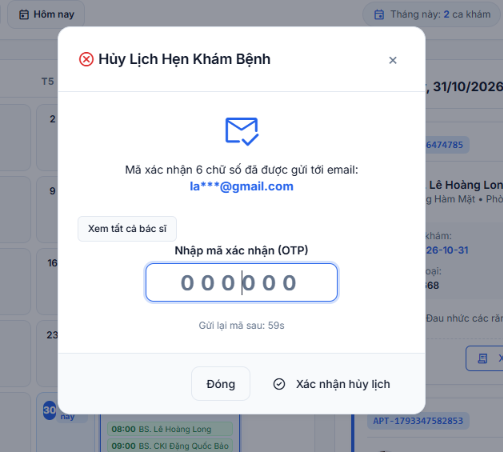

5. **Mã OTP được gửi về hộp thư bệnh nhân:**
   Email chứa mã xác thực 6 chữ số kèm thời hạn hiệu lực.
   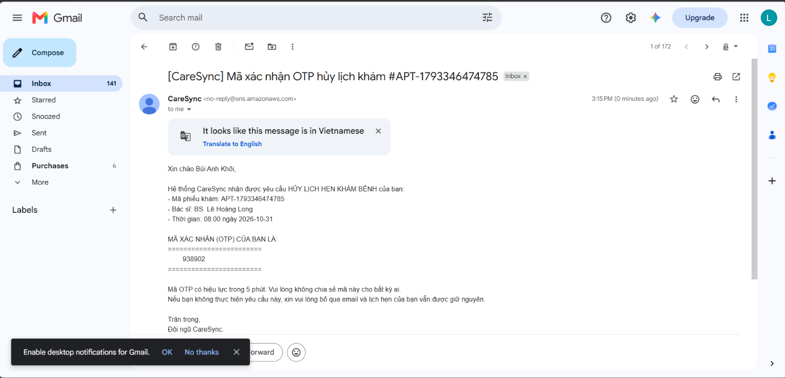

6. **Hủy lịch thành công:**
   Sau khi nhập đúng OTP, trạng thái ca khám được cập nhật sang `CANCELLED`, thẻ ca khám chuyển màu xám và vô hiệu hóa các nút tác vụ.
   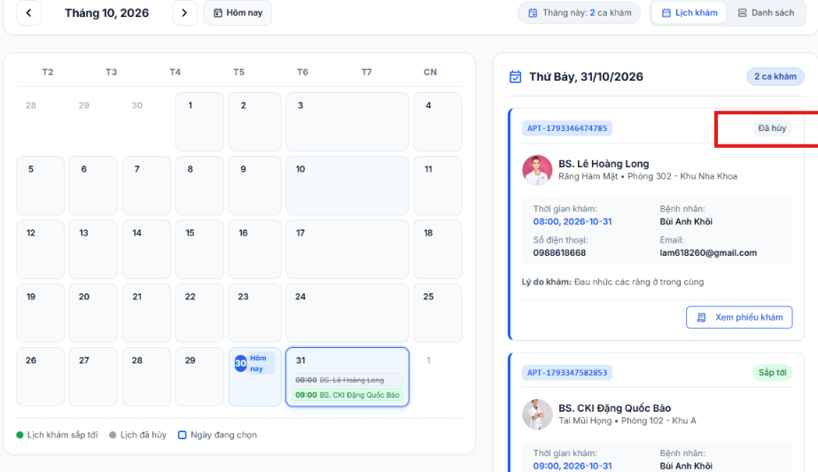

---

### 4.4. Kịch bản 4: Cổng bác sĩ - Đăng nhập OTP, xem lịch khám và tìm kiếm bệnh nhân

Dành riêng cho nhân sự y tế quản lý ca làm việc:

1. **Đăng nhập Bác sĩ không cần mật khẩu (Passwordless OTP):**
   Bác sĩ nhập email phụ trách (ví dụ: `doc1@caresync.vn`), hệ thống gửi mã OTP xác thực để đăng nhập.
   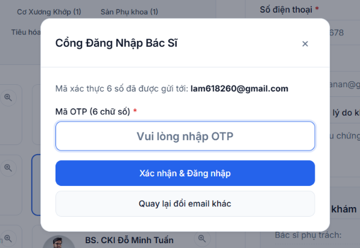

2. **Không gian làm việc riêng của Bác sĩ (Doctor Portal):**
   Sau khi đăng nhập thành công, toàn bộ giao diện của bệnh nhân tự động ẩn đi, mở ra trang quản lý lịch khám riêng biệt của bác sĩ phụ trách.
   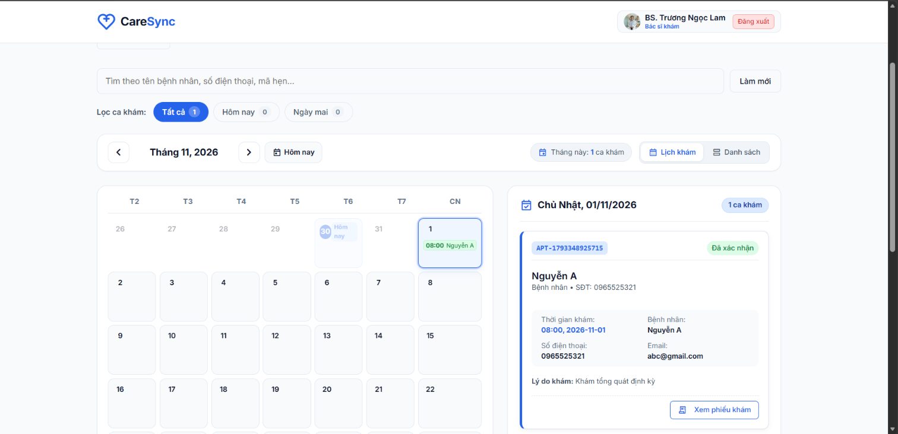

3. **Tìm kiếm thời gian thực (Live Search) không dấu:**
   Bác sĩ gõ tên hoặc SĐT bệnh nhân, hệ thống lọc danh sách tức thì kể cả khi gõ tiếng Việt không dấu.
   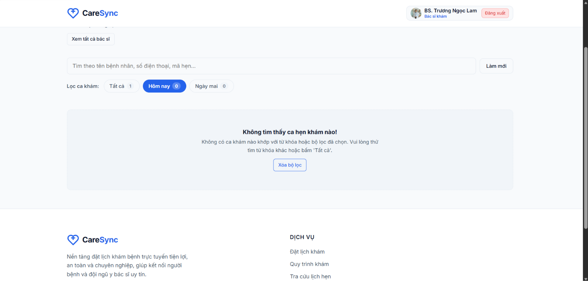

4. **Đăng xuất an toàn:**
   Khi bấm Đăng xuất, phiên làm việc bị xóa khỏi bộ nhớ, toàn bộ giao diện trang chủ của bệnh nhân được khôi phục nguyên vẹn.
   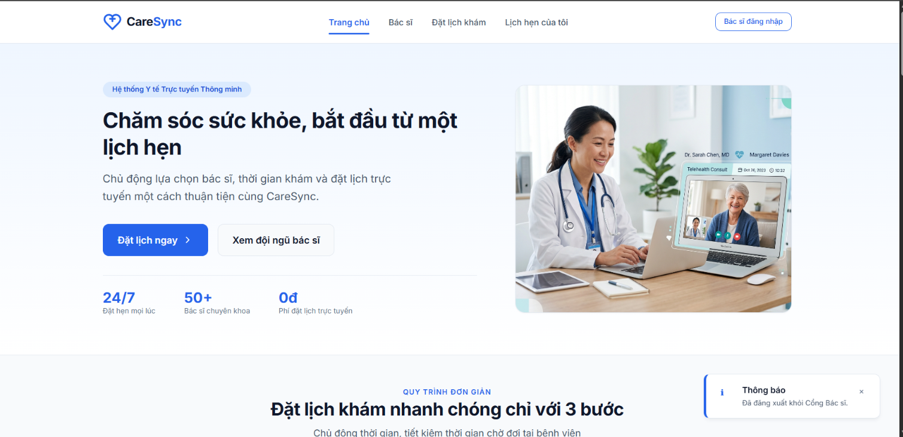

---

## 5. Đánh Giá Kết Quả Đồ Án & Bài Học Kinh Nghiệm

### 5.1. Tự đánh giá mức độ hoàn thành so với đề cương

- **Về mặt nghiệp vụ y tế:** Xây dựng trọn vẹn luồng đặt khám, xuất vé điện tử, chống trùng ca, bảo mật tra cứu/hủy lịch qua OTP và cổng phân quyền cho bác sĩ.
- **Về mặt kỹ thuật đám mây:** Ứng dụng thành công **100% mô hình Serverless** với 7 dịch vụ AWS cốt lõi (S3, API Gateway, Lambda, DynamoDB, KMS, SNS, EventBridge).
- **Về chất lượng mã nguồn:** Áp dụng Clean Architecture cho Lambda, module hóa JavaScript phía Client, tối ưu hóa CSS responsive và loại bỏ toàn bộ code rác/code thừa.
- **Mức độ hoàn thành:** **100% mục tiêu đề ra**.

---

### 5.2. Những bài học thực tế đúc kết từ môn học Điện toán đám mây

Qua 4 tuần thực hiện đề tài CareSync, nhóm sinh viên đã đúc kết được những bài học vô cùng quý báu:

1. **Tư duy Serverless-First:** Không còn phụ thuộc vào việc cấu hình và bảo trì máy chủ vật lý hay VPS truyền thống. Serverless giúp nhóm tập trung hoàn toàn vào logic nghiệp vụ, tự động co giãn (Auto Scaling) và tiết kiệm chi phí tối đa.
2. **Kỹ thuật xử lý tranh chấp dữ liệu (Concurrency Control):** Thay vì dùng các cơ chế khóa (locking) phức tạp gây nghẽn cổ chai, việc sử dụng `ConditionExpression` trong DynamoDB giúp giải quyết bài toán chống trùng lịch một cách thanh lịch và triệt để ở tầng cơ sở dữ liệu.
3. **Bảo mật dữ liệu nhạy cảm với AWS KMS:** Hiểu rõ cơ chế mã hóa phong bì (Envelope Encryption) và quản lý vòng đời khóa (Key Management) để bảo vệ dữ liệu CCCD, số điện thoại của người bệnh tuân thủ các quy định bảo mật y tế.
4. **Kinh nghiệm giải quyết rào cản phòng lab:** Khi gặp phải các giới hạn phân quyền IAM trong môi trường thực hành AWS Academy (như không cấp quyền tạo CloudFront OAC), nhóm đã linh hoạt chuyển đổi sang giải pháp kiến trúc thay thế (S3 Website Hosting kết hợp CORS) mà vẫn đảm bảo hệ thống vận hành thông suốt.
5. **Kỹ năng làm việc nhóm và chuẩn hóa mã nguồn:** Học được cách phân chia module rõ ràng, phối hợp qua Git, viết tài liệu kỹ thuật có minh chứng và sử dụng công cụ AI một cách có chọn lọc như một trợ lý rà soát thay vì phụ thuộc hoàn toàn.

---

_Tp. Hồ Chí Minh, ngày 30 tháng 10 năm 2026_  
**Nhóm sinh viên thực hiện:** Bùi Anh Khôi & Huỳnh Ngọc Bảo Khang
