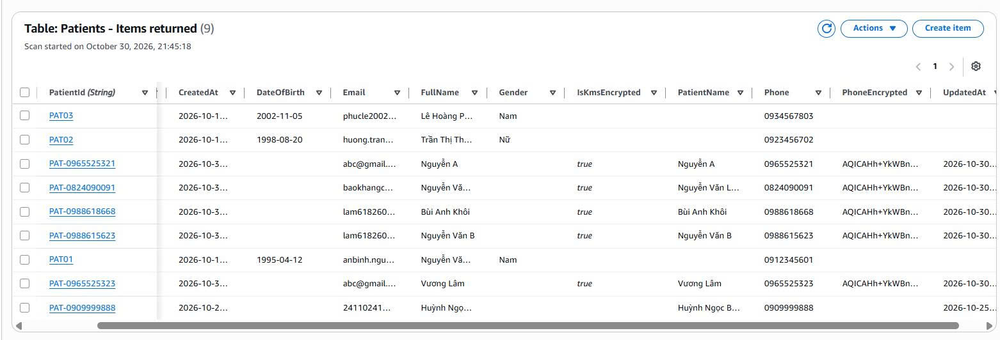

# Báo Cáo Minh Chứng Thực Hành Tuần 4 - SV1 Bùi Anh Khôi

## Chủ đề: Kiểm thử Toàn diện trên Giao diện Web (End-to-End Testing - E2E)

**Học phần:** Điện toán đám mây (Cloud Computing) – HCMUTE  
**Dự án:** Hệ thống đặt lịch khám bệnh cho phòng khám trực tuyến (CareSync)  
**Sinh viên thực hiện:** Bùi Anh Khôi  
**MSSV:** 24110258  
**Vai trò:** SV1 – Phát triển Giao diện Cổng Bác sĩ, Đồng bộ Bảo mật KMS & Kiểm thử Toàn diện Hệ thống (E2E Testing)  
**Repository GitHub:** [https://github.com/Arenef/CareSync](https://github.com/Arenef/CareSync)  
**Nhánh (Branch):** `main`

---

## Mục Lục

- [Báo Cáo Minh Chứng Thực Hành Tuần 4 - SV1 Bùi Anh Khôi](#báo-cáo-minh-chứng-thực-hành-tuần-4---sv1-bùi-anh-khôi)
  - [Chủ đề: Kiểm thử Toàn diện trên Giao diện Web (End-to-End Testing - E2E)](#chủ-đề-kiểm-thử-toàn-diện-trên-giao-diện-web-end-to-end-testing---e2e)
  - [Mục Lục](#mục-lục)
  - [1. Tổng quan Môi trường \& Kiến trúc Kiểm thử Toàn diện (E2E Testing)](#1-tổng-quan-môi-trường--kiến-trúc-kiểm-thử-toàn-diện-e2e-testing)
    - [1.1. Mục tiêu và phạm vi kiểm thử E2E](#11-mục-tiêu-và-phạm-vi-kiểm-thử-e2e)
    - [1.2. Danh mục kịch bản kiểm thử (E2E Test Cases)](#12-danh-mục-kịch-bản-kiểm-thử-e2e-test-cases)
  - [2. Kịch bản 1: Kiểm thử Luồng Đặt lịch Khám bệnh \& Chống trùng lịch (Booking Flow)](#2-kịch-bản-1-kiểm-thử-luồng-đặt-lịch-khám-bệnh--chống-trùng-lịch-booking-flow)
    - [2.1. Hiển thị danh sách bác sĩ từ DynamoDB và chọn bác sĩ khám](#21-hiển-thị-danh-sách-bác-sĩ-từ-dynamodb-và-chọn-bác-sĩ-khám)
    - [2.2. Kiểm thử Validation dữ liệu đầu vào trên biểu mẫu đặt lịch](#22-kiểm-thử-validation-dữ-liệu-đầu-vào-trên-biểu-mẫu-đặt-lịch)
    - [2.3. Đặt lịch khám thành công (201 Created), Mã hóa KMS và Thông báo SNS/Scheduler](#23-đặt-lịch-khám-thành-công-201-created-mã-hóa-kms-và-thông-báo-snsscheduler)
    - [2.4. Kiểm thử cơ chế chống trùng lịch khám (409 Conflict)](#24-kiểm-thử-cơ-chế-chống-trùng-lịch-khám-409-conflict)
  - [3. Kịch bản 2: Kiểm thử Luồng Tra cứu "Lịch hẹn của tôi" theo Số điện thoại](#3-kịch-bản-2-kiểm-thử-luồng-tra-cứu-lịch-hẹn-của-tôi-theo-số-điện-thoại)
    - [3.1. Trạng thái bảo mật mặc định và kiểm tra định dạng số điện thoại](#31-trạng-thái-bảo-mật-mặc-định-và-kiểm-tra-định-dạng-số-điện-thoại)
    - [3.2. Tra cứu lịch hẹn trực tiếp từ AWS DynamoDB (GSI PatientPhone-index)](#32-tra-cứu-lịch-hẹn-trực-tiếp-từ-aws-dynamodb-gsi-patientphone-index)
    - [3.3. Kiểm thử trường hợp số điện thoại không có lịch hẹn](#33-kiểm-thử-trường-hợp-số-điện-thoại-không-có-lịch-hẹn)
  - [4. Kịch bản 3: Kiểm thử Luồng Hủy lịch hẹn Xác thực bằng Mã OTP qua Email](#4-kịch-bản-3-kiểm-thử-luồng-hủy-lịch-hẹn-xác-thực-bằng-mã-otp-qua-email)
    - [4.1. Yêu cầu hủy lịch và nhận mã OTP 6 chữ số qua Amazon SNS](#41-yêu-cầu-hủy-lịch-và-nhận-mã-otp-6-chữ-số-qua-amazon-sns)
    - [4.2. Xác thực mã OTP, xóa lịch trên DynamoDB và thu hồi lịch nhắc EventBridge](#42-xác-thực-mã-otp-xóa-lịch-trên-dynamodb-và-thu-hồi-lịch-nhắc-eventbridge)
  - [5. Kịch bản 4: Kiểm thử Cổng Bác sĩ – Đăng nhập OTP \& Quản lý Ca khám (Doctor Portal)](#5-kịch-bản-4-kiểm-thử-cổng-bác-sĩ--đăng-nhập-otp--quản-lý-ca-khám-doctor-portal)
    - [5.1. Xác thực đăng nhập Bác sĩ bằng OTP qua Email](#51-xác-thực-đăng-nhập-bác-sĩ-bằng-otp-qua-email)
    - [5.2. Xem danh sách bệnh nhân đặt khám, tìm kiếm và lọc ca khám theo thời gian](#52-xem-danh-sách-bệnh-nhân-đặt-khám-tìm-kiếm-và-lọc-ca-khám-theo-thời-gian)
    - [5.3. Kiểm thử chức năng Đăng xuất và khôi phục giao diện Bệnh nhân](#53-kiểm-thử-chức-năng-đăng-xuất-và-khôi-phục-giao-diện-bệnh-nhân)
  - [6. Tổng kết Kết quả Nghiệm thu Kiểm thử E2E](#6-tổng-kết-kết-quả-nghiệm-thu-kiểm-thử-e2e)

---

## 1. Tổng quan Môi trường & Kiến trúc Kiểm thử Toàn diện (E2E Testing)

### 1.1. Mục tiêu và phạm vi kiểm thử E2E

Trong tuần 4, sau khi hoàn thiện toàn bộ các tính năng từ Frontend đến Backend Serverless, SV1 đã thực hiện **Kiểm thử toàn diện trên giao diện Web (End-to-End Testing)** nhằm đảm bảo tính đồng bộ, bảo mật và ổn định của toàn bộ hệ thống **CareSync** khi vận hành thực tế trên nền tảng đám mây AWS:

- **Frontend Hosting:** Giao diện Web tĩnh triển khai trên **Amazon S3 Static Website Hosting** kết hợp mã nguồn tại [`client/index.html`](../../client/index.html), [`client/js/api.js`](../../client/js/api.js), [`client/js/booking.js`](../../client/js/booking.js), [`client/js/lookup.js`](../../client/js/lookup.js) và [`client/js/doctor-auth.js`](../../client/js/doctor-auth.js).
- **API Gateway Endpoint:** `https://2q1b3nxtkg.execute-api.us-east-1.amazonaws.com`
- **Compute & Business Logic:** AWS Lambda (`AppointmentBookingFunction`) xử lý định tuyến tập trung cho Bác sĩ, Bệnh nhân và Lịch hẹn.
- **Cơ sở dữ liệu & Bảo mật:**
  - 3 bảng Amazon DynamoDB: `Doctors`, `Appointments` (kèm GSI `PatientPhone-index`), và `Patients`.
  - Mã hóa trường số điện thoại nhạy cảm (`PhoneEncrypted`) bằng khóa đối xứng **AWS KMS** (`alias/caresync-patient-key`).
- **Thông báo & Tự động hóa:** **Amazon SNS** (`CareSync-AppointmentNotice`) gửi email xác nhận đặt lịch, mã OTP hủy lịch, mã OTP đăng nhập bác sĩ; **Amazon EventBridge Scheduler** tự động tạo và thu hồi lịch nhắc khám.

_Hình 1.1: Giao diện tổng thể của ứng dụng Web CareSync kết nối trực tiếp với hệ thống Backend AWS._

---

### 1.2. Danh mục kịch bản kiểm thử (E2E Test Cases)

|  Mã TC   | Tên kịch bản kiểm thử (Test Case)              | Endpoint / Dịch vụ AWS liên quan                               | Kết quả mong đợi                                                                                     | Trạng thái |
| :------: | :--------------------------------------------- | :------------------------------------------------------------- | :--------------------------------------------------------------------------------------------------- | :--------: |
| **TC01** | Tải danh sách bác sĩ & lọc theo chuyên khoa    | `GET /doctors` (DynamoDB `Doctors`)                            | Hiển thị đầy đủ danh sách bác sĩ đang hoạt động, lọc chính xác theo chuyên khoa.                     |  **PASS**  |
| **TC02** | Validate biểu mẫu đặt lịch khám bệnh           | Client Validation (`booking.js`)                               | Báo lỗi đỏ và chặn gửi form khi thiếu bác sĩ, ngày quá khứ, SĐT sai chuẩn 10 số hoặc sai email.      |  **PASS**  |
| **TC03** | Đặt lịch khám mới thành công & đồng bộ KMS/SNS | `POST /appointments` (DynamoDB, KMS, SNS, Scheduler)           | Trả về `201 Created`, hiện popup Vé khám, lưu hồ sơ mã hóa KMS vào bảng `Patients` và gửi email SNS. |  **PASS**  |
| **TC04** | Chống trùng lịch khám cùng bác sĩ & khung giờ  | `POST /appointments` (`ConditionExpression`)                   | Trả về `409 Conflict`, hiện Toast cảnh báo trùng lịch và khóa nút khung giờ trên giao diện.          |  **PASS**  |
| **TC05** | Kiểm tra bảo mật & validate ô tra cứu lịch hẹn | Client Validation (`lookup.js`)                                | Mặc định ẩn danh sách lịch hẹn; cảnh báo khi nhập SĐT không đúng định dạng Việt Nam.                 |  **PASS**  |
| **TC06** | Tra cứu lịch hẹn theo số điện thoại bệnh nhân  | `GET /appointments?phone=...` (GSI `PatientPhone-index`)       | Hiển thị đúng các thẻ lịch hẹn của SĐT tra cứu từ DynamoDB, cập nhật bộ đếm và mở xem vé khám.       |  **PASS**  |
| **TC07** | Tra cứu số điện thoại chưa có lịch khám        | `GET /appointments?phone=...`                                  | Hiển thị màn hình Empty State và bắn Toast cảnh báo không tìm thấy lịch hẹn.                         |  **PASS**  |
| **TC08** | Yêu cầu hủy lịch & gửi mã OTP qua Email        | `POST /appointments/request-cancel` (DynamoDB, SNS)            | Sinh mã OTP 6 số (hiệu lực 5 phút), gửi về email qua SNS và chuyển sang bước nhập OTP.               |  **PASS**  |
| **TC09** | Xác nhận OTP hủy lịch & thu hồi lịch nhắc      | `POST /appointments/confirm-cancel` (DynamoDB, Scheduler, SNS) | Xóa lịch hẹn giải phóng khung giờ, xóa lịch nhắc EventBridge Scheduler và gửi email xác nhận hủy.    |  **PASS**  |
| **TC10** | Đăng nhập Cổng Bác sĩ bằng xác thực OTP Email  | `POST /auth/doctor/send-otp` & `/verify-otp`                   | Kiểm tra email bác sĩ hợp lệ, gửi và xác thực OTP 6 số, chuyển sang giao diện Cổng Bác sĩ.           |  **PASS**  |
| **TC11** | Bác sĩ xem, tìm kiếm và lọc danh sách ca khám  | `GET /doctors/{id}/appointments` (DynamoDB Query)              | Hiển thị toàn bộ bệnh nhân đặt khám với bác sĩ, lọc theo Hôm nay/Ngày mai và tìm kiếm tức thì.       |  **PASS**  |

---

## 2. Kịch bản 1: Kiểm thử Luồng Đặt lịch Khám bệnh & Chống trùng lịch (Booking Flow)

### 2.1. Hiển thị danh sách bác sĩ từ DynamoDB và chọn bác sĩ khám

**Các bước thực hiện:**

1. Truy cập trang chủ CareSync, cuộn xuống khu vực **"Đội ngũ Bác sĩ Chuyên khoa"**.
2. Quan sát dữ liệu bác sĩ được tải động qua API `GET /doctors` từ bảng `Doctors` trên DynamoDB.
3. Sử dụng thanh tìm kiếm tên bác sĩ và bộ lọc chuyên khoa (Tim mạch, Nội tổng quát, Nhi khoa, Da liễu...).
4. Bấm nút **"Đặt lịch khám"** trên thẻ của bác sĩ (ví dụ: `BS.CKII Nguyễn Văn Bình`). Hệ thống tự động cuộn mượt xuống biểu mẫu đặt lịch và điền sẵn thông tin bác sĩ vào cột **"Tóm tắt phiếu khám"**.

_Hình 2.1: Danh sách bác sĩ được đồng bộ từ AWS DynamoDB và tự động cập nhật vào bảng Tóm tắt phiếu khám khi chọn._

---

### 2.2. Kiểm thử Validation dữ liệu đầu vào trên biểu mẫu đặt lịch

**Các bước thực hiện:**

1. Tại biểu mẫu **"Đặt lịch khám trực tuyến"** ([`client/js/booking.js`](../../client/js/booking.js)), thử bấm **"Xác nhận đặt lịch"** khi chưa chọn khung giờ hoặc để trống thông tin cá nhân.
2. Nhập thử số điện thoại sai chuẩn hoặc địa chỉ email không hợp lệ.
3. **Kết quả thực tế:** Hệ thống lập tức chặn sự kiện gửi form, hiển thị viền đỏ quanh ô nhập lỗi kèm thông báo chi tiết dưới từng trường và bắn Toast cảnh báo ở góc phải màn hình.

_Hình 2.2: Giao diện kiểm tra tính hợp lệ của dữ liệu (Validation) chặn các thông tin sai định dạng trước khi gọi API._

---

### 2.3. Đặt lịch khám thành công (201 Created), Mã hóa KMS và Thông báo SNS/Scheduler

**Các bước thực hiện:**

1. Chọn Bác sĩ, chọn Ngày khám hợp lệ và chọn Khung giờ khám (ví dụ: `09:00`).
2. Nhập đầy đủ thông tin bệnh nhân:
   - **Họ và tên:** `Bùi Anh Khôi`
   - **Số điện thoại:** `0912345678`
   - **Email nhận thông báo:** địa chỉ email đã xác nhận Subscription trên SNS.
   - **Lý do khám:** `Khám kiểm tra sức khỏe tim mạch định kỳ`
3. Bấm **"Xác nhận đặt lịch"**. Nút bấm chuyển sang trạng thái khóa tạm thời `"Đang gửi lên AWS..."` để chống bấm đúp.

**Kết quả nghiệm thu trên Giao diện & Hạ tầng AWS:**

- **Trên Giao diện Web:** Nhận phản hồi `201 Created`, hiển thị Toast xanh _"Đặt lịch thành công!"_ và tự động bật cửa sổ **Popup Vé Khám (Ticket Modal)** chứa Mã phiếu khám (`APT-...`), Bác sĩ, Chuyên khoa, Phòng khám, Ngày giờ và Thông tin bệnh nhân.
- **Trên DynamoDB (`Appointments` & `Patients`):** Bản ghi lịch hẹn được lưu vào bảng `Appointments`; đồng thời bảng `Patients` tự động cập nhật hồ sơ `PAT-0912345678` với trường `PhoneEncrypted` đã được mã hóa Base64 qua **AWS KMS** (`IsKmsEncrypted: true`).
- **Trên Hộp thư Email (Amazon SNS & EventBridge Scheduler):** Nhận ngay email `[CareSync] Xác nhận đặt lịch khám` và đúng 2 phút sau nhận tiếp email `[CareSync] Nhắc lịch hẹn khám bệnh` do EventBridge Scheduler kích hoạt tự động.

_Hình 2.3: Cửa sổ Vé khám (Ticket Modal) hiển thị chi tiết mã phiếu hẹn sau khi lưu thành công vào DynamoDB._

_Hình 2.4: Minh chứng bản ghi trên bảng DynamoDB Patients với trường PhoneEncrypted được mã hóa bằng AWS KMS._

_Hình 2.5: Hộp thư người bệnh nhận được Email xác nhận tức thì và Email nhắc lịch tự động từ EventBridge Scheduler._

---

### 2.4. Kiểm thử cơ chế chống trùng lịch khám (409 Conflict)

**Các bước thực hiện:**

1. Giữ nguyên Bác sĩ, Ngày khám và Khung giờ (`09:00`) vừa đặt thành công ở bước 2.3.
2. Nhập thông tin một bệnh nhân thứ hai và bấm **"Xác nhận đặt lịch"** vào đúng khung giờ đó.
3. **Kết quả thực tế:**
   - Tầng DynamoDB từ chối ghi đè nhờ biểu thức điều kiện `ConditionExpression: "attribute_not_exists(DoctorId) AND attribute_not_exists(SlotKey)"` và trả về mã lỗi HTTP **`409 Conflict`**.
   - Giao diện bắt chính xác mã `409`, hiển thị Toast cảnh báo màu vàng: _"Trùng lịch khám! Khung giờ này vừa có người đặt rồi! Vui lòng chọn khung giờ khác."_
   - Nút khung giờ `09:00` trên giao diện tự động chuyển sang trạng thái khóa (`disabled` / `.is-unavailable`).

_Hình 2.6: Hệ thống chặn trùng lịch khám với mã 409 Conflict và khóa khung giờ đã có người đặt trên giao diện._

---

## 3. Kịch bản 2: Kiểm thử Luồng Tra cứu "Lịch hẹn của tôi" theo Số điện thoại

### 3.1. Trạng thái bảo mật mặc định và kiểm tra định dạng số điện thoại

Trong phiên bản hoàn thiện tuần 4 ([`client/js/lookup.js`](../../client/js/lookup.js)), nhóm đã loại bỏ hoàn toàn việc lưu trữ lịch hẹn trên `localStorage` để đảm bảo **100% dữ liệu được truy vấn thực tế từ AWS DynamoDB** và bảo vệ quyền riêng tư y tế:

1. Khi mới mở trang hoặc bấm nút xóa trắng ô tìm kiếm, khu vực **"Lịch hẹn của tôi"** hiển thị khung thông báo bảo mật (_"Vì lý do bảo mật thông tin y tế, danh sách lịch hẹn không hiển thị công khai..."_), bộ đếm các tab đều ở mức `0`.
2. Khi nhập số điện thoại sai quy chuẩn Việt Nam (ví dụ: `12345`), form lập tức rung nhẹ và báo lỗi: _"Số điện thoại không hợp lệ (Cần 10 chữ số, ví dụ: 0912345678)"_.

_Hình 3.1: Trạng thái bảo mật mặc định ẩn lịch hẹn công khai và kiểm tra định dạng số điện thoại Việt Nam._

---

### 3.2. Tra cứu lịch hẹn trực tiếp từ AWS DynamoDB (GSI PatientPhone-index)

**Các bước thực hiện:**

1. Nhập số điện thoại đã đặt lịch vào ô tra cứu và bấm nút **"Tra cứu"** (hoặc nhấn `Enter`).
2. Hệ thống hiển thị hiệu ứng spinner _"Đang tra cứu lịch hẹn trên AWS DynamoDB..."_ và gọi API `GET /appointments?phone=...`.
3. **Kết quả thực tế:**
   - Hiển thị Toast màu xanh: _"Tra cứu thành công - Tìm thấy X lịch hẹn cho số điện thoại ..."_.
   - Render danh sách các thẻ lịch hẹn (Visual Cards) với đầy đủ: Mã phiếu hẹn, Badge trạng thái **"Sắp tới"**, Ảnh & Tên bác sĩ, Chuyên khoa, Phòng khám, Khung giờ khám, Thông tin bệnh nhân và Lý do khám.
   - Khi bấm nút **"Xem phiếu khám"** trên thẻ, cửa sổ Popup Vé khám mở lại đầy đủ thông tin để người bệnh chụp màn hình làm thủ tục tại phòng khám.

_Hình 3.2: Danh sách thẻ lịch hẹn của bệnh nhân được tải trực tiếp từ chỉ mục GSI PatientPhone-index trên DynamoDB._

---

### 3.3. Kiểm thử trường hợp số điện thoại không có lịch hẹn

**Các bước thực hiện:**

1. Nhập một số điện thoại hợp lệ nhưng chưa từng đặt khám và bấm **"Tra cứu"**.
2. **Kết quả thực tế:** API trả về mảng rỗng `[]`, giao diện hiển thị khung thông báo **"Bạn không có lịch hẹn nào"** kèm nút dẫn nhanh đến biểu mẫu đặt lịch mới, đồng thời hiển thị Toast cảnh báo màu cam.

_Hình 3.3: Giao diện xử lý trường hợp không tìm thấy lịch hẹn gắn với số điện thoại tra cứu._

---

## 4. Kịch bản 3: Kiểm thử Luồng Hủy lịch hẹn Xác thực bằng Mã OTP qua Email

Nhằm ngăn chặn tình trạng người lạ biết số điện thoại và tự ý hủy lịch khám của bệnh nhân khác, hệ thống được trang bị quy trình **Xác thực hủy lịch 2 bước bằng mã OTP qua Email**.

### 4.1. Yêu cầu hủy lịch và nhận mã OTP 6 chữ số qua Amazon SNS

**Các bước thực hiện:**

1. Tại thẻ lịch hẹn vừa tra cứu, bấm nút **"Hủy lịch"** màu đỏ.
2. Cửa sổ **Modal Xác thực Hủy lịch** (`#cancelOtpModal`) hiện lên ở **Bước 1**, tóm tắt rõ Mã phiếu khám, Bác sĩ, Thời gian và Tên bệnh nhân.
3. Bấm nút **"Gửi mã OTP qua Email"**. Frontend gọi API `POST /appointments/request-cancel` truyền `doctorId` và `slotKey`.
4. **Kết quả thực tế:**
   - Backend Lambda sinh mã OTP 6 chữ số ngẫu nhiên (hiệu lực 5 phút), lưu vào thuộc tính `CancelOtp` và `OtpExpiry` trên DynamoDB, đồng thời bắn email chứa mã OTP qua **Amazon SNS**.
   - Giao diện chuyển sang **Bước 2 (Nhập mã OTP)**, hiển thị địa chỉ email đã được che mờ bảo mật (ví dụ: `bu***@student.hcmute.edu.vn`) và kích hoạt bộ đếm ngược 60 giây trước khi cho phép gửi lại mã.

_Hình 4.1: Cửa sổ Modal hủy lịch hẹn chuyển từ Bước 1 (Yêu cầu mã) sang Bước 2 (Nhập mã OTP 6 số kèm email che mờ)._

_Hình 4.2: Email từ Amazon SNS gửi mã xác nhận OTP 6 chữ số về hộp thư của bệnh nhân._

---

### 4.2. Xác thực mã OTP, xóa lịch trên DynamoDB và thu hồi lịch nhắc EventBridge

**Các bước thực hiện:**

1. **Thử nhập mã OTP sai:** Nhập `000000` và bấm **"Xác nhận hủy lịch"** $\rightarrow$ Hệ thống báo lỗi đỏ: _"Mã xác nhận OTP không chính xác. Vui lòng kiểm tra lại!"_.
2. **Nhập mã OTP chính xác từ Email:** Nhập đúng 6 chữ số nhận được và bấm **"Xác nhận hủy lịch"** (`POST /appointments/confirm-cancel`).
3. **Kết quả nghiệm thu toàn trình:**
   - **Trên Giao diện Web:** Đóng modal, hiện Toast xanh _"Hủy lịch thành công! Lịch hẹn #APT-... đã được hủy trên hệ thống AWS DynamoDB"_, thẻ lịch hẹn chuyển sang trạng thái **"Đã hủy"** và bộ đếm tab `Đã hủy` tăng lên.
   - **Trên DynamoDB:** Bản ghi trong bảng `Appointments` được xóa bằng `DeleteCommand`, giải phóng hoàn toàn khung giờ đó để bệnh nhân khác có thể đặt lịch.
   - **Trên EventBridge Scheduler & SNS:** Lịch nhắc hẹn tự động `CareSync-remind-...` bị thu hồi qua `DeleteScheduleCommand`, đồng thời SNS gửi một email xác nhận lịch khám đã được hủy thành công.

_Hình 4.3: Lịch hẹn chuyển sang trạng thái Đã hủy trên giao diện Web và email xác nhận hủy thành công từ hệ thống._

---

## 5. Kịch bản 4: Kiểm thử Cổng Bác sĩ – Đăng nhập OTP & Quản lý Ca khám (Doctor Portal)

Bên cạnh luồng dành cho Bệnh nhân, SV1 đã xây dựng và kiểm thử toàn diện **Cổng Bác sĩ (Doctor Portal)** ([`client/js/doctor-auth.js`](../../client/js/doctor-auth.js), [`server/lambda/service/doctor.service.js`](../../server/lambda/service/doctor.service.js)), giúp bác sĩ đăng nhập bảo mật không cần mật khẩu (Passwordless OTP) và theo dõi danh sách bệnh nhân đặt khám theo thời gian thực.

### 5.1. Xác thực đăng nhập Bác sĩ bằng OTP qua Email

**Các bước thực hiện:**

1. Trên thanh Header của trang web, bấm nút **"Dành cho Bác sĩ"** (`#doctorLoginTriggerBtn`).
2. **Bước 1 - Nhập Email Bác sĩ:**
   - Thử nhập một email không có trong bảng `Doctors` (ví dụ: `unknown@gmail.com`) $\rightarrow$ Hệ thống trả về lỗi `404 Not Found` và hiển thị thông báo: _"Email này không tồn tại trong danh sách bác sĩ của hệ thống!"_.
   - Nhập email hợp lệ của bác sĩ trong hệ thống (ví dụ: `doc1@caresync.vn`) và bấm **"Gửi mã xác thực OTP"** (`POST /auth/doctor/send-otp`).
3. **Bước 2 - Xác thực OTP (`POST /auth/doctor/verify-otp`):**
   - Backend sinh mã OTP 6 chữ số lưu vào bản ghi bác sĩ trên bảng `Doctors` (`OtpCode`, `OtpExpiresAt`) và gửi về email qua Amazon SNS.
   - Nhập mã OTP 6 chữ số vào ô xác thực và bấm **"Xác nhận & Đăng nhập"**.

_Hình 5.1: Giao diện Modal đăng nhập Cổng Bác sĩ bằng phương thức xác thực mã OTP qua Email._

---

### 5.2. Xem danh sách bệnh nhân đặt khám, tìm kiếm và lọc ca khám theo thời gian

**Kết quả sau khi Bác sĩ đăng nhập thành công:**

1. **Chuyển đổi không gian làm việc chuyên biệt:**
   - Thanh Header hiển thị Avatar, Họ tên bác sĩ (ví dụ: `BS.CKII Nguyễn Văn Bình`) và nút **"Đăng xuất"**.
   - Toàn bộ các khu vực dành cho bệnh nhân (Hero, Quy trình, Danh mục bác sĩ, Form đặt lịch, Form tra cứu SĐT) tự động được ẩn đi (`togglePatientSections(false)`), chuyển màn hình thành **Cổng Bác sĩ** duy nhất.
2. **Đồng bộ danh sách ca khám từ DynamoDB (`GET /doctors/{id}/appointments`):**
   - Hệ thống thực hiện `QueryCommand` với Partition Key `DoctorId` trên bảng `Appointments` để lấy toàn bộ các ca bệnh nhân đã đặt lịch với bác sĩ đó và sắp xếp tăng dần theo ngày giờ.
3. **Kiểm thử Tìm kiếm & Bộ lọc ca khám:**
   - **Bộ lọc nhanh (Filter Chips):** Bấm chuyển đổi giữa các tab **`Tất cả`**, **`Hôm nay`**, **`Ngày mai`** — danh sách thẻ bệnh nhân và số lượng badge cập nhật tức thì.
   - **Thanh tìm kiếm thời gian thực:** Gõ tên bệnh nhân, số điện thoại, mã phiếu hẹn hoặc triệu chứng/lý do khám vào ô tìm kiếm (`#doctorSearchInput`), giao diện lọc mượt mà ngay khi gõ mà không làm mất focus con trỏ.
   - **Nút "Làm mới":** Gọi lại API lên AWS DynamoDB để cập nhật ngay các ca khám mới vừa được bệnh nhân đặt.

_Hình 5.2: Không gian làm việc của Bác sĩ sau khi đăng nhập, hiển thị danh sách các ca bệnh nhân từ AWS DynamoDB._

_Hình 5.3: Kiểm thử tính năng lọc ca khám và tìm kiếm bệnh nhân theo thời gian thực trên Cổng Bác sĩ._

---

### 5.3. Kiểm thử chức năng Đăng xuất và khôi phục giao diện Bệnh nhân

**Các bước thực hiện:**

1. Bấm nút **"Đăng xuất"** (`#doctorLogoutBtn`) trên thanh Header.
2. **Kết quả thực tế:**
   - Phiên đăng nhập (`caresync_doctor_session`) được xóa khỏi trình duyệt.
   - Thanh điều hướng và toàn bộ các section dành cho Bệnh nhân được khôi phục nguyên vẹn.
   - Khu vực lịch hẹn quay trở về trạng thái bảo mật yêu cầu nhập số điện thoại tra cứu ban đầu, đồng thời hiển thị Toast thông báo: _"Đã đăng xuất khỏi Cổng Bác sĩ"_.

_Hình 5.4: Hệ thống xóa phiên làm việc của Bác sĩ và khôi phục lại giao diện dành cho Bệnh nhân._

---

## 6. Tổng kết Kết quả Nghiệm thu Kiểm thử E2E

Qua quá trình kiểm thử toàn diện End-to-End (11/11 kịch bản đạt **100% PASS**), hệ thống **CareSync** đã đáp ứng đầy đủ các tiêu chí kỹ thuật và nghiệp vụ đề ra:

1. **Tính toàn vẹn & Chống trùng lặp dữ liệu:** Cơ chế `ConditionExpression` trên DynamoDB kết hợp xử lý lỗi `409 Conflict` trên UI ngăn chặn triệt để tình trạng đặt trùng lịch khám.
2. **Bảo mật dữ liệu y tế đa lớp:**
   - Dữ liệu định danh nhạy cảm của bệnh nhân được mã hóa bằng **AWS KMS** (`alias/caresync-patient-key`) khi lưu vào bảng `Patients`.
   - Không lưu trữ lịch hẹn nhạy cảm dưới `localStorage`; mọi thao tác hủy lịch của bệnh nhân và đăng nhập của bác sĩ đều yêu cầu xác thực **OTP 6 chữ số qua Email (Amazon SNS)** có thời hạn 5 phút.
3. **Tự động hóa Serverless hoàn chỉnh:** Tích hợp nhịp nhàng giữa **API Gateway – AWS Lambda – DynamoDB – KMS – SNS – EventBridge Scheduler**, đảm bảo tốc độ phản hồi nhanh và trải nghiệm người dùng mượt mà trên cả hai phân hệ Bệnh nhân và Bác sĩ.
4. **Đặc thù Kiến trúc Thông báo qua Amazon SNS & Hướng mở rộng Amazon SES:**
   - **Cơ chế hiện tại của Amazon SNS:** Hoạt động theo mô hình **Pub/Sub (Publish/Subscribe)** qua Topic (`SNS_TOPIC_ARN`). Hệ thống phát sóng thông báo xác nhận lịch hẹn, nhắc lịch khám và mã OTP tới các hộp thư đã đăng ký và xác nhận (**Confirmed Subscription**) trong Topic trên AWS Console. Do đó, nếu người dùng nhập một email tùy ý chưa được Subscribe vào Topic, email đó sẽ không nhận được thư trực tiếp từ SNS.

---

[Quay lại đầu trang](#top)
